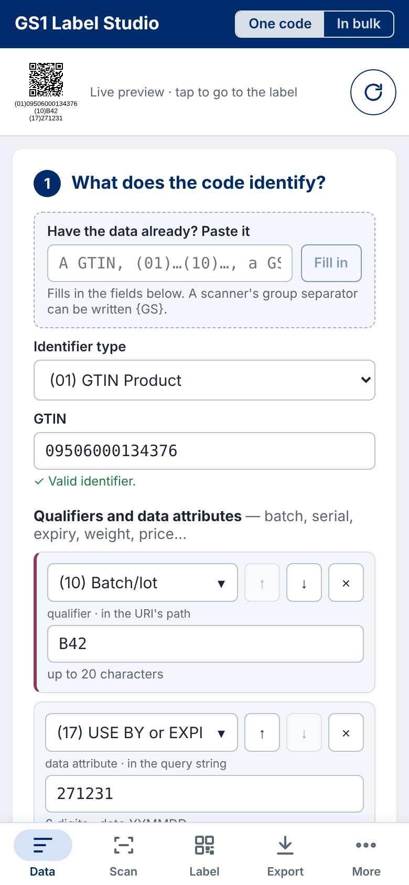
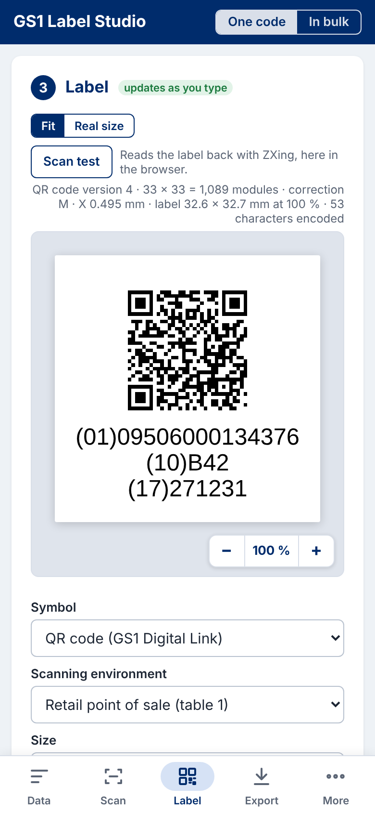
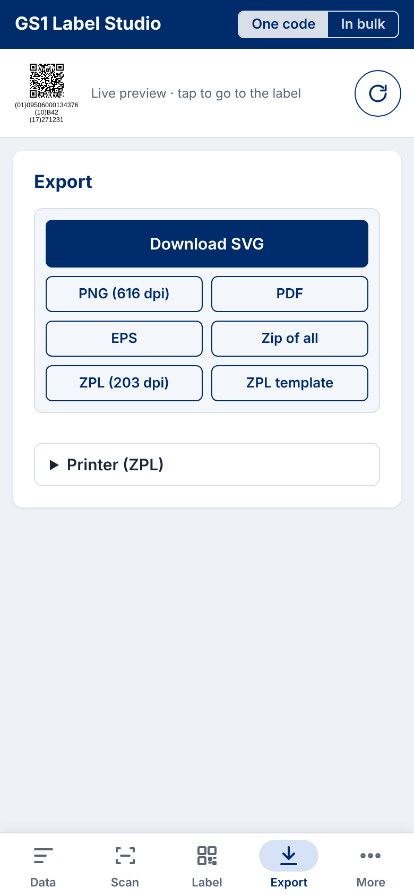
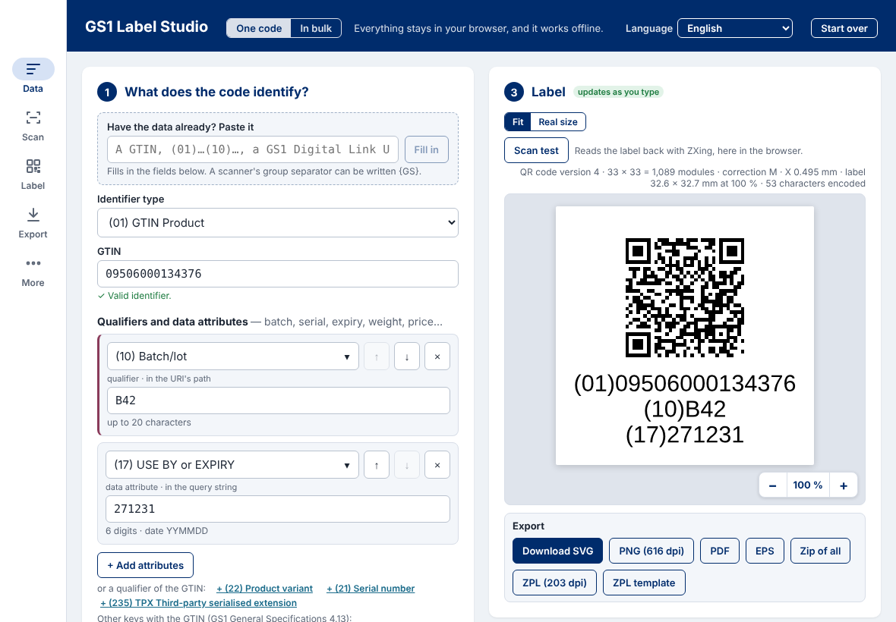

# GS1 Label Studio

[](https://github.com/ricardomelo/gs1-label-studio/actions/workflows/ci.yml)
[](https://ricardomelo.github.io/gs1-label-studio/)


**GS1 barcodes and labels, right by construction, made in your browser.** Say what the code identifies and where it
is scanned: the studio follows the GS1 General Specifications to the symbol, its size, its quiet zones and its human
readable text, reads what it drew back to prove it, and exports it for artwork or for a label printer — one code at a
time, or thousands from a spreadsheet. Nothing you type or upload leaves your computer; it works offline, on a
computer, a tablet or a phone, in English, Brazilian Portuguese and Spanish. Free and open source.

<p align="center">
  <a href="https://ricardomelo.github.io/gs1-label-studio/"><b>Open the studio → ricardomelo.github.io/gs1-label-studio</b></a>
  &nbsp;·&nbsp; <a href="docs/user-guide.md"><b>User guide</b></a>
  &nbsp;·&nbsp; <a href="docs/printing-guide.md"><b>Printing guide</b></a>
  &nbsp;·&nbsp; <a href="docs/README.md"><b>All the manuals</b></a>
</p>

<p align="center">
  
</p>

### Why it stands out

- **Right by construction.** It asks what the code identifies and where it is scanned, walks the GS1 decision tree
  (figure 5-68) to the symbol specification table, offers only the symbols that table allows and only the sizes within
  its range, recommends one, and computes or checks every check digit.
- **Paste anything.** A GTIN, an element string with or without brackets, a GS1 Digital Link URI or what a scanner
  types: GS1's own Barcode Syntax Engine reads it, names each Application Identifier and says in plain words what is
  wrong.
- **Proved, not assumed.** Every symbol an export makes is read back by an independent decoder (ZXing) in the tests —
  its symbology identifier and its data —; PDFs are drawn by poppler, EPS by Ghostscript, ZPL printed by Labelary.
  More than 700 automated tests, each feature naming the tests that prove it ([features](docs/features.md)).
- **For artwork and for printers.** SVG, PNG, PDF and EPS at real size, process black, bar width reduction; ZPL II
  with the printer's own barcode commands (not pictures), templates with placeholders for systems, printer profiles in
  whole dots.
- **Thousands at once.** Rows from Excel, CSV or a paste, each checked, fixed in place or skipped; serial numbers and
  SSCCs made for you; a file a row, one PDF, laser label sheets, one ZPL file and a CSV of what was made.
- **Beyond the barcode.** The GS1 Logistic Label, the EPC for RFID and NFC tags, NFC tags written from a phone, GS1
  digital signatures and verifiable credentials.
- **Private, offline, anywhere.** Everything runs in the page: no server, no account, no upload. After the first visit
  it works without a connection, and installs as an application.

> **Status:** early development, published at <https://ricardomelo.github.io/gs1-label-studio/> (31 October 2026); the
> [backlog](#backlog) says what is done and what comes next. Phase 3 (more printer languages) and phase 4 (a label
> designer) are on the way.

> **Community software.** GS1 Label Studio is maintained by its community, not by GS1 or any GS1 Member Organisation;
> GS1 is a registered trademark of GS1 AISBL. It is provided "as is", without warranties or conditions of any kind
> (Apache License 2.0, sections 7 and 8): check a printed symbol before a production run.

---

## A tour of the studio

### 1. Say what the code identifies — or paste what you have

<p align="center">
  
  &nbsp;
  
</p>

Choose the key — every GS1 identification key, GTIN, SSCC, GLN, GRAI and the rest — and add its qualifiers (batch,
serial, variant…) and data attributes (expiry, weight, price…) from one list, each checked as you type; decimals are
typed as decimals and written as the AI asks. Or paste anything and press **Fill in**: an element string, a GS1
Digital Link URI, a scanner's output with its group separators. Several keys in one code (an SSCC with the GTIN it
contains), and the GS1 Digital Link URI's own parameters, are offered as the General Specifications allow them.
→ [User guide, step 1](docs/user-guide.md#3-step-1--what-the-code-identifies)

### 2. Where is it scanned? The symbol the standard recommends

<p align="center">
  
  &nbsp;
  
</p>

A few yes-or-no questions — a retail till? general distribution? a regulated healthcare item? — lead to the GS1 symbol
specification table, the symbols it allows for this data, and the one it recommends, drawn at once: here an EAN-13 for
the till with a QR code carrying a GS1 Digital Link URI beside it. **Choose a symbol yourself** offers every symbol,
still within the tables' ranges. → [User guide, step 2](docs/user-guide.md#4-step-2--where-it-is-scanned)

### 3. The label at its real size, read back in the browser

<p align="center">
  
</p>

The label is redrawn as you type, with what it is — version, modules, X-dimension, size — written under it. **Real
size** draws it between rulers in millimetres, calibrated against a bank card on your screen; **Scan test** reads it
back with ZXing, here in the browser, and says whether it reads as intended.
→ [User guide, real size and the scan test](docs/user-guide.md#7-seeing-it-at-real-size-and-the-scan-test)

### 4. Every GS1 symbol, laid out as the standard places it

<p align="center">
  
  &nbsp;
  
</p>

EAN-13, EAN-8, UPC-A, UPC-E, ITF-14 with its bearer bars, GS1-128 (over several symbols when the data is longer than
one may carry), the GS1 DataBar family, GS1 DataMatrix, and the QR code and Data Matrix with a GS1 Digital Link URI —
each at its table's sizes and bar height, its human readable text placed and sized as section 4.14 allows. And the
**GS1 Logistic Label** for an SSCC, in A6, A5, 4 × 6 or 6 × 8 inches.
→ [User guide, the label's options](docs/user-guide.md#6-the-labels-options) ·
[the GS1 Logistic Label](docs/user-guide.md#9-the-gs1-logistic-label)

### 5. Files for artwork, print files for label printers

<p align="center">
  
</p>

**SVG, PNG, PDF and EPS** at real size for artwork, in process black, with a bar width reduction for the press;
**ZPL II** for thermal printers with the printer's own barcode commands, every one checked by printing it through
Labelary and reading it back; ZPL templates with placeholders for an ERP or a WMS; printer profiles that put each module
on whole dots. → [Printing guide](docs/printing-guide.md)

### 6. Thousands of labels from a spreadsheet

<p align="center">
  
  &nbsp;
  
</p>

**In bulk** takes an Excel workbook, a CSV or rows pasted from a spreadsheet; guesses each column's AI from its header
and remembers it; checks every row, with the cell at fault outlined and fixed in place, or the row skipped; makes serial
numbers or SSCCs for you; and generates every label in one zip — a file a row named by a pattern, one PDF, laser label
sheets (Avery or your own), one ZPL file and a CSV of what was made — in the background, with its progress.
→ [User guide, in bulk](docs/user-guide.md#13-in-bulk-rows-from-a-spreadsheet)

### 7. RFID, NFC and digital signatures

<p align="center">
  
  &nbsp;
  
</p>

The key's **EPC** as the EPC Tag Data Standard encodes it, for RFID and NFC tags, with GS1's GCP length table loaded in
your browser; an **NFC tag** written and read back from a phone; a **GS1 digital signature** of the code's data (the
GS1 Digital Signatures guideline) and GS1 verifiable credentials, the key kept in your hands.
→ [User guide, RFID and NFC](docs/user-guide.md#11-rfid-and-nfc-epc-and-nfc-tags) ·
[digital signature](docs/user-guide.md#12-digital-signature-gs1-jws)

### 8. On a computer, a tablet or a phone — in three languages

<p align="center">
  
  
  
  &nbsp;
  
</p>

On a phone, one part at a time — Data, Scan, Label, Export, More — chosen in a tab bar at the bottom, as phone apps
do; on a tablet held horizontally, a rail with the label always beside you; on a computer, everything at once. English,
Português (Brasil) and Español, in the browser's language from the first visit.
→ [User guide, the screen at a glance](docs/user-guide.md#2-the-screen-at-a-glance)

---

## The manuals

Everything the studio does, step by step, with screenshots — written for people who make barcodes and labels, people
who print them, and people who build on the studio. The index by reader: [docs/README.md](docs/README.md).

| Manual | For | What it holds |
|---|---|---|
| **[User guide](docs/user-guide.md)** | anyone making barcodes and labels | every task, step by step: [the screen](docs/user-guide.md#2-the-screen-at-a-glance) · [what the code identifies](docs/user-guide.md#3-step-1--what-the-code-identifies) · [where it is scanned](docs/user-guide.md#4-step-2--where-it-is-scanned) · [the label](docs/user-guide.md#5-step-3--the-label) and [its options](docs/user-guide.md#6-the-labels-options) · [real size and the scan test](docs/user-guide.md#7-seeing-it-at-real-size-and-the-scan-test) · [exporting](docs/user-guide.md#8-exporting-the-label) · [the GS1 Logistic Label](docs/user-guide.md#9-the-gs1-logistic-label) · [printer profiles](docs/user-guide.md#10-printer-zpl) · [RFID and NFC](docs/user-guide.md#11-rfid-and-nfc-epc-and-nfc-tags) · [digital signatures](docs/user-guide.md#12-digital-signature-gs1-jws) · [in bulk](docs/user-guide.md#13-in-bulk-rows-from-a-spreadsheet), [the validation report](docs/user-guide.md#14-in-bulk-the-validation-report), [sequences and generating](docs/user-guide.md#15-in-bulk-sequences-and-generating-every-label) · [messages and what to do](docs/user-guide.md#16-messages-and-what-to-do) · [glossary](docs/user-guide.md#17-glossary) |
| **[Printing guide](docs/printing-guide.md)** | people who print | [which file for which printing](docs/printing-guide.md#1-which-file-for-which-printing) · [artwork and prepress](docs/printing-guide.md#2-artwork-and-prepress-svg-pdf-eps) · [laser printers and label sheets](docs/printing-guide.md#3-office-and-laser-printers-pdf-and-label-sheets) · [thermal printers and ZPL](docs/printing-guide.md#4-thermal-label-printers-zpl) · [ZPL templates for systems](docs/printing-guide.md#5-zpl-templates-for-systems) · [checking a printed symbol](docs/printing-guide.md#6-checking-a-printed-symbol) · [what ZPL refuses, and why](docs/printing-guide.md#7-what-zpl-refuses-and-why) |
| [Features](docs/features.md) | anyone checking what it does | every feature, the commit that brought it and the tests that prove it |
| [Conformance](docs/conformance.md) | quality and standards people | each standard, section by section: what is done, what is not, and the evidence |
| [Developer guide](docs/developer-guide.md) | developers | architecture, every module, the tests, how to extend |
| [The core's API reference](docs/core-api.md) | integrators | every name `@gs1-label-studio/core` exports |
| [Third-party licences](docs/third-party.md) | anyone reusing it | what the studio is made of, and why nothing restricts commercial use |
| [Inventory of features](docs/test-inventory.md) · [History](docs/history.md) · [Changelog](CHANGELOG.md) | maintainers | every test by area; how the project grew; every change |

## Development

Requires Node.js 22 and pnpm 10 (`corepack enable`).

```bash
pnpm install
pnpm dev          # the web application on http://localhost:5173
pnpm check        # typecheck, tests and build — what CI runs
node scripts/metrics.mjs   # development indicators (docs/metrics/README.md)
```

| Path | What |
|---|---|
| `packages/core` | GS1 encoding, geometry, printer dot grid, exporters; no user interface; runs in browser and Node |
| `apps/web` | the web application (React + Vite); `src/locales/` its languages, `test/` their test |
| `docs/adr` | architecture decision records |
| `docs/metrics` | development and management indicators, from day one |
| `scripts` | project tools: `metrics.mjs`, `inventory.mjs` and `api-reference.mjs` (ADR 0005); `resolver-reference/golden.py` writes the resolver's answers as test fixtures (ADR 0004) |

## Backlog

**Order from here** (29 October 2026; 2.2 done the same day, 1.10 and 1.11 on 30 October, 1.11 at the owner's
request before 2.4; the owner's ideas of 30 October, 1.15 to 1.19, placed where they cost least; 2.4 done the same
day, 1.15, 1.17, 1.12, 2.3, 1.16, 1.13, 2.5 and 1.14 too; 1.18 and 1.19 on 31 October): phase 3 (3.1 done on 31 October). The
editor's corrections (1.10) came first, being small and seen every day; the qualifiers and attributes in one block
(1.15) and the URI's own parameters (1.17) before several keys (1.12), whose other keys are rows of that same block;
several keys before the generated SSCCs (2.3), which a logistic unit's label needs; the human readable text placed and
sized (1.16) before GS1-128 over several symbols (1.13), whose stacked symbols each carry it, opening the logistic
label of phase 4; signatures and verifiable credentials (1.18) and writing NFC tags (1.19) after the symbols are
complete.

**Phase 0 — setting up**

- 0.1 Repository, CI, publication on GitHub Pages — *done*
- 0.2 Development indicators from the first day (`docs/metrics`) — *done*
- 0.3 Walking skeleton: core encoding through bwip-js, read back by ZXing; printer dot grid; SVG; ZPL graphic — *done*
- 0.4 Release process, as in the resolver's project (the owner, 29 October 2026): `main` holds the last stable
  version, published at the site's root; `develop` holds the work in progress, published for the owner's tests under
  `/develop/`. Set up at the first release: until then there is no stable version, and `main` is where work lands
- 0.5 Documentation by reader, as in the resolver's project (the owner, 31 October 2026): user and printing guides,
  features each naming the tests that prove it, an inventory drawn from the tests, the core's API reference, a
  developer guide, conformance and licences, kept in step by a test (ADR 0005) — *done 31 October*

**Phase 1 — one code, right by construction** (ported from the resolver's label studio where it had it: ADR 0004)

- 1.1 Input: GS1 Barcode Syntax Engine; paste an element string, a GS1 Digital Link URI or a scanner's output; AIs
  named and checked; errors explained — *done (a "(" inside a value is refused: the barcode encoder cannot take it)*
- 1.2 Guided choice: what is identified → symbol specification table → symbols allowed and recommended; scanning
  environments table carried over from the resolver (General Specifications 26.0, section 5.12.3) — *table, sizes and
  checks ported (2 970 of the resolver's answers equal); done: every row of tables 1 to 13, with ITF-14, GS1-128, GS1
  DataBar and GS1 DotCode, tested against the standard's text; the decision tree (figure 5-68), section 2's carrier
  choices and a recommendation; the editor's step 2, "Where is it scanned?" (mock-up B); ITF-14 and GS1-128 at their
  table's sizes and bar height*
- 1.3 Every GS1 symbology: EAN-13, EAN-8, UPC-A, UPC-E, ITF-14, GS1-128, GS1 DataBar family, GS1 DataMatrix,
  QR and Data Matrix with a GS1 Digital Link URI, GS1 DotCode; composite components later. GS1 QR Code is encoded by
  the core but not offered in the editor: beside the QR code with a GS1 Digital Link URI it confuses (ADR 0003) —
  *done: ITF-14, GS1-128 and the GS1 DataBar family laid out by their table's row, ITF-14 with bearer bars, each read
  back by ZXing from the SVG, PNG and PDF. GS1 DotCode is not drawn: no independent decoder reads it back (ZXing does
  not), which every symbol needs before it is offered; GS1 DataMatrix is recommended for tobacco unit packs instead.
  Composite components later*
- 1.4 Layout and human readable text as the General Specifications place them: the resolver's 2D symbol with an EAN/UPC
  beside it, guard bars, quiet zones, digits in OCR-B, text as outlines or as text; QR version and error correction —
  *ported and checked against the resolver (ADR 0004); an EAN/UPC alone too; GS1-128, ITF-14 and DataBar with 1.3*
- 1.5 Exports: SVG, PNG with dpi, PDF (vector, real size, written without a library, as the resolver's), EPS, zip;
  prepress options (bar width reduction, 100 % K) — *done: SVG, PNG (12 pixels per module, its dpi recorded), PDF and
  zip with README ported from the resolver and checked against it, for every symbol from its layout (1.3); EPS (the
  PDF's drawing in PostScript, read back through Ghostscript); PDF and EPS in process black alone; a bar width
  reduction for linear symbols; the PNG at 300, 600 or 1200 dpi. Margins and crop marks later, with the labels of
  phase 4*
- 1.6 Preview at real size with a ruler and a scan test; light and dark; phone width (the tool is in English) — *done:
  the editor screen (preview beside the options, live, desktop and phone, light and dark); the preview at real size
  between rulers in millimetres, the screen calibrated against a bank card; a scan test that reads the label back with
  ZXing in the browser (mock-up A)*
- 1.7 Offline (PWA) — *done: a service worker written at build time keeps every file of the application (the
  engines' WebAssembly, the font, the EPC schemes) on the first visit; a web app manifest and icons, so it installs*
- 1.8 EPC for RFID and NFC: every key with a TDS scheme, from the resolver's TDT-derived schemes; the GS1 Company
  Prefix's length from GS1's GCP length table, loaded by the user and kept in the browser — *done, checked against the
  resolver and read back by epc-tds; the tag's hexadecimal filled to the 16-bit word*
- 1.9 Data attributes in the GS1 Digital Link URI, with the resolver's decimal families (e.g. a net weight typed as
  1,25 kg); the URI's domain — *done: ported with the resolver's editor (key, qualifiers, attributes), checked against it*

*The owner's review of 29 October 2026 added items 1.10 to 1.14.*

- 1.10 The editor, corrected: (a) it takes the whole width of the screen (today at most 1 400 px, centred) — *done
  30 October, with step 3 rearranged at the owner's request (mock-up B of three): the label in its own area across
  the step, its tools over it, an export bar below it, the options below them; room for the designer of 4.2*; (b) every
  list of AIs in alphabetical order of the name it shows — the identifier types, the attributes and the bulk columns'
  AIs — *done 30 October: every AI choice reads "(AI) abbreviation name", "(01) GTIN Product", "(10) Batch/lot", so
  the order of the text shown is the AI's, as the General Specifications list them (the owner's request)*; (c) the screen's
  calibration (1.6) usable at its whole range: the bar outgrows the options column near the slider's maximum, so it
  cannot be measured, and the slider is coarse — the bar where there is room, and a fine adjustment — *done 30 October:
  the calibration spans the label's card, its slider stops where the bar still fits (7 pixels a millimetre on a
  computer, less on a phone), and − and + move the bar by about half a pixel*
- 1.11 Every identifier and qualifier: every GS1 key the dictionary has (the 16 GS1 Digital Link primary keys are
  offered today) and every qualifier of each, from the current GS1 Digital Link URI syntax; the four main qualifiers
  on the screen and the rest behind "+ Add qualifier", as the attributes are; checked against the GS1 General
  Specifications 2026 and the GS1 Digital Link standard in `references`. Beyond the Digital Link: the identification AIs a
  GS1 Digital Link URI cannot carry — (03) MTO GTIN first (the owner, 30 October 2026) — offered for the element
  string symbols only (GS1-128, GS1 DataMatrix, GS1 DataBar Expanded), with the pairs the Syntax Engine refuses ((03)
  not with (01), (02) or (37)) — *done 30 October, from the General Specifications 26.0, section 1.3 (each GS1
  identifier with its element string and Digital Link qualifiers): the 16 Digital Link keys and the Made-to-Order GTIN
  (03) with its batch/lot (10) or serial (21), grouped as "GS1 Digital Link keys" and "In element strings only", (03)
  drawn in GS1 DataMatrix when a URI symbol was chosen; the HIDRI (8014) needs a GTIN beside it, so it is an
  attribute; the attributes of element strings only — (8014), (8040) to (8043), (8200)… — offered and marked so;
  "+ Add qualifier" beyond the first four, though no key of 26.0 has more; the attribute's AI field lists every AI
  from its arrow even once one is chosen (the owner's report); "Start over" in the header*
- 1.12 Several keys in one symbol. An element string may carry more than one key; the Syntax Engine already checks the
  pairs the General Specifications forbid (e.g. (01) with (02) or (37); (8017) with (8018)) and require ((02) needs
  (37); (8020) and (415) go together). The cases to support: a logistic unit, SSCC (00) with the content's GTIN (02)
  and count (37), or with a GTIN (01) when the unit is itself a trade item, or with (8026) and (37); the transport
  keys beside it — consignment GINC (401), shipment GSIN (402), routing (403), ship to GLN (410); a trade item that is
  also an asset (GTIN with GRAI (8003) or GIAI (8004), e.g. a returnable keg). Today another key can only be added as
  a data attribute. To do: the cases confirmed against sections 3 and 4.13–4.14 of the General Specifications, the
  editor's "other keys" with their check digits, the GS1 Digital Link URI with one key in its path and the others in
  its query string, and the HRI — *done 30 October: checked against sections 4.13.1 and 4.13.2 (tables 4-4 and 4-5),
  which the Syntax Engine enforces, and which already put one key in the URI's path and the others in its query string
  and every element string in the HRI; in the list of 1.15, a row of another key says so and has its check digit
  checked on the row; links under the list add the pairings of the General Specifications for the key chosen — an SSCC
  with (02) and (37), with (01), with (8026) and (37), with (401), (402), (403) or (410); a GTIN with (8003) or (8004)*
- 1.13 GS1-128 over several symbols: when the data passes 48 characters (section 5.4.4.3), split it into as many
  GS1-128 symbols as needed, the key in the first and the rest in data-only symbols without a key, in the
  standard's order, stacked as the GS1 Logistic Label stacks them; the person can also move element strings between
  the symbols. Each symbol read back. Prepares 4.1 — *done 30 October: beyond 48 data characters (AIs, data and
  separating FNC1s), or where a symbol would pass 165.10 mm with its quiet zones (also refused for one symbol, which
  was not checked before), the element strings go in as many GS1-128 symbols as needed, in order, the key in the
  first; stacked on the left a quiet zone apart, each with its own text; "GS1-128 symbols" under the options lists the
  element strings, "new symbol" starts one where the person chooses, "Automatic" goes back; the guided choice now
  offers GS1-128 for such data; each symbol read back from the SVG, PNG and PDF; in ZPL a ^BC a symbol, stacked the same
  way, each read back through Labelary (31 October)*
- 1.14 QR Code's encoding modes: today bwip-js chooses the segments itself (numeric, alphanumeric, byte, mixed, for the
  smallest symbol). Offer automatic (as today) or one mode for the whole data — numeric, alphanumeric, byte — as ISO/IEC
  18004 defines them, alphanumeric only when the data allow it (upper case: a GS1 Digital Link URI's scheme and domain
  may be upper case, its path and values are case-sensitive). bwip-js has no option for it: an encoder that takes
  segments is needed (to choose), and every mode read back by ZXing — *done 30 October: "Encoding mode" for the QR code
  with a GS1 Digital Link URI — automatic (bwip-js, as before), numeric, alphanumeric or byte through node-qrcode,
  which takes segments — and "Scheme and domain" in capitals (HTTPS://ID.GS1.ORG; RFC 3986 makes them case-insensitive,
  the path and query stay as typed); a character a mode cannot take is named; each mode read back by ZXing at the
  version its capacity gives. ZPL keeps the printer's automatic mode until phase 3*

*The owner's ideas of 30 October 2026 added items 1.15 to 1.19; the requests of 31 October, items 1.20 and 1.21.*

- 1.15 Qualifiers and data attributes in one block: every qualifier the key has, and every attribute, added one at a
  time with "+ Add attributes" (an AI chosen from the whole list, the qualifiers of the key first), each row checked as
  today; the qualifiers still go to the GS1 Digital Link URI's path in the order its syntax asks, whatever order they
  were added in — *done 30 October (mock-up B of three): one list under the key, "+ Add attributes" adding a row whose
  AI field lists the key's qualifiers not yet given first, then every attribute; links beside it add a qualifier of
  the key straight away; each row says whether it goes to the URI's path or its query string, a qualifier at its
  left edge in the qualifiers' colour; two qualifiers the key does not take together are said on the row*
- 1.16 The human readable text placed and sized as the General Specifications allow (section 4.14): below the symbol
  (the default) or above it, beside a 2D symbol where the standard allows it; its character height chosen within the
  standard's range for the symbol and the X-dimension; for every symbol drawn with text, in every export, the scan
  test still reading the symbol — *done 30 October: "Text position" below, above, split (the key below and its
  attributes above, rule 1d), left or right (an element string a line, never broken, rule 1e), and "Text height" from
  the 2 mm minimum (rule 2a iii) to 5 mm, 3 mm marked for the GS1 Logistic Label (rule 5c), for the 2D symbols, GS1-128,
  ITF-14 and the GS1 DataBar family, in the SVG, PNG, PDF, EPS and the files made in bulk; the text clears the quiet
  zone by a module (2D) or the bars by 1.02 mm as below; beside an EAN/UPC a 2D symbol's text goes below or above;
  EAN/UPC's digits stay where section 5.2.5 puts them. In ZPL (31 October) the height everywhere, and below, above
  or split, read back through Labelary; left and right are refused there, the printer's font setting the text's width*
- 1.17 A GS1 Digital Link URI with parameters of its own: name=value pairs in the query string after the data
  attributes, e.g. `https://id.gs1.org/01/09506000134376/10/B42?17=271231&20=12&a=1&b=2&c=3`; a name made only of
  digits is refused (digits are the AIs'), names and values percent-encoded as the GS1 Digital Link standard asks; not
  in element strings, which have no place for them — *done 30 October: "Parameters of the URI" under the qualifiers
  and attributes, name = value rows with "+ Add parameter", appended to the URI after the data attributes; a name of
  digits only, a missing name or a name given twice is refused; pasting a URI keeps its parameters, which the Syntax
  Engine leaves out. Not yet in bulk (a column for them could come with 2.3)*
- 1.18 Verifiable credentials and digital signatures as GS1 defines them: the GS1 Digital Signatures Technical
  Implementation Guideline 1.1.0 (January 2026: the digital signature AI (8030) over the symbol's data) and the GS1
  Verifiable Credentials data model (ref.gs1.org/gs1/vc: the credentials and their JSON-LD contexts); the keys stay in
  the browser; the guideline and the data model are in `references`. What to sign and how the keys are held to be
  decided with mock-ups — *done 31 October for the guideline's section 4 (mock-up A of two): "Digital signature (GS1,
  JWS)" under the EPC section signs the code's data as a compact JWS with ES256 — JSON-LD with the GS1 Web Vocabulary,
  the GS1 Digital Link URI as its id, GTIN, serial, batch and dates (xsd:date, century by section 7.12), product name,
  brand, and a security marking (hologram, microprinting, UV ink, watermark: gs1:SecurityMarking in vocabulary 1.18)
  whose code is shown (workflow 2) or taken out to be read from the marking (workflow 3); verified in the page before
  it is offered; the key (ECDSA P-256, its RFC 7638 thumbprint as kid) made with Web Crypto and kept in the page only,
  saved and taken back as a JWK; the public key as a JWK set; the data model 1.2.1's ProductDataCredential and
  KeyCredential as JWTs for an issuer's DID. Every signature also verified by Node's crypto in the tests. Not done: the
  DigSig of ISO/IEC 20248 in AI (8030), section 3, whose encoding is defined by the ISO standard, which the studio
  does not have; the chain of trust from GS1 (section 4.6) is GS1's own work in progress*
- 1.19 Writing NFC tags: the GS1 Digital Link URI (or the EPC section's NFC links) written to an NFC tag as an NDEF URI
  record through Web NFC, where the browser has it (Chrome on Android); read back from the tag to check it; where it
  is missing, the NDEF message as a file for a tag writer — *done 31 October: "NFC tag" in the RFID and NFC section
  writes the GS1 Digital Link URI, or the EPC's link for NFC, as an NDEF URI record through Web NFC, and reads the tag
  back to say whether it holds that URI; where the browser has no Web NFC (all but Chrome on Android), the buttons say
  so and the NDEF message (NFC Forum URI RTD, the prefix abbreviated) downloads as a file for a tag writer app. Tested
  with Web NFC stood in for in the browser tests; a real tag waits for the owner's phone*

- 1.20 The interface in Brazilian Portuguese and Spanish besides English, the documentation in English only (the owner,
  31 October 2026) — *done 31 October (mock-up A of three: a language menu in the header, each language named in
  itself): the browser's language on the first visit, the choice kept afterwards, the page redrawn in place; every
  text of the page and every message of the core and of the GS1 Barcode Syntax Engine in each language, the engine's
  and the keys' texts from the resolver's catalogues; a test refuses a text without its translation. Drafts by
  Claude, to be reviewed by native speakers; the files made stay in English*
- 1.21 A design for phones and tablets, the computer's left as it is, and About at the foot of the page (the owner,
  31 October 2026) — *done 31 October (mock-up A of three: B was one long column with step chips and a floating
  download button, C a drawer menu): on a phone, a tablet held upright or a narrow window, one column and one
  destination at a time — Data, Scan, Label, Export, More — chosen in a tab bar at the bottom as phone apps do, each
  keeping its scroll, a link to another destination opening it, a dot where there is an error; on a tablet held
  horizontally a navigation rail, the destination on the left and the label with its exports always on the right; the
  same page in every layout, so turning the device keeps what was typed. About: the repository, the Apache 2.0
  licence, the manuals, the version published (its commit and date) and the software of others it is made with, each
  linked to its repository. The browser tests run on a phone and a tablet besides the desktop. Then, from the
  owner's look on an Android phone: layout A kept; the home screen's name GS1 Label Studio (the manifest's short
  name was "GS1 Labels"); *Install the app* under More; Start over a round reload icon beside the live preview*

**Phase 2 — in bulk**

- 2.1 CSV, Excel and pasted rows; column mapping remembered by header; fixed values — *done: "In bulk" beside "One
  code" (mock-up A): CSV (comma, semicolon or tab), pasted rows and Excel workbooks read without a library; each
  column's AI guessed from its header and remembered for the same headers; values for every row; each row checked by
  the Syntax Engine, its label in the preview*
- 2.2 Validation report; fix or skip rows — *done (mock-up A of three): in the rows card, the rows with errors, fixed,
  skipped or all; each with its reason and its cells, the one at fault outlined and fixed in place (the file is not
  changed); a hint when Excel kept 15 digits of a code or a CSV wrote it in scientific notation; one row or every row
  in error skipped; the report and the corrected rows as CSV*
- 2.3 Generated sequences: serial numbers, SSCCs — *done 30 October (mock-up A of two): "…or make a sequence" in
  step 1 makes serial numbers (21) — a prefix, the number padded to a number of digits, a first number and a step —
  or SSCCs (00) — the extension digit, the GS1 Company Prefix, the serial reference from a first one, the check digit —
  as rows of their own or as a column added to the rows loaded (fixes, skipped rows and columns kept); what AI (21)
  cannot hold, a serial reference that does not fit and more than 100,000 rows are refused before anything is made*
- 2.4 Outputs: zip by row with a name pattern, multi-page PDF, laser label sheets (Pimaco, Avery, custom), one print
  file per printer language, CSV of what was generated — *done 30 October (mock-up A of three): "Generate in bulk"
  under the label's Export bar draws the label shown, with its options, for every row ready or fixed, in one zip: SVG,
  PNG, PDF or EPS for each row, named by a pattern ({row}, {symbol}, {key}, any AI such as {10}; a name repeated is
  numbered); one PDF a label a page; label sheets (Avery L7160, L7163, L7651, 5160 or a custom sheet), each label at
  100 % centred in its place, from any place of the first sheet, a label larger than the sheet's refused and said
  before generating; one ZPL file with the printer's own commands; generated.csv with every row, its files or why
  none. Pimaco's sheets wait: its 2026 catalogue gives their label sizes and counts but not their margins or pitch
  (a custom sheet takes one meanwhile). The printer languages after ZPL come with phase 3*
- 2.5 Web Workers with progress and cancel; a measured performance target — *done 30 October: the generation runs in
  a Web Worker, a progress bar and Cancel beside "Generate N labels", the page usable meanwhile; checking stays on the
  page (10,000 rows in 0.64 s, within the target of 1 s); 1,000 QR labels as SVG and one PDF in 10.7 s instead of
  32.6 s (target 15 s), with the same bytes out (docs/metrics, "Performance targets")*

**Phase 3 — printers** (ADR 0002)

- 3.1 Printer profiles; whole-dot X-dimensions within the table's range; test print — *done 31 October (mock-up A of
  two): "Printer (ZPL)" above the EPC section, generic ZPL profiles at 152 to 600 dpi, 104 mm wide, and profiles of
  one's own (name, resolution, print width) kept in this browser; the module's whole dots offered within the table's
  range, the nearest by default, said when none fits; a label wider than the printer prints refused; "Test print
  (ZPL)" adds a 50 mm ruler and the settings under the label (Labelary prints the ruler 400 dots long at 8 dots a
  millimetre); the bulk ZPL file takes the same dots*
- 3.2 ZPL II with the printer's commands and templates with placeholders — *EAN/UPC, ITF-14, GS1-128, GS1 DataMatrix,
  QR and Data Matrix with a GS1 Digital Link URI done (checked through Labelary); GS1 DataBar through `^BR` and
  ITF-14's bearer bars through `^GB` done, with what `^BR` cannot print refused (ADR 0002); the label layout to do*
- 3.3 TSPL/TSPL2 · 3.4 PPLB · 3.5 PPLA · 3.6 EPL2 · 3.7 DPL
- 3.8 Direct printing: WebUSB, Zebra Browser Print; a local agent for network printers
- 3.9 Compatibility matrix from tests on physical printers

**Phase 4 — labels**

- 4.1 Templates: GS1 Logistic Label (SSCC), product labels, healthcare labels — *the GS1 Logistic Label done 31
  October (mock-up A of two; General Specifications 26.0, 6.6): for an SSCC, "Label" in step 3 offers it in A6, 4 × 6
  in, A5 or 6 × 8 in; the top block with who sends and receives it (3.5 mm), the middle block with each element
  string's data title above its content (7 mm), the bottom block with the GS1-128 symbols and their 3 mm text, the
  SSCC alone in the lowest, the rest split as they fit the page's width; refused when the page is too short; one
  Layout, so the SVG, PNG, PDF, EPS and the files in bulk draw it; each symbol read back. Not yet: ZPL, a 2D symbol
  beside the middle block, a second language for the data titles; product and healthcare labels*
- 4.2 Designer: text, images, lines, several symbols, fields bound to spreadsheet columns
- 4.3 Templates saved and shared as files

**Phase 5 — beyond the browser** (if needed)

- 5.1 CLI and HTTP API from the same core

## Licence

[Apache License 2.0](LICENSE). Uses [bwip-js](https://github.com/metafloor/bwip-js) (MIT), GS1's
[Barcode Syntax Engine](https://github.com/gs1/gs1-syntax-engine) (`gs1encoder`, Apache-2.0),
[opentype.js](https://github.com/opentypejs/opentype.js) (MIT), [node-qrcode](https://github.com/soldair/node-qrcode) (MIT, for a QR code in one encoding mode) and the Liberation Sans font (SIL Open Font License,
`packages/core/assets/fonts/OFL.txt`); the EPC schemes derived from GS1's EPC Tag Data Translation artefacts;
[zxing-wasm](https://github.com/Sec-ant/zxing-wasm) (MIT) for the editor's scan test and the tests; for tests,
[resvg-js](https://github.com/yisibl/resvg-js) (MPL-2.0), [epc-tds](https://github.com/sergiss/epc-tds) (MIT), [Playwright](https://playwright.dev) (Apache-2.0) and
poppler's `pdftoppm` (GPL-2.0) and Ghostscript (AGPL-3.0), both run as separate programs. The full list, with versions:
[third-party licences](docs/third-party.md); the studio's About lists them too.
