# GS1 Label Studio

[](https://github.com/ricardomelo/gs1-label-studio/actions/workflows/ci.yml)
[](https://ricardomelo.github.io/gs1-label-studio/)


**GS1 barcodes and labels, right by construction, made in your browser.** Say what the code identifies and where it
is scanned: the studio follows the GS1 General Specifications to the symbol, its size, its quiet zones and its human
readable text, reads what it drew back to prove it, and exports it for artwork or for a label printer — one code at a
time, or thousands from a spreadsheet. Nothing you type or upload leaves your computer; it works offline, on a
computer, a tablet or a phone, in English, Brazilian Portuguese, Spanish, French, German and Italian. Free and open
source.

<p align="center">
  <a href="https://ricardomelo.github.io/gs1-label-studio/"><b>Open the studio → ricardomelo.github.io/gs1-label-studio</b></a>
  &nbsp;·&nbsp; <a href="docs/user-guide.md"><b>User guide</b></a>
  &nbsp;·&nbsp; <a href="docs/printing-guide.md"><b>Printing guide</b></a>
  &nbsp;·&nbsp; <a href="docs/README.md"><b>All the manuals</b></a>
</p>

<p align="center">
  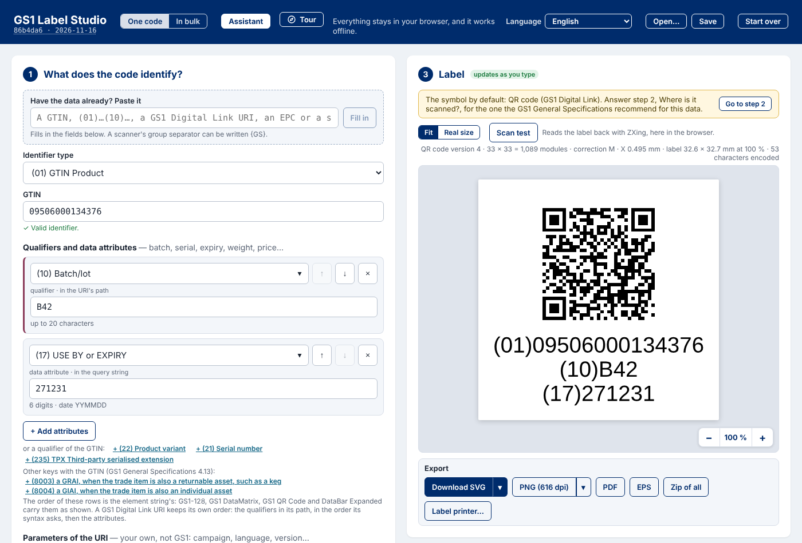
</p>

### Why it stands out

- **Right by construction.** It asks what the code identifies and where it is scanned, walks the GS1 decision tree
  (figure 5-68) to the symbol specification table, offers only the symbols that table allows and only the sizes within
  its range, recommends one, and computes or checks every check digit.
- **Paste anything.** A GTIN, an element string with or without brackets, a GS1 Digital Link URI or what a scanner
  types: GS1's own Barcode Syntax Engine reads it, names each Application Identifier and says in plain words what is
  wrong.
- **Proved, not assumed.** Every symbol an export makes is read back by an independent decoder (ZXing) in the tests —
  its symbology identifier and its data —; PDFs are drawn by poppler, EPS by Ghostscript, ZPL printed by Labelary.
  More than 1,100 automated tests, each feature naming the tests that prove it ([features](docs/features.md)).
- **For artwork and for printers.** SVG, PNG, PDF and EPS at real size, process black, bar width reduction; ZPL II,
  TSPL, EPL2 and DPL with the printer's own barcode commands (not pictures), templates with placeholders for systems,
  printer profiles in whole dots.
- **A label of your own.** Barcodes, text with fields from the data, lines, boxes and images placed freely, turned and
  resized, with a grid and rulers; or the GS1 Logistic Label laid out as section 6.6 asks. The work is saved as a file
  and opened again, and the last one is kept in the browser.
- **Thousands at once.** Rows from Excel, CSV or a paste, each checked, fixed in place or skipped; serial numbers and
  SSCCs made for you; a file a row, one PDF, laser label sheets, one ZPL file and a CSV of what was made.
- **Beyond the barcode.** The GS1 Logistic Label, the EPC for RFID and NFC tags, NFC tags written from a phone, GS1
  digital signatures and verifiable credentials.
- **Private, offline, anywhere.** Everything runs in the page: no server, no account, no upload. After the first visit
  it works without a connection, and installs as an application.

> **Status (21 November 2026):** release 1.0.0, published at <https://ricardomelo.github.io/gs1-label-studio/>; the
> next version, still being tested, at <https://ricardomelo.github.io/gs1-label-studio/develop/>
> ([releases](https://github.com/ricardomelo/gs1-label-studio/releases), [release process](docs/release-process.md)).
> One code (phase 1), in bulk (phase 2), the labels (phase 4: the GS1 Logistic Label, the designer, the saved work),
> the Check Studio, the RFID Studio and `gs1ls` are done; of the printers (phase 3), ZPL, TSPL, EPL2, DPL, PPLA and
> PPLB are done, and direct printing and tests on physical printers are still to come. The [backlog](#backlog) says
> what is done and what comes next.

> **Community software.** GS1 Label Studio is maintained by its community, not by GS1 or any GS1 Member Organisation;
> GS1 is a registered trademark of GS1 AISBL. It is provided "as is", without warranties or conditions of any kind
> (Apache License 2.0, sections 7 and 8): check a printed symbol before a production run.

---

## A tour of the studio

In the studio itself, **Tour** in the header (**Take the tour** in *More* on a phone or a tablet) points these out one at
a time. → [User guide, the tour](docs/user-guide.md#the-tour)

### 1. Say what the code identifies — or paste what you have

<p align="center">
  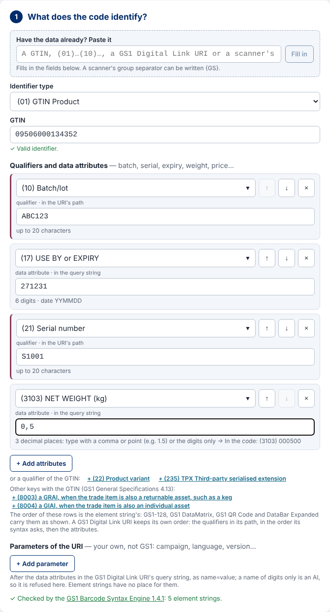
  &nbsp;
  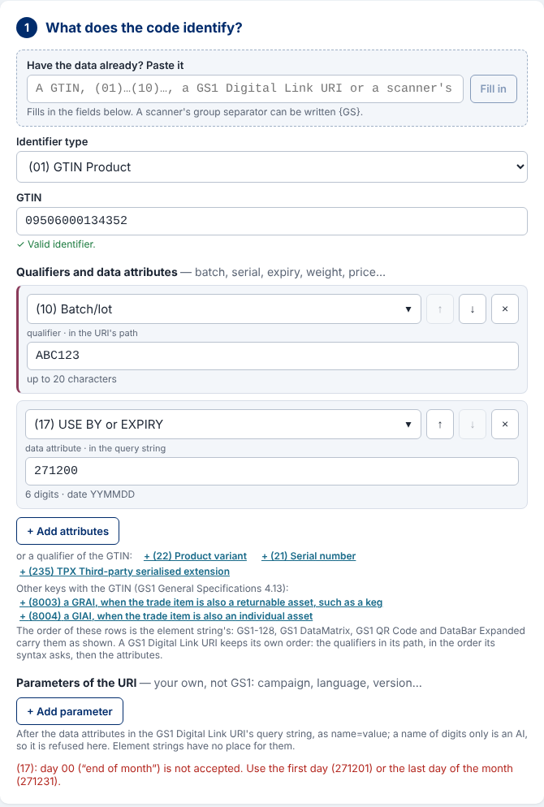
</p>

Choose the key — every GS1 identification key, GTIN, SSCC, GLN, GRAI and the rest — and add its qualifiers (batch,
serial, variant…) and data attributes (expiry, weight, price…) from one list, each checked as you type; decimals are
typed as decimals and written as the AI asks. Or paste anything and press **Fill in**: an element string, a GS1
Digital Link URI, a scanner's output with its group separators. Several keys in one code (an SSCC with the GTIN it
contains), and the GS1 Digital Link URI's own parameters, are offered as the General Specifications allow them.
→ [User guide, step 1](docs/user-guide.md#3-step-1--what-the-code-identifies)

### 2. Where is it scanned? The symbol the standard recommends

<p align="center">
  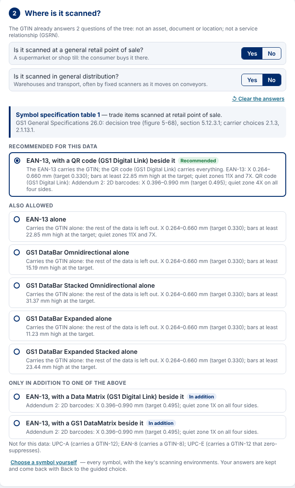
  &nbsp;
  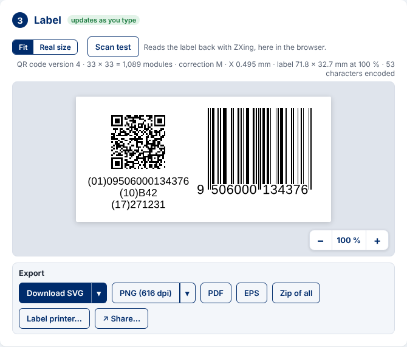
</p>

A few yes-or-no questions — a retail till? general distribution? a regulated healthcare item? — lead to the GS1 symbol
specification table, the symbols it allows for this data, and the one it recommends, drawn at once: here an EAN-13 for
the till with a QR code carrying a GS1 Digital Link URI beside it. **Choose a symbol yourself** offers every symbol,
still within the tables' ranges. → [User guide, step 2](docs/user-guide.md#4-step-2--where-it-is-scanned)

New to GS1? The **Assistant** asks in plain words what you want to identify and what for — a product for shops or a
marketplace, a QR code that opens your website, a medicine, a pallet — or reads the need as you write it, then fills the
three steps and says the rules for the artwork, each with its section of the General Specifications.
→ [User guide, the assistant](docs/user-guide.md#the-assistant)

### 3. The label at its real size, read back in the browser

<p align="center">
  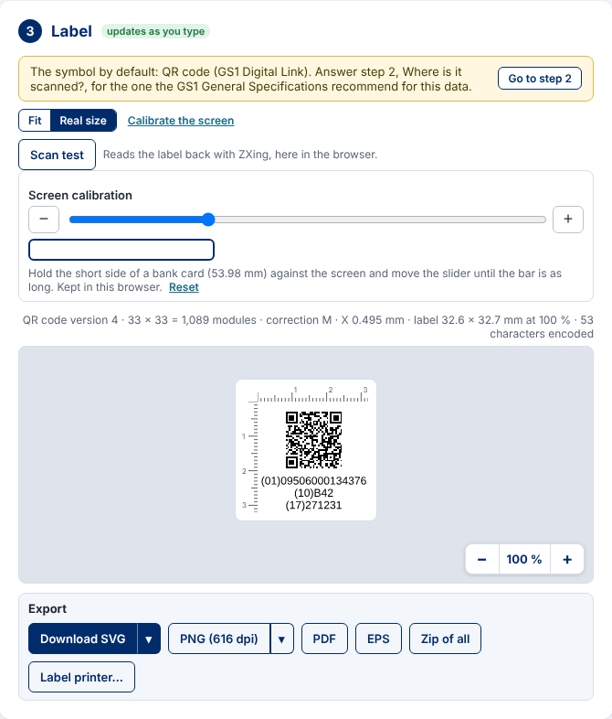
</p>

The label is redrawn as you type, with what it is — version, modules, X-dimension, size — written under it. **Real
size** draws it between rulers in millimetres, calibrated against a bank card on your screen; **Scan test** reads it
back with ZXing, here in the browser, and says whether it reads as intended.
→ [User guide, real size and the scan test](docs/user-guide.md#7-seeing-it-at-real-size-and-the-scan-test)

### 4. Every GS1 symbol, laid out as the standard places it

<p align="center">
  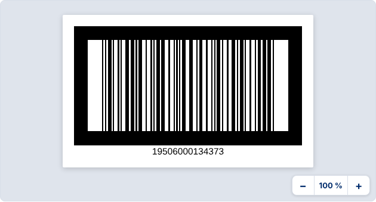
  &nbsp;
  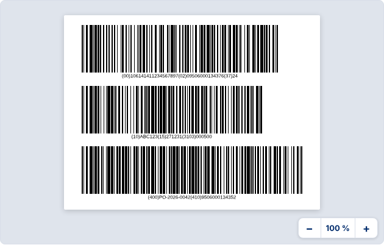
</p>

EAN-13, EAN-8, UPC-A, UPC-E, ITF-14 with its bearer bars, GS1-128 (over several symbols when the data is longer than
one may carry), the GS1 DataBar family, GS1 DataMatrix, and the QR code and Data Matrix with a GS1 Digital Link URI —
each at its table's sizes and bar height, its human readable text placed and sized as section 4.14 allows. And the
**GS1 Logistic Label** for an SSCC, in A6, A5, 4 × 6 or 6 × 8 inches.
→ [User guide, the label's options](docs/user-guide.md#6-the-labels-options) ·
[the GS1 Logistic Label](docs/user-guide.md#9-the-gs1-logistic-label)

### 5. A label of your own, or the GS1 Logistic Label

<p align="center">
  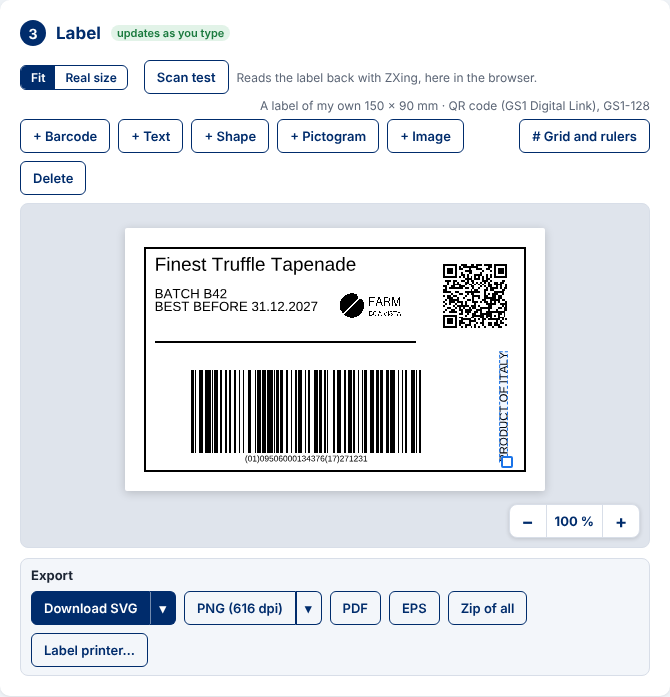
  &nbsp;
  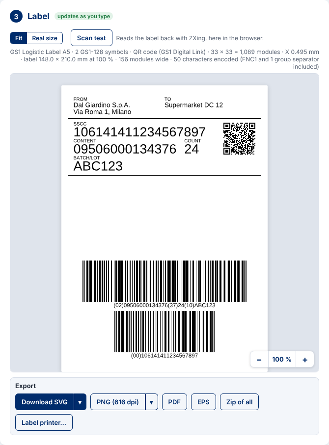
</p>

**A label of my own** places barcodes, text blocks, lines, boxes and images on a label of any size: each dragged or
moved from the keyboard, turned by quarter turns and resized from its corner, held within the label, a barcode only
to the sizes its scanning environment allows. Text takes fields from the data — `{10}`, a date as `{17:DD/MM/YYYY}`, a
spreadsheet's column such as `{Produto}` — so every row in bulk gets its own label; a grid and rulers help to line
things up. The **GS1 Logistic Label** lays out an SSCC's label as section 6.6 asks, in A6, A5, 4 × 6 or 6 × 8 inches,
its data titles also in a second language. **Save** keeps the work as a file to open again.
→ [User guide, a label of one's own](docs/user-guide.md#a-label-of-ones-own-barcodes-text-lines-boxes-and-images-placed-freely) ·
[saving the work](docs/user-guide.md#saving-the-work-and-opening-it-again)

### 6. Files for artwork, print files for label printers

<p align="center">
  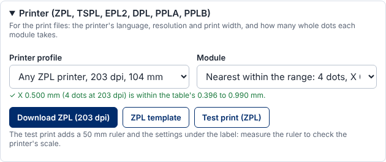
</p>

**SVG, PNG, PDF and EPS** at real size for artwork, in process black, with a bar width reduction for the press and crop marks if asked;
**ZPL II** for thermal printers with the printer's own barcode commands, every one checked by printing it through
Labelary and reading it back; **TSPL**, **EPL2** and **DPL** the same way through the Labelize emulator; ZPL templates
with placeholders for an ERP or a WMS; printer profiles that put each module on whole dots.
→ [Printing guide](docs/printing-guide.md)

### 7. Thousands of labels from a spreadsheet

<p align="center">
  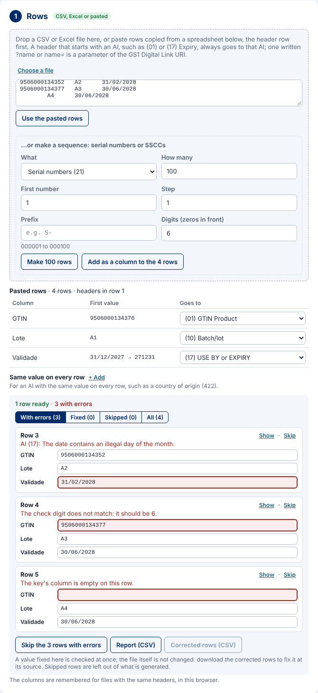
  &nbsp;
  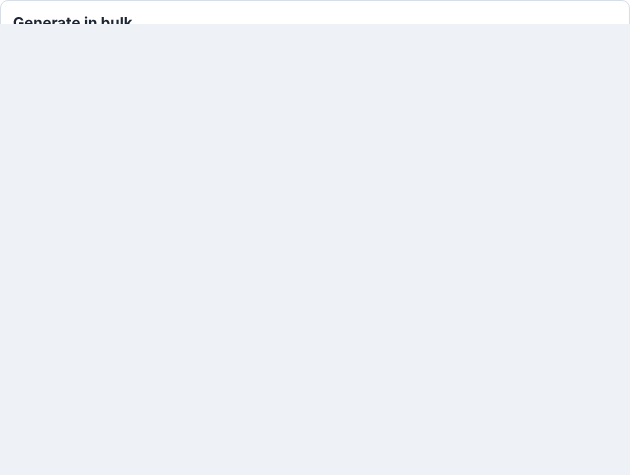
</p>

**In bulk** takes an Excel workbook, a CSV or rows pasted from a spreadsheet; guesses each column's AI from its header
and remembers it; checks every row, with the cell at fault outlined and fixed in place, or the row skipped; makes serial
numbers or SSCCs for you; and generates every label in one zip — a file a row named by a pattern, one PDF, laser label
sheets (Avery or your own), one ZPL file and a CSV of what was made — in the background, with its progress.
→ [User guide, in bulk](docs/user-guide.md#13-in-bulk-rows-from-a-spreadsheet)

### 8. RFID, NFC and digital signatures

<p align="center">
  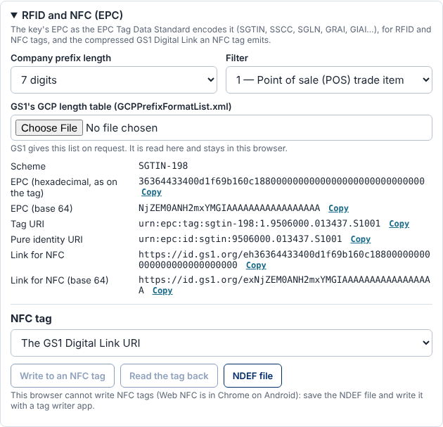
  &nbsp;
  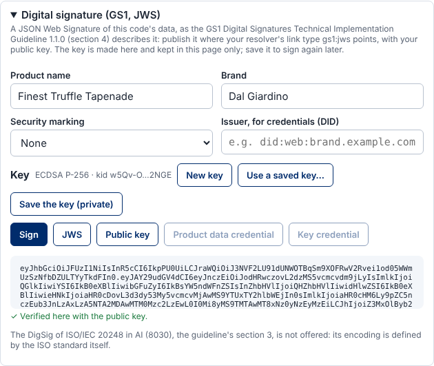
</p>

The key's **EPC** as the EPC Tag Data Standard encodes it, for RFID and NFC tags, with GS1's GCP length table loaded in
your browser; an **NFC tag** written and read back from a phone; a **GS1 digital signature** of the code's data (the
GS1 Digital Signatures guideline) and GS1 verifiable credentials, the key kept in your hands.
→ [User guide, RFID and NFC](docs/user-guide.md#11-rfid-and-nfc-epc-and-nfc-tags) ·
[digital signature](docs/user-guide.md#12-digital-signature-gs1-jws)

### 9. On a computer, a tablet or a phone — in six languages

<p align="center">
  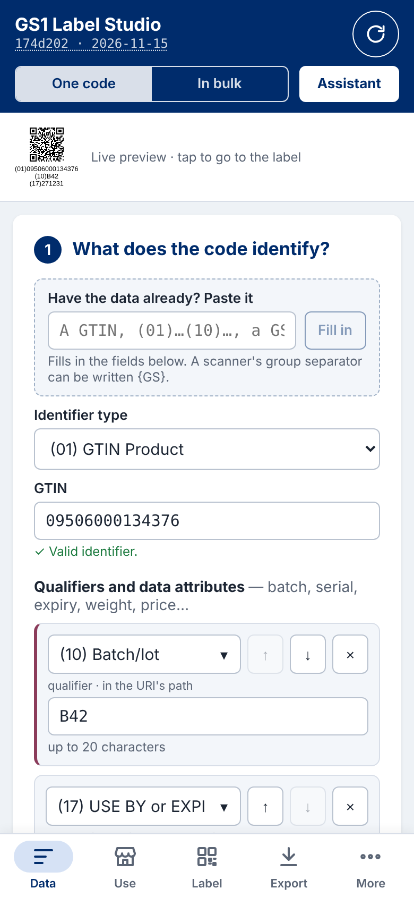
  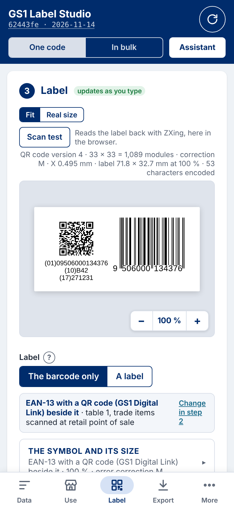
  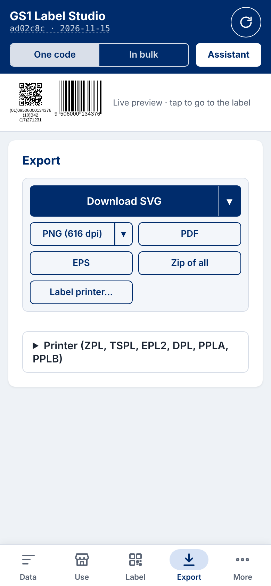
  &nbsp;
  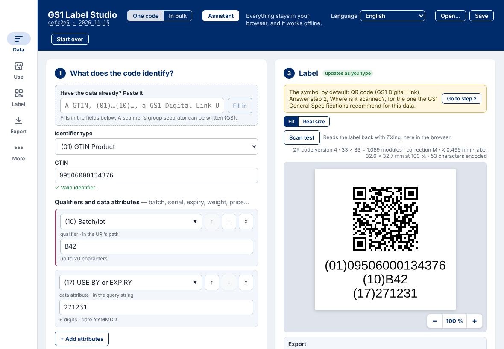
</p>

On a phone, one part at a time — Data, Scan, Label, Export, More — chosen in a tab bar at the bottom, as phone apps
do; on a tablet held horizontally, a rail with the label always beside you; on a computer, everything at once. English,
Português (Brasil), Español, Français, Deutsch and Italiano, in the browser's language from the first visit.
→ [User guide, the screen at a glance](docs/user-guide.md#2-the-screen-at-a-glance)

---

## The manuals

Everything the studio does, step by step, with screenshots — written for people who make barcodes and labels, people
who print them, and people who build on the studio. The index by reader: [docs/README.md](docs/README.md).

| Manual | For | What it holds |
|---|---|---|
| **[User guide](docs/user-guide.md)** | anyone making barcodes and labels | every task, step by step: [the screen](docs/user-guide.md#2-the-screen-at-a-glance) · [what the code identifies](docs/user-guide.md#3-step-1--what-the-code-identifies) · [where it is scanned](docs/user-guide.md#4-step-2--where-it-is-scanned) · [the label](docs/user-guide.md#5-step-3--the-label) and [its options](docs/user-guide.md#6-the-labels-options) · [real size and the scan test](docs/user-guide.md#7-seeing-it-at-real-size-and-the-scan-test) · [exporting](docs/user-guide.md#8-exporting-the-label) · [the GS1 Logistic Label](docs/user-guide.md#9-the-gs1-logistic-label) · [printer profiles and languages](docs/user-guide.md#10-printer-zpl-tspl-epl2) · [RFID and NFC](docs/user-guide.md#11-rfid-and-nfc-epc-and-nfc-tags) · [digital signatures](docs/user-guide.md#12-digital-signature-gs1-jws) · [in bulk](docs/user-guide.md#13-in-bulk-rows-from-a-spreadsheet), [the validation report](docs/user-guide.md#14-in-bulk-the-validation-report), [sequences and generating](docs/user-guide.md#15-in-bulk-sequences-and-generating-every-label) · [shortcuts worth knowing](docs/user-guide.md#16-shortcuts-worth-knowing) · [messages and what to do](docs/user-guide.md#17-messages-and-what-to-do) · [glossary](docs/user-guide.md#18-glossary) |
| **[Printing guide](docs/printing-guide.md)** | people who print | [which file for which printing](docs/printing-guide.md#1-which-file-for-which-printing) · [artwork and prepress](docs/printing-guide.md#2-artwork-and-prepress-svg-pdf-eps) · [laser printers and label sheets](docs/printing-guide.md#3-office-and-laser-printers-pdf-and-label-sheets) · [thermal printers and ZPL](docs/printing-guide.md#4-thermal-label-printers-zpl) · [ZPL templates for systems](docs/printing-guide.md#5-zpl-templates-for-systems) · [checking a printed symbol](docs/printing-guide.md#6-checking-a-printed-symbol) · [what ZPL refuses, and why](docs/printing-guide.md#7-what-zpl-refuses-and-why) · [TSPL, EPL2 and DPL](docs/printing-guide.md#8-tspl-epl2-and-dpl-and-the-other-printer-languages) |
| [Features](docs/features.md) | anyone checking what it does | every feature, the commit that brought it and the tests that prove it |
| [Conformance](docs/conformance.md) | quality and standards people | each standard, section by section: what is done, what is not, and the evidence |
| [Developer guide](docs/developer-guide.md) | developers | architecture, every module, the tests, how to extend |
| [The core's API reference](docs/core-api.md) | integrators | every name `@gs1-label-studio/core` exports |
| [Third-party licences](docs/third-party.md) | anyone reusing it | what the studio is made of, and why nothing restricts commercial use |
| [Inventory of features](docs/test-inventory.md) · [History](docs/history.md) · [Changelog](CHANGELOG.md) · [Release process](docs/release-process.md) | maintainers | every test by area; how the project grew; every change; how a release is made |

## Development

Requires Node.js 22 and pnpm 10 (`corepack enable`).

```bash
pnpm install
pnpm dev          # the web application on http://localhost:5173
pnpm check        # typecheck, tests and build — what CI runs
pnpm --filter @gs1-label-studio/web e2e          # browser tests on a desktop, a phone and a tablet, after pnpm build
pnpm --filter @gs1-label-studio/web screenshots  # the manuals' screenshots, after pnpm build
node scripts/metrics.mjs   # development indicators (docs/metrics/README.md)
```

Some tests run programs outside Node: poppler's `pdftoppm` and Ghostscript (`apt-get install poppler-utils
ghostscript`); the ZPL printed through Labelary only with `LABELARY=1`. The [developer guide](docs/developer-guide.md)
says more.

| Path | What |
|---|---|
| `packages/core` | GS1 encoding, geometry, printer dot grid, exporters; no user interface; runs in browser and Node |
| `apps/web` | the web application (React + Vite); `src/locales/` its languages, `test/` their test |
| `docs/adr` | architecture decision records |
| `docs/metrics` | development and management indicators, from day one |
| `scripts` | project tools: `metrics.mjs`, `inventory.mjs` and `api-reference.mjs` (ADR 0005); `syntax-engine.mjs` makes the dictionary and the engine's messages from a Syntax Engine release (0.6); `release.mjs` writes a release's version and cuts the CHANGELOG (0.4); `resolver-reference/golden.py` writes the resolver's answers as test fixtures (ADR 0004) |
| `.github/workflows` | `ci.yml` (checks, Labelary and the browser tests), `pages.yml` (publication of main at the root and develop under `/develop/`), `release.yml` (a tag's GitHub release), `docs.yml` (the documents' test), `syntax-engine.yml` (a new Syntax Engine release, every Monday) |

## Backlog

**Where it stands** (21 November 2026). Release 1.0.0. Phases 0, 1 and 2 are done, but for composite components (1.3,
later); 0.4, the release process, came with the first release. Phase 4 is done — the GS1 Logistic Label, the designer, the
saved work —, product and healthcare templates left out at the owner's word (3 November). Phase 3 has ZPL, TSPL, EPL2
and DPL, each checked through an emulator, and Argox's PPLA and PPLB (13 November) as DPL and EPL2; still to come are direct
printing (3.8) and tests on physical printers (3.9); phase 5 only if needed. Phase 6, the owner's review of 11 November
(twelve points on versions, usability, templates, EPC+ and DotCode), is assessed and ordered, to start on 13 November;
DotCode stays as it is for now. Open points include GS1-128 beyond an SSCC in TSPL and DPL and a review of the French,
German and Italian texts by native speakers.

**How the order went.** On 29 October: the editor's corrections (1.10) first, being small and seen every day; the
qualifiers and attributes in one block (1.15) and the URI's own parameters (1.17) before several keys (1.12), whose
other keys are rows of that same block; several keys before the generated SSCCs (2.3), which a logistic unit's label
needs; the human readable text placed and sized (1.16) before GS1-128 over several symbols (1.13), whose stacked
symbols each carry it, opening the logistic label of phase 4; signatures and verifiable credentials (1.18) and writing
NFC tags (1.19) after the symbols were complete — all done by 31 October with 1.20 and 1.21. Then phase 3's ZPL, TSPL,
EPL2 and DPL (31 October to 2 November), the GS1 Logistic Label in the printer languages (2 to 6 November), the
designer and the saved work (3 to 8 November), French, German and Italian (8 November) and following the Syntax
Engine's releases (0.6, 8 November), then the crop marks 1.5 had left for later, the zip's PNG at the resolution chosen, From and To's postcodes with a space, the URI's own parameters in bulk, the marks a word starts with in From and To and element strings in the rows' order (9 November). The [history](docs/history.md) tells it session by session.

**Phase 0 — setting up**

- 0.1 Repository, CI, publication on GitHub Pages — *done*
- 0.2 Development indicators from the first day (`docs/metrics`) — *done*
- 0.3 Walking skeleton: core encoding through bwip-js, read back by ZXing; printer dot grid; SVG; ZPL graphic — *done*
- 0.4 Release process, as in the resolver's project (the owner, 29 October 2026): `main` holds the last stable
  version, published at the site's root; `develop` holds the work in progress, published for the owner's tests under
  `/develop/`. Set up at the first release: until then there is no stable version, and `main` is where work lands —
  *done 21 November ([ADR 0010](docs/adr/0010-releases-and-two-sites.md), [release process](docs/release-process.md)):
  a, both sites built into one publication, develop naming itself and keeping its storage and service worker apart; b,
  `scripts/release.mjs` (the version in the four package.json files, the CHANGELOG cut), `release.yml` (the tag's
  GitHub release with its notes and `gs1ls`'s archive); c, the documents and the first release, 1.0.0*
- 0.5 Documentation by reader, as in the resolver's project (the owner, 31 October 2026): user and printing guides,
  features each naming the tests that prove it, an inventory drawn from the tests, the core's API reference, a
  developer guide, conformance and licences, kept in step by a test (ADR 0005) — *done 31 October*
- 0.6 Following the GS1 Barcode Syntax Engine's releases, and naming the release that checked the data (the owner,
  8 November 2026): a weekly workflow finds a new `gs1encoder`, makes the dictionary and the engine's messages again
  from its sources, runs `pnpm check` and opens a draft pull request with what is left (translations, the resolver's
  comparisons); the release on the screen (the data check, About) and in the files made (the zip's README, the PDF's
  Producer, the EPS's Creator) — *done 8 November*

**Phase 1 — one code, right by construction** (ported from the resolver's label studio where it had it: ADR 0004)

- 1.1 Input: GS1 Barcode Syntax Engine; paste an element string, a GS1 Digital Link URI or a scanner's output; AIs
  named and checked; errors explained — *done (a "(" inside a value is refused: the barcode encoder cannot take it)*
- 1.2 Guided choice: what is identified → symbol specification table → symbols allowed and recommended; scanning
  environments table carried over from the resolver (General Specifications 26.0, section 5.12.3) — *table, sizes and
  checks ported (2 970 of the resolver's answers equal); done: every row of tables 1 to 13, with ITF-14, GS1-128, GS1
  DataBar and GS1 DotCode, tested against the standard's text; the decision tree (figure 5-68), section 2's carrier
  choices and a recommendation; the editor's step 2, "Where is it scanned?" (mock-up B); ITF-14 and GS1-128 at their
  table's sizes and bar height*
- 1.3 Every GS1 symbology: EAN-13, EAN-8, UPC-A, UPC-E, ITF-14, GS1-128, GS1 DataBar family, GS1 DataMatrix,
  QR and Data Matrix with a GS1 Digital Link URI, GS1 DotCode; composite components later. GS1 QR Code is encoded by
  the core but not offered in the editor: beside the QR code with a GS1 Digital Link URI it confuses (ADR 0003) —
  *done: ITF-14, GS1-128 and the GS1 DataBar family laid out by their table's row, ITF-14 with bearer bars, each read
  back by ZXing from the SVG, PNG and PDF. GS1 DotCode is not drawn: no independent decoder reads it back (ZXing does
  not), which every symbol needs before it is offered; GS1 DataMatrix is recommended for tobacco unit packs instead.
  Composite components later*
- 1.4 Layout and human readable text as the General Specifications place them: the resolver's 2D symbol with an EAN/UPC
  beside it, guard bars, quiet zones, digits in OCR-B, text as outlines or as text; QR version and error correction —
  *ported and checked against the resolver (ADR 0004); an EAN/UPC alone too; GS1-128, ITF-14 and DataBar with 1.3*
- 1.5 Exports: SVG, PNG with dpi, PDF (vector, real size, written without a library, as the resolver's), EPS, zip;
  prepress options (bar width reduction, 100 % K) — *done: SVG, PNG (12 pixels per module, its dpi recorded), PDF and
  zip with README ported from the resolver and checked against it, for every symbol from its layout (1.3); EPS (the
  PDF's drawing in PostScript, read back through Ghostscript); PDF and EPS in process black alone; a bar width
  reduction for linear symbols; the PNG at 300, 600 or 1200 dpi; crop marks on a 10 mm margin in the PDF and EPS,
  the PDF's TrimBox the label, in bulk too but never on label sheets (9 November); the zip's PNG at the resolution
  chosen, as the PNG alone and bulk's were (9 November)*
- 1.6 Preview at real size with a ruler and a scan test; light and dark; phone width — *done:
  the editor screen (preview beside the options, live, desktop and phone, light and dark); the preview at real size
  between rulers in millimetres, the screen calibrated against a bank card; a scan test that reads the label back with
  ZXing in the browser (mock-up A)*
- 1.7 Offline (PWA) — *done: a service worker written at build time keeps every file of the application (the
  engines' WebAssembly, the font, the EPC schemes) on the first visit; a web app manifest and icons, so it installs*
- 1.8 EPC for RFID and NFC: every key with a TDS scheme, from the resolver's TDT-derived schemes; the GS1 Company
  Prefix's length from GS1's GCP length table, loaded by the user and kept in the browser — *done, checked against the
  resolver and read back by epc-tds; the tag's hexadecimal filled to the 16-bit word*
- 1.9 Data attributes in the GS1 Digital Link URI, with the resolver's decimal families (e.g. a net weight typed as
  1,25 kg); the URI's domain — *done: ported with the resolver's editor (key, qualifiers, attributes), checked against it;
  since 8 November names and addresses typed as people write them, their spaces as + and accents as %XX in the code*

*The owner's review of 29 October 2026 added items 1.10 to 1.14.*

- 1.10 The editor, corrected: (a) it takes the whole width of the screen (today at most 1 400 px, centred) — *done
  30 October, with step 3 rearranged at the owner's request (mock-up B of three): the label in its own area across
  the step, its tools over it, an export bar below it, the options below them; room for the designer of 4.2*; (b) every
  list of AIs in alphabetical order of the name it shows — the identifier types, the attributes and the bulk columns'
  AIs — *done 30 October: every AI choice reads "(AI) abbreviation name", "(01) GTIN Product", "(10) Batch/lot", so
  the order of the text shown is the AI's, as the General Specifications list them (the owner's request)*; (c) the screen's
  calibration (1.6) usable at its whole range: the bar outgrows the options column near the slider's maximum, so it
  cannot be measured, and the slider is coarse — the bar where there is room, and a fine adjustment — *done 30 October:
  the calibration spans the label's card, its slider stops where the bar still fits (7 pixels a millimetre on a
  computer, less on a phone), and − and + move the bar by about half a pixel*; (d) sliders for the label's short
  choices (the owner, 10 November 2026) — *assessed with mock-ups and left out (a slider suits an evenly spaced scale,
  and the categorical choices have no order); instead Error correction, Scheme and domain and Crop marks became rows of
  buttons (mock-up A of two), the longer choices staying lists*
- 1.11 Every identifier and qualifier: every GS1 key the dictionary has (the 16 GS1 Digital Link primary keys are
  offered today) and every qualifier of each, from the current GS1 Digital Link URI syntax; the four main qualifiers
  on the screen and the rest behind "+ Add qualifier", as the attributes are; checked against the GS1 General
  Specifications 2026 and the GS1 Digital Link standard in `references`. Beyond the Digital Link: the identification AIs a
  GS1 Digital Link URI cannot carry — (03) MTO GTIN first (the owner, 30 October 2026) — offered for the element
  string symbols only (GS1-128, GS1 DataMatrix, GS1 DataBar Expanded), with the pairs the Syntax Engine refuses ((03)
  not with (01), (02) or (37)) — *done 30 October, from the General Specifications 26.0, section 1.3 (each GS1
  identifier with its element string and Digital Link qualifiers): the 16 Digital Link keys and the Made-to-Order GTIN
  (03) with its batch/lot (10) or serial (21), grouped as "GS1 Digital Link keys" and "In element strings only", (03)
  drawn in GS1 DataMatrix when a URI symbol was chosen; the HIDRI (8014) needs a GTIN beside it, so it is an
  attribute; the attributes of element strings only — (8014), (8040) to (8043), (8200)… — offered and marked so;
  "+ Add qualifier" beyond the first four, though no key of 26.0 has more; the attribute's AI field lists every AI
  from its arrow even once one is chosen (the owner's report); "Start over" in the header*
- 1.12 Several keys in one symbol. An element string may carry more than one key; the Syntax Engine already checks the
  pairs the General Specifications forbid (e.g. (01) with (02) or (37); (8017) with (8018)) and require ((02) needs
  (37); (8020) and (415) go together). The cases to support: a logistic unit, SSCC (00) with the content's GTIN (02)
  and count (37), or with a GTIN (01) when the unit is itself a trade item, or with (8026) and (37); the transport
  keys beside it — consignment GINC (401), shipment GSIN (402), routing (403), ship to GLN (410); a trade item that is
  also an asset (GTIN with GRAI (8003) or GIAI (8004), e.g. a returnable keg). Today another key can only be added as
  a data attribute. To do: the cases confirmed against sections 3 and 4.13–4.14 of the General Specifications, the
  editor's "other keys" with their check digits, the GS1 Digital Link URI with one key in its path and the others in
  its query string, and the HRI — *done 30 October: checked against sections 4.13.1 and 4.13.2 (tables 4-4 and 4-5),
  which the Syntax Engine enforces, and which already put one key in the URI's path and the others in its query string
  and every element string in the HRI; in the list of 1.15, a row of another key says so and has its check digit
  checked on the row; links under the list add the pairings of the General Specifications for the key chosen — an SSCC
  with (02) and (37), with (01), with (8026) and (37), with (401), (402), (403) or (410); a GTIN with (8003) or (8004)*
- 1.13 GS1-128 over several symbols: when the data passes 48 characters (section 5.4.4.3), split it into as many
  GS1-128 symbols as needed, the key in the first and the rest in data-only symbols without a key, in the
  standard's order, stacked as the GS1 Logistic Label stacks them; the person can also move element strings between
  the symbols. Each symbol read back. Prepares 4.1 — *done 30 October: beyond 48 data characters (AIs, data and
  separating FNC1s), or where a symbol would pass 165.10 mm with its quiet zones (also refused for one symbol, which
  was not checked before), the element strings go in as many GS1-128 symbols as needed, in order, the key in the
  first; stacked on the left a quiet zone apart, each with its own text; "GS1-128 symbols" under the options lists the
  element strings, "new symbol" starts one where the person chooses, "Automatic" goes back; the guided choice now
  offers GS1-128 for such data; each symbol read back from the SVG, PNG and PDF; in ZPL a ^BC a symbol, stacked the same
  way, each read back through Labelary (31 October)*
- 1.14 QR Code's encoding modes: today bwip-js chooses the segments itself (numeric, alphanumeric, byte, mixed, for the
  smallest symbol). Offer automatic (as today) or one mode for the whole data — numeric, alphanumeric, byte — as ISO/IEC
  18004 defines them, alphanumeric only when the data allow it (upper case: a GS1 Digital Link URI's scheme and domain
  may be upper case, its path and values are case-sensitive). bwip-js has no option for it: an encoder that takes
  segments is needed (to choose), and every mode read back by ZXing — *done 30 October: "Encoding mode" for the QR code
  with a GS1 Digital Link URI — automatic (bwip-js, as before), numeric, alphanumeric or byte through node-qrcode,
  which takes segments — and "Scheme and domain" in capitals (HTTPS://ID.GS1.ORG; RFC 3986 makes them case-insensitive,
  the path and query stay as typed); a character a mode cannot take is named; each mode read back by ZXing at the
  version its capacity gives. ZPL keeps the printer's automatic mode until phase 3*

*The owner's ideas of 30 October 2026 added items 1.15 to 1.19; the requests of 31 October, items 1.20 and 1.21.*

- 1.15 Qualifiers and data attributes in one block: every qualifier the key has, and every attribute, added one at a
  time with "+ Add attributes" (an AI chosen from the whole list, the qualifiers of the key first), each row checked as
  today; the qualifiers still go to the GS1 Digital Link URI's path in the order its syntax asks, whatever order they
  were added in — *done 30 October (mock-up B of three): one list under the key, "+ Add attributes" adding a row whose
  AI field lists the key's qualifiers not yet given first, then every attribute; links beside it add a qualifier of
  the key straight away; each row says whether it goes to the URI's path or its query string, a qualifier at its
  left edge in the qualifiers' colour; two qualifiers the key does not take together are said on the row. Since
  9 November (a reviewer's comment) the rows' order, qualifiers included, is the element string's (GS1-128, GS1
  DataMatrix, GS1 QR Code, DataBar Expanded and their text), the URI keeping its own; a pasted element string keeps its
  order, and in bulk the columns' order is the element string's*
- 1.16 The human readable text placed and sized as the General Specifications allow (section 4.14): below the symbol
  (the default) or above it, beside a 2D symbol where the standard allows it; its character height chosen within the
  standard's range for the symbol and the X-dimension; for every symbol drawn with text, in every export, the scan
  test still reading the symbol — *done 30 October: "Text position" below, above, split (the key below and its
  attributes above, rule 1d), left or right (an element string a line, never broken, rule 1e), and "Text height" from
  the 2 mm minimum (rule 2a iii) to 5 mm, 3 mm marked for the GS1 Logistic Label (rule 5c), for the 2D symbols, GS1-128,
  ITF-14 and the GS1 DataBar family, in the SVG, PNG, PDF, EPS and the files made in bulk; the text clears the quiet
  zone by a module (2D) or the bars by 1.02 mm as below; beside an EAN/UPC a 2D symbol's text goes below or above;
  EAN/UPC's digits stay where section 5.2.5 puts them. In ZPL (31 October) the height everywhere, and below, above
  or split, read back through Labelary; left and right are refused there, the printer's font setting the text's width*
- 1.17 A GS1 Digital Link URI with parameters of its own: name=value pairs in the query string after the data
  attributes, e.g. `https://id.gs1.org/01/09506000134376/10/B42?17=271231&20=12&a=1&b=2&c=3`; a name made only of
  digits is refused (digits are the AIs'), names and values percent-encoded as the GS1 Digital Link standard asks; not
  in element strings, which have no place for them — *done 30 October: "Parameters of the URI" under the qualifiers
  and attributes, name = value rows with "+ Add parameter", appended to the URI after the data attributes; a name of
  digits only, a missing name or a name given twice is refused; pasting a URI keeps its parameters, which the Syntax
  Engine leaves out. In bulk since 9 November: a column goes to **URI parameter**, named by its header (`?name` or
  `name=` taken for one at once), each row's value on its URI*
- 1.18 Verifiable credentials and digital signatures as GS1 defines them: the GS1 Digital Signatures Technical
  Implementation Guideline 1.1.0 (January 2026: the digital signature AI (8030) over the symbol's data) and the GS1
  Verifiable Credentials data model (ref.gs1.org/gs1/vc: the credentials and their JSON-LD contexts); the keys stay in
  the browser; the guideline and the data model are in `references`. What to sign and how the keys are held to be
  decided with mock-ups — *done 31 October for the guideline's section 4 (mock-up A of two): "Digital signature (GS1,
  JWS)" under the EPC section signs the code's data as a compact JWS with ES256 — JSON-LD with the GS1 Web Vocabulary,
  the GS1 Digital Link URI as its id, GTIN, serial, batch and dates (xsd:date, century by section 7.12), product name,
  brand, and a security marking (hologram, microprinting, UV ink, watermark: gs1:SecurityMarking in vocabulary 1.18)
  whose code is shown (workflow 2) or taken out to be read from the marking (workflow 3); verified in the page before
  it is offered; the key (ECDSA P-256, its RFC 7638 thumbprint as kid) made with Web Crypto and kept in the page only,
  saved and taken back as a JWK; the public key as a JWK set; the data model 1.2.1's ProductDataCredential and
  KeyCredential as JWTs for an issuer's DID. Every signature also verified by Node's crypto in the tests. Not done: the
  DigSig of ISO/IEC 20248 in AI (8030), section 3, whose encoding is defined by the ISO standard, which the studio
  does not have; the chain of trust from GS1 (section 4.6) is GS1's own work in progress*
- 1.19 Writing NFC tags: the GS1 Digital Link URI (or the EPC section's NFC links) written to an NFC tag as an NDEF URI
  record through Web NFC, where the browser has it (Chrome on Android); read back from the tag to check it; where it
  is missing, the NDEF message as a file for a tag writer — *done 31 October: "NFC tag" in the RFID and NFC section
  writes the GS1 Digital Link URI, or the EPC's link for NFC, as an NDEF URI record through Web NFC, and reads the tag
  back to say whether it holds that URI; where the browser has no Web NFC (all but Chrome on Android), the buttons say
  so and the NDEF message (NFC Forum URI RTD, the prefix abbreviated) downloads as a file for a tag writer app. Tested
  with Web NFC stood in for in the browser tests; a real tag waits for the owner's phone*

- 1.20 The interface in Brazilian Portuguese and Spanish besides English, the documentation in English only (the owner,
  31 October 2026) — *done 31 October (mock-up A of three: a language menu in the header, each language named in
  itself): the browser's language on the first visit, the choice kept afterwards, the page redrawn in place; every
  text of the page and every message of the core and of the GS1 Barcode Syntax Engine in each language, the engine's
  and the keys' texts from the resolver's catalogues; a test refuses a text without its translation. Drafts by
  Claude, to be reviewed by native speakers; the files made stay in English. French, German and Italian too since 8
  November (the owner's request; everywhere a language enters: the menu, the page and the messages, the GS1 Logistic
  Label's data titles, a text block's months, the spreadsheets' headers)*
- 1.21 A design for phones and tablets, the computer's left as it is, and About at the foot of the page (the owner,
  31 October 2026) — *done 31 October (mock-up A of three: B was one long column with step chips and a floating
  download button, C a drawer menu): on a phone, a tablet held upright or a narrow window, one column and one
  destination at a time — Data, Scan, Label, Export, More — chosen in a tab bar at the bottom as phone apps do, each
  keeping its scroll, a link to another destination opening it, a dot where there is an error; on a tablet held
  horizontally a navigation rail, the destination on the left and the label with its exports always on the right; the
  same page in every layout, so turning the device keeps what was typed. About: the repository, the Apache 2.0
  licence, the manuals, the version published (its commit and date) and the software of others it is made with, each
  linked to its repository. The browser tests run on a phone and a tablet besides the desktop. Then, from the
  owner's look on an Android phone: layout A kept; the home screen's name GS1 Label Studio (the manifest's short
  name was "GS1 Labels"); *Install the app* under More; Start over a round reload icon beside the live preview*

**Phase 2 — in bulk**

- 2.1 CSV, Excel and pasted rows; column mapping remembered by header; fixed values — *done: "In bulk" beside "One
  code" (mock-up A): CSV (comma, semicolon or tab), pasted rows and Excel workbooks read without a library; each
  column's AI guessed from its header and remembered for the same headers; values for every row; each row checked by
  the Syntax Engine, its label in the preview; since 8 November a patient list's headers too (GSRN, date of birth,
  names), its names' spaces as + and accents as %XX, a person's sex from words in the six languages*
- 2.2 Validation report; fix or skip rows — *done (mock-up A of three): in the rows card, the rows with errors, fixed,
  skipped or all; each with its reason and its cells, the one at fault outlined and fixed in place (the file is not
  changed); a hint when Excel kept 15 digits of a code or a CSV wrote it in scientific notation; one row or every row
  in error skipped; the report and the corrected rows as CSV*
- 2.3 Generated sequences: serial numbers, SSCCs — *done 30 October (mock-up A of two): "…or make a sequence" in
  step 1 makes serial numbers (21) — a prefix, the number padded to a number of digits, a first number and a step —
  or SSCCs (00) — the extension digit, the GS1 Company Prefix, the serial reference from a first one, the check digit —
  as rows of their own or as a column added to the rows loaded (fixes, skipped rows and columns kept); what AI (21)
  cannot hold, a serial reference that does not fit and more than 100,000 rows are refused before anything is made*
- 2.4 Outputs: zip by row with a name pattern, multi-page PDF, laser label sheets (Pimaco, Avery, custom), one print
  file per printer language, CSV of what was generated — *done 30 October (mock-up A of three): "Generate in bulk"
  under the label's Export bar draws the label shown, with its options, for every row ready or fixed, in one zip: SVG,
  PNG, PDF or EPS for each row, named by a pattern ({row}, {symbol}, {key}, any AI such as {10}, a column's header
  since 6 November; a name repeated is
  numbered); one PDF a label a page; label sheets (Avery L7160, L7163, L7651, 5160 or a custom sheet), each label at
  100 % centred in its place, from any place of the first sheet, a label larger than the sheet's refused and said
  before generating; one ZPL file with the printer's own commands; generated.csv with every row, its files or why
  none. Pimaco's sheets wait: its 2026 catalogue gives their label sizes and counts but not their margins or pitch
  (a custom sheet takes one meanwhile). The printer languages after ZPL come with phase 3*
- 2.5 Web Workers with progress and cancel; a measured performance target — *done 30 October: the generation runs in
  a Web Worker, a progress bar and Cancel beside "Generate N labels", the page usable meanwhile; checking stays on the
  page (10,000 rows in 0.64 s, within the target of 1 s); 1,000 QR labels as SVG and one PDF in 10.7 s instead of
  32.6 s (target 15 s), with the same bytes out (docs/metrics, "Performance targets")*

**Phase 3 — printers** (ADR 0002; a printer profile has a language since 31 October 2026: ZPL, TSPL, EPL2 or DPL)

- 3.1 Printer profiles; whole-dot X-dimensions within the table's range; test print — *done 31 October (mock-up A of
  two): "Printer (ZPL)" above the EPC section, generic ZPL profiles at 152 to 600 dpi, 104 mm wide, and profiles of
  one's own (name, resolution, print width) kept in this browser; the module's whole dots offered within the table's
  range, the nearest by default, said when none fits; a label wider than the printer prints refused; "Test print
  (ZPL)" adds a 50 mm ruler and the settings under the label (Labelary prints the ruler 400 dots long at 8 dots a
  millimetre); the bulk ZPL file takes the same dots*
- 3.2 ZPL II with the printer's commands and templates with placeholders — *EAN/UPC, ITF-14, GS1-128, GS1 DataMatrix,
  QR and Data Matrix with a GS1 Digital Link URI done (checked through Labelary); GS1 DataBar through `^BR` and
  ITF-14's bearer bars through `^GB` done, with what `^BR` cannot print refused (ADR 0002); the GS1 Logistic Label done
  2 November (each GS1-128 a `^BC`, the text and rules where the layout puts them), with two fixes found on the way:
  the text's capitals at their height, and GS1-128 as wide as `^BC` prints it*
- 3.3 TSPL/TSPL2 — *done 31 October for the symbols Labelize reads back (the owner chose it to stand in for a printer,
  ADR 0002): EAN-13, ITF-14 with bearer bars, GS1 DataMatrix (FNC1 as `~1`), Data Matrix and QR code with a GS1 Digital
  Link URI, text in the dot fonts, the test label; GS1-128 (the manual's `!102`, which Labelize encodes as text),
  EAN-8, UPC-A, UPC-E and GS1 DataBar refused until a test reads them; GS1-128 of an SSCC alone done 6 November as
  `EAN128`, its 20 digits, which Labelize draws as ZPL's UCC case mode*
- 3.4 PPLB · 3.5 PPLA — *done 13 November: Argox's programmer's manual (49.20002.001, December 2000, in the Drive's
  references; it holds both languages, so no other manual is needed) gives PPLA as compatible with Datamax's DPL and
  PPLB with Eltron's EPL2, and the same syntax for every command the studio writes (argox.ts lists them); so a PPLA
  file is DPL's and a PPLB file EPL2's, each printed in Labelize as that language and read back, refusing what the manual
  lacks: PPLA's QR code, PPLB's Data Matrix and QR code. Generic profiles at 203 and 300 dpi; a refusal of DPL or EPL2
  said in PPLA's or PPLB's name*
- 3.6 EPL2 — *done 31 October through Labelize: EAN-13, EAN-8, UPC-A, UPC-E, ITF-14 with bearer bars, GS1-128 (UCC/EAN
  128, a variable-length element string last only; over several symbols too), Data Matrix with a GS1 Digital Link URI,
  text in fonts 1 to 5, the test label; GS1 DataMatrix (no FNC1) and QR (Japanese models only) refused, as the guide
  says; GS1 DataBar refused until a test reads it*
- 3.7 DPL — *done 2 November through Labelize, from Datamax's Class Series 2 Programmer's Manual (88-2341-01; Honeywell's
  current reference needs a sign-in): EAN-13, EAN-8, UPC-A, UPC-E, ITF-14 with bearer bars, GS1-128 for an SSCC alone
  (UCC/EAN Code 128, `q`), Data Matrix and QR code with a GS1 Digital Link URI, text in the internal fonts, the test
  label; rows and columns in tenths of a millimetre from the label's bottom left corner. GS1 DataMatrix (no FNC1 in the
  manual), other GS1-128 (Labelize draws neither `&G` nor `W1I`) and GS1 DataBar (`W1k` not drawn) refused*
- 3.8 Direct printing: WebUSB, Zebra Browser Print; a local agent for network printers
- 3.9 Compatibility matrix from tests on physical printers

**Phase 4 — labels**

- 4.1 Templates: GS1 Logistic Label (SSCC), product labels, healthcare labels — *the GS1 Logistic Label done 31
  October (mock-up A of two; General Specifications 26.0, 6.6): for an SSCC, "Label" in step 3 offers it in A6, 4 × 6
  in, A5 or 6 × 8 in; the top block with who sends and receives it (3.5 mm), the middle block with each element
  string's data title above its content (7 mm), the bottom block with the GS1-128 symbols and their 3 mm text, the
  SSCC alone in the lowest, the rest split as they fit the page's width; refused when the page is too short; one
  Layout, so the SVG, PNG, PDF, EPS and the files in bulk draw it; each symbol read back. In ZPL since 2 November, EPL2
  since 3 November, TSPL and DPL since 6 November for an SSCC alone (their GS1-128 carries nothing else yet). A 2D symbol beside the middle block since 2 November (mock-up A of two: a QR code or Data
  Matrix with the GS1 Digital Link URI, or a GS1 DataMatrix, at table 5's X-dimension; in ZPL too). Data titles in a
  second language since 7 November (mock-up A of two, taken under the owner's rule; B put the translation on the English
  title's line): **Data titles also in** Portuguese or Spanish, each under its English title (6.6.4.2); French, German and Italian since 8 November. From and To wrapped between words within their halves since 8
  November, a long word after its hyphen, slash or comma first, two marks in a row kept together, a postcode with a space kept whole, no line starting with a mark and the marks a word starts with kept with it (9 November) (3 mm when 3.5 mm leaves the page too short). No product or healthcare templates (the owner, 3 November 2026: every place has its
  own label, so the designer of 4.2 is what matters)*
- 4.2 Designer: one or several barcodes and text blocks placed on a label of one's own, then images, lines, fields bound
  to spreadsheet columns — *done, step by step (each mock-up choice taken under the owner's rule unless said):*
  - *Barcodes and text blocks, 3 November (mock-up A of two): in step 3, "Label" offers "A label of my own"; + Barcode,
    + Text and Delete over the canvas, each element chosen and dragged on it; under it the page's size, the elements
    and the chosen one's properties; text with {AI} fields filled from the data, so the files in bulk fill every row's
    label; one Layout, so SVG, PNG, PDF and EPS; every barcode read back. In ZPL and EPL2 the same day (each barcode as
    the symbol alone, where the page puts it; checked through Labelary and Labelize).*
  - *Lines and boxes, 3 November (mock-up B of two, the owner's choice): + Shape beside + Barcode and + Text, a line
    across or down, a box or a filled box chosen in its properties; in ZPL `^GB`, in EPL2 `LO` and `X`, to the dot
    through Labelary and Labelize.*
  - *A date field in a format, 3 November (mock-up B of two): Insert a field offers each date also as
    `{17:DD/MM/YYYY}` and four other formats, each with the date it gives; any format of DD, MM, MMM, YY and YYYY
    typed; the month's abbreviation in English, Portuguese or Spanish, and since 8 November French, German or
    Italian, chosen for each text block, the interface's language first.*
  - *A new element never lands exactly on another, 3 November (the owner: one made over another went unnoticed):
    where an element already has its corner, it goes 5 mm right and down, and again.*
  - *Images, 4 November (mock-up A of two; B added an empty image to fill in its properties, with a preview):
    **+ Image** takes a file at once and places it 20 mm wide, its height from its proportions, in black and white as
    label printers print; in ZPL `^GFA`, every dot checked through Labelary; in EPL2 as `GW` with raw bytes (a print
    file of bytes; 0 prints black, as Zebra says, the other way round in Labelize, so its tests invert the bits).*
  - *Rotation, 4 November (mock-up A of two; B turned the chosen element a quarter at a time from a button over the
    label): **Rotation** 0°, 90°, 180° or 270° in a barcode's, a text block's or an image's properties, its box's
    corner kept; in ZPL each field with its orientation (`R`, `I`, `B`), every dot of each symbol as the upright one
    turned through Labelary; a QR code stays upright (`^BQ` has no orientation); in EPL2 with `A`'s and `B`'s
    rotation, the origin turned with the object as the guide shows (Labelize places it otherwise; a turned Data
    Matrix refused, `b` has no rotation).*
  - *TSPL, 4 November: barcodes, text (`TEXT` at its capitals' height, measured through Labelize), lines and boxes
    (`BAR`, `BOX`) and images (`BITMAP`, raw bytes as in EPL2), every one checked through Labelize; turned barcodes
    and text with TSPL's rotation, about the origin as the manual's own example prints it (a turned QR code refused:
    Labelize does not turn it).*
  - *DPL, 6 November: barcodes, text (the internal fonts at their capitals' height, measured through Labelize), lines
    and boxes (`X` records), each by its bottom left corner in tenths of a millimetre, checked through Labelize; an
    image refused (DPL's `Y` record prints a stored image, which Labelize does not draw); turned barcodes and text
    with their record's rotation, about their bottom left corner as the manual's figure shows (a turned Data Matrix or
    QR code refused: Labelize does not turn them).*
  - *Fields bound to spreadsheet columns, 6 November (mock-up A of two; B offered the columns in a second list): in
    bulk, **Insert a field from the data** also offers each column holding no AI, such as `{Produto}`, with the row
    shown's value; each row's label and print file show its own cell; a name no column has stays as typed; the bulk
    **File names** take a column's header too, such as `{Produto}_{10}`, on any label.*
  - *An image's darkness, 6 November (mock-up A of two; B offered five steps in a list): **Darkness**, a slider from
    lighter to darker in the image's properties, makes the black and white again from the file's grey levels, kept in
    the page's memory only (the work keeps the picture and its threshold; after a reload the file is chosen again to
    change it).*
  - *Images in ZPL's own compression, 6 November (repeat counts, `,`, `!` and `:`, which every ZPL II printer reads;
    several times smaller, every dot checked through Labelary).*
  - *Resizing by dragging a corner, 7 November (mock-up A of two; B had a handle at each corner): the chosen element's
    handle at its bottom right corner, its top left corner kept; a box and a line to the corner, an image in its
    proportions, a barcode to the nearest size its environment allows, a text block to the nearest text height.*
  - *A date's time, 7 November (the recommended of two: `hh`, `mm` and `ss` in lower case, so that `MM` stays the
    month; the other was `HH` and `MI`): Insert a field offers a date followed by a time, such as (7003) or (8008),
    also as `{7003:DD/MM/YYYY hh:mm}` and three other formats, with seconds where the AI has them; a part the value
    lacks is left out with the text before it.*
  - *Names offered for the bulk file names, 7 November (mock-up A of two; B offered each name as a button): **Insert a
    name** under File names lists `{row}`, `{symbol}`, `{key}`, the first row's AIs and the columns holding no AI, each
    with the first row's value, and adds the one chosen at the end.*
  - *Greys as dots for a photo, 7 November (mock-up A of two; B offered two buttons): a box under an image's Darkness
    dithers its greys (Floyd and Steinberg), the darkness then darkening the greys; each printer dithers the picture
    again at its own dots, so a grey prints as dark as it is (checked through Labelary).*
  - *The handle of an element past the label's edge, 7 November (mock-up A of two; B drew the whole outline past the
    edge): held at the edge, in red, and dragged, the corner under the pointer.*
  - *A date of birth, 7 November: (7250) and (7251), whose dates are YYYYMMDD, offered in the date fields' formats with
    the year as given, (7251) with its time, and read from ISO and DD/MM/YYYY cells in bulk.*
  - *Resizing from the keyboard, 7 November (mock-up A of two; B gave the keyboard to the element's outline, the arrows
    moving it): Tab reaches the chosen element's handle, and the arrow keys move its corner by half a millimetre, 5 mm
    with Shift, a barcode and a text block a size at a time.*
  - *A date's time in bulk, 7 November: (7003), (4324), (4325), (7011) and (8008) keep a cell's time after the date,
    (8008) its seconds, and an Excel cell keeps the time its format shows.*
  - *Moving from the keyboard, 7 November (mock-up A of two; B moved the element by the arrow keys on its button in the
    list): Tab reaches the chosen element's outline on the label, just before its handle, and the arrow keys move it
    by half a millimetre, 5 mm with Shift.*
  - *What an arrow key did, said, 7 November (mock-up B of two; A told a screen reader alone): the hint under the
    outline or the handle starts with the new place or size, the end of a barcode's or a text's sizes and the label's
    edge, and a live region tells a screen reader the same.*
  - *The keyboard's order, 8 November (mock-up A of two; B sent the focus to the outline as an element was chosen):
    **On the label** beside the chosen element in the list takes the focus to its outline, which comes before the
    panel, and Escape on the outline or the handle brings it back to the element's row.*
  - *Times in bulk, 8 November: a time with AM or PM, an Excel cell that holds a time alone (HH:MM, as on a 24-hour
    clock), and (7007)'s harvest period from two dates in one cell (`01/09/2027 - 15/09/2027`).*
  - *A grid and rulers, 8 November (mock-up A of two; B had the grid alone, from a button beside the zoom): **Grid and
    rulers** over the canvas turns on lines every 1, 2, 5 or 10 mm as the label is drawn, stronger every 10 mm, and
    rulers in millimetres along its top and left, the chosen element's span marked on them; kept on or off in this
    browser.*
  - *Moving held within the label, 8 November (an open point since 7 November; B kept moving free, the page reporting
    the edge): dragging or the arrow keys stop an element at the label's edge, its corner on the last half millimetre
    that keeps it on the label; one already past the edge is never moved further past it but comes back as far as it
    is moved, and the hint says when the edge is reached; **Left** and **Top** typed still place it anywhere.*
  - *Resizing held within the label, 8 November (an open point since the same day; B kept resizing free, the page
    reporting the edge): dragging the corner or the arrow keys on it make an element no larger than the label's edge
    allows, a box or a line on the last half millimetre, an image at the width that keeps it on the label, a barcode
    (its text included) or a text block at its largest size that does; one already past the edge grows no further past
    it but can always be made smaller; the properties typed still make it any size.*
  - *Saving the label is 4.3.*
- 4.3 The work saved on one's own computer and opened again, templates shared as files (the owner, 3 November 2026:
  save the work locally, perhaps by exporting ZPL and opening a ZPL as Labelary does) — *(a) and (b) done 3 November
  (mock-up A of two, taken under the owner's rule; B put a work file among the exports and Open in step 1): **Save**
  and **Open…** in the
  header beside Start over (in More on a phone). (a) Save downloads a work file (JSON: the data typed, step 2's answers,
  the label's settings with a label of one's own, the printer's profile, in bulk the columns chosen; the spreadsheet
  stays a file of its own); Open… takes it back, refused with the reason when it is not one or comes from a newer
  version. (b) The ZPL the Export bar downloads carries the same work in `^FX` comments, which printers and Labelary
  ignore, so Open… takes the studio's own ZPL back too. A ZPL made elsewhere is refused: Labelary draws any ZPL but
  recovers no design, and a printer's commands lose what the studio needs (the fields such as `{17:DD/MM/YYYY}`, the
  GS1 meaning of the data, sizes in millimetres rather than dots at one resolution). (c) The last work kept in
  this browser and offered again on the next visit, done 4 November (mock-up A of two, taken under the owner's rule;
  B asked in a dialog over the page): the work file kept in IndexedDB a moment after each change; the next visit asks
  in a bar under the header (its time, the key's element string, a label of one's own), **Continue it** or **Start
  anew**; a first visit's work and Start over keep nothing. Templates tied to a project perhaps later still (the owner, 3
  November 2026: not needed now)*

**Phase 5 — beyond the browser** (if needed)

- 5.1 CLI and HTTP API from the same core — *assessed on 20 November 2026 (ADR 0009): option A of three taken under
  the owner's rule (a command line, `gs1ls`, in `packages/cli`, and `gs1ls serve`, an HTTP API on 127.0.0.1; B, a
  hosted API, and C, nothing until asked, set aside); items a to d: a, the package, its bundle, `check` and `label`;
  b, `bulk` and `epc`; c, `serve` and its OpenAPI document; d, `--lang`, a guide for integrators, the inventory and the
  test plan; a done the same day: `designFor()` in the core (the label step 2 recommends from the data alone), and
  `gs1ls check` (the Check Studio's verdict and findings, text or JSON, exit status 0, 1 or 2) and `gs1ls label` (SVG,
  PNG, PDF, EPS or a printer's language, to a file or standard output), bundled into `packages/cli/dist/gs1ls.mjs`;
  b done the same day: the EPC with the person's choices moved from the page into the core (`epcOf`, `tagFor`),
  `gs1ls epc` (the tag's EPC, bank and URIs, EPC+ and EPC++, GS1's GCP length table, ZPL for an RFID printer) and
  `gs1ls bulk` (a CSV or a workbook as the editor's bulk generation: the zip with `generated.csv`, one PDF, one print
  file, each row's tag with `--rfid` and `tags.csv`); c done the same day: `gs1ls serve`, the same as a local HTTP API
  (`POST /v1/check`, `/v1/label`, `/v1/epc`, `/v1/bulk`, on 127.0.0.1) with its OpenAPI document at
  `/v1/openapi.json`; d done the same day: `--lang` (the page's catalogues through the core's `translator`, the
  Check Studio's plain words for each finding, `Accept-Language` on the API) and the integrators' guide; 5.1 closed*

**Phase 6 — the owner's review of 11 November 2026** (twelve points, then the owner's comments of 11 and 13
November, assessed and ordered; to start when the week's quota starts again). Recommended order: 6.1, 6.2 and 6.9 (small, seen at once), then the
usability study 6.3 as mock-ups for the owner, then PPLA and PPLB (3.4, 3.5: the manual is in the Drive since
11 November) while the owner looks at them, then 6.4 to 6.6 as the study decides, 6.7 after an assessment; 6.8 left for
now. 6.10 (the assistant, 13 November) before 6.4 and 6.5, which follow from it. Effort: S a session, M two or three, L more.

- 6.1 The version in the header, and new versions found by themselves (S) — *done 13 November: the commit and its
  date under the name, linking to About (mock-up A of two: B put them beside the name as a badge); a new release asked
  for when the page opens and when it comes back to the screen, then offered in a bar, Reload or × for later*. Under *GS1 Label Studio*, the commit and its
  date (About already has them), linking to About. The service worker already fetches pages from the network first
  and takes over at once (`skipWaiting`, `clients.claim`), but an installed app brought back from the background keeps
  the page it had: the page will ask for a new worker when it opens and whenever it comes back to the screen, and
  when one is ready show a bar *A new version is ready — Reload* (the work in progress is kept for the next visit, so a
  reload loses nothing). Recommended rather than a check icon, which asks the user to think of it, or a reload
  without asking, which would redraw the page under someone typing
- 6.2 The name on the installed app's opening screen (S). The manifest already gives *GS1 Label Studio* as `name`,
  but Android 12 and later draw the opening screen themselves with the icon alone, whatever the manifest says. So: a
  launch screen of the page's own, only in the installed app (`display-mode: standalone`), the icon with the name under
  it, gone as soon as the page is ready, never held longer. To check first on the owner's phone (its Android version)
  — *done 13 November: the icon and the name on the manifest's background colour, in the page's HTML so that the page
  drawn replaces it (mock-up A of two: B, white on navy, jumped from Android's own light screen); to be seen on the
  owner's phone in the test plan*
- 6.3 A usability study by device, as mock-ups first (M): Playwright screenshots of the real application with each
  proposal, on a computer, a tablet and a phone, in a doc for the owner to choose from, then the chosen ones built.
  *Mock-ups done 13 November (twenty screenshots in a doc for the owner, its link in the handover): recommended (a) A, a ? opening a
  popover, a sheet on a phone; (b) framed groups, folded on a phone; (c) the tablet's layout on a computer, the label
  always on the right, and a picture of each choice in step 2 on a phone; (d) a prompt over the label until step 2 is
  answered; (e) Start the answers again; (f) Use with a shop front (the owner's choice, 13 November: Where
  with a map pin would be confused with the GLN, a location's key); (g) a switch, the barcode only or a label, the kinds
  as cards; (h) split buttons; (i) one printer button, the section with its own downloads; (j) the two options in one
  group, each reduction saying what it takes off. Built from the next session unless the owner chooses otherwise,
  (h), (i) and (j) first; (h), (i) and (j) done 13 November, (a) on 14 November: a ? beside every option of the label, twenty texts
  in the six languages; (b) and (f) on 14 November: the options in five framed groups (and the GS1 Logistic Label's),
  folded on a phone with a line saying what is set; the phone's Scan renamed Use, with a shop front; with them the
  assistant's button beside One code and In bulk on every device (the owner, 14 November: it was missing on a phone);
  then the phone's Start over moved from the live preview's bar to the header, at the right of the name, so that the
  Label tab has it too (the owner, 14 November; mock-up A of two); (g) on 14 November: the switch *The barcode only* or
  *A label*, the kinds of label as cards (the GS1 Logistic Label greyed with its reason until the key is an SSCC; a
  label of one's own; a work saved, opening a file); (c) on a computer, 14 November: the tablet's layout, steps 1 and 2
  and the options on the left, the label and its exports on the right, kept in view as the page scrolls; and on a phone, 14 November, a small picture of each choice of step 2 at its right,
  drawn from the data (mock-up A of two: B put a larger picture under each choice's text); (d) and (e) re-assessed
  14 November once the assistant and the computer's two columns were built: (d) a line over the label until step 2 is
  answered, with *Go to step 2* (mock-up A of two: B covered the label, in the way of those who know what they want), and
  (e) *Clear the answers* under step 2's questions, *Choose a symbol yourself* saying the answers are kept*
  It covers the owner's points (a) to (j), which bear on one another:
  (a) a ? beside each option of the label, opening a short help with what it does and a tip, written in the six
  languages;
  (b) the label's options grouped by what they do (the symbol and its size; its human readable text; the GS1 Digital
  Link URI; prepress and files), each group framed with its title;
  (c) step 3 in sight while step 2 changes it: on a computer the label's preview kept on screen as the page scrolls
  (or step 3 beside step 2); on a phone, a small picture of each symbol in step 2's choices;
  (d) step 2, optional, more visible on a computer, where it is easily passed by;
  (e) step 2 saying plainly how to start its answers again, and that choosing the symbol yourself sets them aside;
  (f) the phone's bottom bar: *Scan* (step 2) reads as reading a barcode, which a future reading module would mean;
  renamed after the scanning environment, such as *Where* or *Use*, with an icon to match;
  (g) a switch at the top of step 3 between *The symbol only* and *A label*, which today hides in a list;
  (h) the PNG's resolution and the SVG's text beside their buttons (the owner, 11 November 2026, a comment on the test plan): today
  **PNG resolution** is among the label's options, far from the **PNG** button; a split button *PNG (300 dpi) ▾*,
  its arrow listing the resolutions (at the label's size, 300, 600, 1200 dpi), the choice kept as today, so the
  button downloads at once and the option lives where it is used; likewise **Text in the SVG** beside the **SVG**
  button, *SVG (outlines) ▾*, its arrow offering outlines or text (the owner's second comment, the same day);
  (i) the printer's buttons: **ZPL (203)** and **ZPL template** among the file buttons replaced by one button that
  opens the **Printer** section and brings it into view, where the profile, its language and the print files are (the
  owner's third comment, the same day); one click more for those who print daily, so the mock-up also shows the
  section's own download button within reach;
  (j) the linear symbol beside a 2D one, its two options said plainly (the owner's comment of 11 November 2026):
  **Size of the linear barcode** sets that symbol's X-dimension (the width of a narrow bar, from the scanning
  environment's table); **Bar width reduction** then takes a fixed amount, in mm, off every bar of every linear
  symbol, half on each side, leaving the symbol's size and the 2D symbol's modules as they are, so the spaces widen
  by as much. The two do not change each other, but a fixed reduction weighs more on a small X (0.02 mm is 6 % of
  0.330 mm, 8 % of 0.264 mm). The list shows only *0.020 mm*, which reads as a bar's width: each value to say what it
  takes off and its share of the X, such as *0.020 mm off each bar (6 % of X 0.330 mm)*, a ? to say what it is for
  (the press's ink gain, which the printer gives), and the two options side by side in the linear symbol's group (b)
- 6.4 A tour of the studio (S to M, after 6.3, as it follows the layout chosen): on a computer a button that stands
  out in the header, on a phone or tablet an entry of the menu (the owner, 13 November 2026), that points out, one at a
  time, the steps and the main buttons on each device, skipped and seen again at will, in the six
  languages; the README's tour and the user guide's sections as its text — *done 14 November (mock-up A of two: the page
  dimmed, an amber ring around what is shown and a card beside it; B left the page bright with the card in a corner):
  nine stops on a computer from **Tour** in the header, eight on a phone or a tablet from **Take the tour** in *More*,
  each destination of the bar opened in turn; Esc, Skip the tour, the arrow keys, the focus brought back*
- 6.5 Labels by segment (M to L; reopens the owner's word of 3 November, which left product and healthcare
  templates out): under *A label* (6.3 g), a list of templates grouped by segment (logistics: the GS1 Logistic Label;
  a label of one's own; the works saved; then retail, healthcare and patients as the owner chooses them, one at a
  time, each from the General Specifications or GS1's guidelines). Choosing one sets step 1 to its key, qualifiers
  and attributes; data that the template has no place for is named first, with *Keep it* and *Leave it out*. The
  owner to say which segments and templates come first — *first templates done 15 November (mock-up A of two: the
  cards under A label grouped by segment, Logistics, Retail, Healthcare and Your own; B put the templates behind a
  fourth card, in a dialog; retail then healthcare, the recommended order): Product with lot and expiry (EAN-13 and a
  QR code), Fresh food sold by weight (GS1 DataBar Expanded Stacked), Medicine or medical device (GS1 DataMatrix with
  its data written beside it); a medical device's UDI label done 15 November (mock-up A of two: the UDI's element
  strings beside the GS1 DataMatrix, one a line; B wrote them in one line under it): under the ISO 15223-1 UDI pictogram,
  with MD, and with it **+ Pictogram** on any label of one's own (the owner: let the UDI pictogram be placed); a
  patient's wristband the same day (mock-up A of two: a GS1 DataMatrix at each end, the name, date of birth, sex and
  GSRN between; B put the GSRN alone in a GS1-128 along the band); a consumer unit with GS1 Digital Link done 15 November
  (mock-up A of two: the EAN-13 and a QR code carrying the GTIN alone side by side, a call to scan under the QR code; B
  stacked them on a narrow panel), as the barcode area on a pack's back rather than its front (General Specifications
  6.3.2, 6.3.3.1: the front is the trading and advertising area), and with it a 2D barcode further than 50 mm from the
  nearest point-of-sale linear barcode named on any label of one's own (6.3.3.1); next: patients and further templates
  as the owner chooses them*
- 6.6 A barcode on a label of one's own with the options of the symbol alone (M): today its symbol, size, human
  readable text and element strings; then the human readable text's place and height (1.16), error correction and
  the QR code's encoding modes (1.14), the bar width reduction, ITF-14's bearer bars, and a linear symbol beside a
  2D one, in the files and in the four printer languages (ADR 0002: a native command only once a test shows the same
  symbol) — *all but the linear symbol beside a 2D one done 15 November (mock-up A of two: a group of its own under the
  barcode's fields, framed on a computer and folded on a phone; B left them loose): the text's place and height, a QR
  code's level (the label's until changed) and mode, a linear symbol's bar width reduction and ITF-14's bearer bars,
  each the barcode's own, in the files, the printer languages (Labelary reads them back) and the work file; the linear
  symbol beside a 2D one done the same day (mock-up A of two: in the same group; B gave it a group of its own): an
  EAN/UPC beside a QR code or Data Matrix, at the 2D symbol's size or its own, drawn as the symbol alone draws the
  pair, printed as two symbols with the printer's own commands (Labelary and Labelize read both back) — item done*
- 6.7 EPC+ and EPC++ (assessment first, then M to L): the Tag Data Standard's newer schemes (`sgtin+`, `sscc+`,
  `dsgtin+`…), which carry an alphanumeric serial and further data, and their `++` forms, which also carry the GS1
  Digital Link URI's domain; from TDS and TDT 2.3 (in the owner's Drive), tested against their examples and, where it
  has them, epc-tds. With it, the reverse of today's card: an EPC pasted in step 1 (its hexadecimal or its tag URI,
  classic or +) fills the fields, a shortcut for section 16 of the user guide. Where: the card stays in step 3 while it
  fits; a mode of its own beside *One code* and *In bulk* only if the study (6.3) shows the options outgrow it — *assessed
  15 November (option A of three, taken under the owner's rule): TDS 2.3 has 24 new schemes, a '+' scheme for each of
  the twelve kinds of EPC the studio writes today (headers F0 to FB: CPI+, GRAI+, SGLN+, ITIP+, GSRN+, GSRNP+, GDTI+,
  SGTIN+, SGCN+, SSCC+, GIAI+ and DSGTIN+, the date-prioritised SGTIN) and a '++' form of each (E6 to EF, FC and FD),
  which also carries the GS1 Digital Link URI's hostname. Each is a binary string of variable length: an 8-bit header, a
  bit saying whether +AIDC data follows, the filter, the key in four bits a digit (so no GS1 Company Prefix length is
  needed, unlike the classic schemes), the serial or other component in one of six character encodings chosen by its
  characters, and for '++' the hostname. They have no tag URI or pure identity URI: the binary string and the GS1
  Digital Link URI only (TDS 2.3, sections 14.5 and 14.6, examples in E.3). A: encode and decode the 24 schemes' EPC,
  without +AIDC data, offered beside the classic scheme in step 3's EPC card, with the reverse: a hexadecimal EPC,
  classic or new, pasted in step 1 fills the data; tested against E.3's 24 examples (two of which, SSCC++ and ITIP++,
  begin with the '+' header, F9 and F3, instead of EF and ED: the tests follow the header table, 14.2). B: A and the
  +AIDC data after the EPC (batch, expiry and the other AIs of TDS table F, each with its own encoding): its own item
  after A. C: decoding only. epc-tds 1.4.1 (July 2024) has the classic schemes only, so the tests rest on the
  standard's examples. Next: A, the core first, then mock-ups of the card; done 15 November (sessions 68 and 69): the core encodes and decodes the 24 schemes, and reads a classic EPC back from its hexadecimal, tag URI or pure identity URI; the EPC card offers Classic, EPC+ or EPC++ as buttons (mock-up A of two; B a list beside the filter), with a DSGTIN's date of the data and the GS1 Digital Link URI the EPC carries; step 1 takes an EPC pasted, classic or new — A done; B done the same day (session 69): the data's other element strings after an EPC+ or EPC++ (+AIDC data),
  each in the encoding of TDS table F (read from the standard's text, checked against the GS1 dictionary: two AIs the
  2026 dictionary lengthened, (7254) and (8007), keep table F's shorter limit; table K leaves out (30), added), read
  back with the rest of the EPC; one box in the EPC card (mock-up A of two; B a box for each element string), with the
  EPC's length in bits and words — item done*
- 6.8 GS1 DotCode — *left as it is for now (the owner, 11 November 2026: option C)*: it is not offered because no independent decoder reads it back (ZXing does not), and
  every symbol is read back before it is offered (CLAUDE.md; 1.3). Options: (A, recommended) a decoder of our own,
  written from the DotCode specification (ISO/IEC 21471, or AIM's DotCode specification), that reads the dots from
  the studio's own SVG: not a camera's reader, but independent of bwip-js's encoder, enough to prove the data, the
  structure and the error correction; then DotCode offered where tables 12 and 13 allow it. It needs the
  specification, bought or from AIM. (B) DotCode drawn with a warning that nothing has read it back: quicker, but
  against the rule above, so only by the owner's explicit word. (C) Left as it is, GS1 DataMatrix recommended instead
- 6.9 The Delete key removes the chosen element of a label of one's own (S; the owner, 13 November 2026), as the
  **Delete** button over the label does, and Backspace too; never while a field of the properties has the focus, where
  the keys edit the text; a screen reader told what was removed — *done 13 November: from the label's canvas, its
  tools, the designer's buttons or nowhere; not with Ctrl, Alt or Command, nor from a button elsewhere on the page*
- 6.10 An assistant for first-time users (L; the owner, 13 November 2026; ADR 0006): simple questions that set up the
  whole scenario of a lay user — what is identified and what for (a product sold in shops or online, a medicine or
  medical device, a case of several units, a pallet or parcel shipped, something else), then two to four questions
  that depend on it (where it is sold; the lot, expiry or serial on each unit; a QR code that opens the brand's own
  website; how it will be printed) — and fills steps 1, 2 and 3, explaining the rules that apply (two barcodes side by
  side keeping their quiet zones, the 2D symbol within 50 mm of the EAN-13's centre, the back's lower right quadrant,
  the size range, the GTIN from the company's own prefix), each with its section of the General Specifications.
  Options taken under the owner's rule, open to change: (A, taken) a dialog, one question per screen, full screen on a
  phone, ending in a summary and a card above step 1 (B a step 0 above step 1 with every question in sight; C templates
  only); a need written in one's own words read by keywords offline in the six languages (B cards only; C an AI, which
  needs a service and sends what is typed out of the browser: not offered); opened by itself on a first visit and from
  an *Assistant* button. Step 2 still chooses the symbol from the decision tree; the templates by segment (6.5) become
  its scenarios, the tour (6.4) follows it. Mock-ups (A recommended, B) in a doc for the owner, 13 November, its link
  in the handover. Deliveries: the core's scenarios, questions and keywords; the dialog on three devices; cases,
  pallets, healthcare and the other keys; the documents — *the core and the dialog done 14 November (every scenario,
  cases, pallets, healthcare and the other keys included; the owner's three examples read as meant); the fields still
  to type marked in step 1 (mock-up A7: an amber outline and a line under each example value, the card naming those
  left) and the first screen's *I know what I want* as a button (the owner, 14 November 2026: the link was too discreet
  on a phone) done 14 November; next: 6.4 and 6.5 on it*
- 6.11 The human readable text's format, chosen (S to M; the owner, 15 November 2026): under each symbol, the AIs in
  parentheses as today, *(17) 271231*; data titles, *EXPIRY 271231*; both, *EXPIRY (17) 271231* (General
  Specifications 4.14.1, figure 4-8); or a format of one's own. A date written otherwise, such as *20 Nov 2027*, takes
  its data title without the AI (figure 4-9). In the files and the four printer languages (ADR 0002: a native command
  only once a test shows the same symbol); data titles in the six languages from `data_titles.json` — *done 15
  November (mock-up A of two: a list whose choices show the data as each writes it; B, four buttons and a line of
  example): Text format in the Human readable text group and under a barcode of a label of one's own, Data titles in
  English or one of five languages, a format of one's own with {title}, {ai}, {value} and a date's {value:DD MMM YYYY}
  and its example as typed; the text, not the symbol, changes, in the SVG, PDF, EPS, PNG and every printer language,
  each element string sharing a line under a linear symbol joined by two spaces; the AI in parentheses stays the
  default; not for EAN/UPC's and ITF-14's digits, nor the GS1 Logistic Label, whose rules are its own*
- 6.12 A destination of its own for RFID (assessment first; the owner, 15 November 2026): the EPC card, EPC+ and EPC++,
  +AIDC data, an EPC pasted and NFC grown past step 3's card; a menu of its own beside the label's, with its own steps
  (the key and data, the scheme, the tag's memory, writing and reading back). Mock-ups first, after an ideation round
  with the owner (7.1) — *assessed on 17 November 2026 (ADR 0008): option A of three taken under the owner's rule (a
  studio at `#/rfid` with its own steps; B, a carrier switch in the editor, and C, a converter, set aside), then
  mock-up A of two (the editor's two columns: steps 1 and 2 on the left, the tag's memory and writing on the right; B,
  one step at a time); items a to f: a, the studio's screen — done 17 November: `#/rfid` offered by the start page and
  as a shortcut, the editor's step 1 with the scheme shared with the editor's card, which links to it; b, the tag's
  memory — done the same day (`tagMemory.ts`: the StoredCRC of Gen2 Annex F, the StoredPC's Length, user memory
  indicator and hazardous material bit, the bank word by word from 00h, 10h or 20h, a bank read back); c, writing —
  done the same day (`rfidZpl.ts`: `^RS8` and `^RFW,H,1,n,1` from bit 10h on any Gen2 printer, or `^RFW,H,,,A` on
  the ZD500R, ZT400 and ZT600; a label of its own or the Label Studio's label with its tag; Labelary's linter and the
  EPC read back in the tests); d, many tags at once — done 20 November (mock-up A of two: *Many tags* in step 4 above
  the RFID printer; B, a step 5 of its own): *In bulk* in the studio, each row of step 1 a tag; a CSV an encoder takes
  (`encoderCsv`: the EPC from bit 20h, the StoredPC and EPC from bit 10h, the URIs, a row with no tag kept with its
  reason), one ZPL file with a label a tag (`zplRfidLabels`), and every row's Label Studio label with its tag in ZPL (the
  bulk generator's `BatchRow.rfid`); e, reading back — done 20 November (`compareReadBack()`: what a reader returned, the EPC alone or the
  bank from bit 10h or 00h, compared with the tag meant, each difference named with what to do); f, the documents and
  the test plan — done 20 November, closing 6.12: ADR 0008's decisions 1 to 6, the features, the user and printing
  guides, the inventory and the owner's test plan (sections 43 to 45)*
- 6.13 More pictograms (the owner, 15 November 2026): **+ Pictogram** with an arrow beside it to choose among
  pictograms by segment (healthcare, food, textiles, logistics and others), rather than adding UDI alone. Each
  pictogram from a standard whose symbols may be drawn freely (ISO 15223-1 for medical devices, ISO 7000 / ISO 780
  for handling); the textile care symbols of ISO 3758 are GINETEX's registered trademarks and need a licence, so they
  wait for the owner's word. Mock-ups first — *done 15 November (mock-up A of two: **+ Pictogram ▾**, its arrow
  listing the pictograms by segment, each with its letters or drawing, the one chosen added and then what the button
  adds; B left the choice to the properties' list, now grouped by segment as B showed): 17 pictograms in three
  segments — healthcare (ISO 15223-1: UDI, MD, LOT, REF, SN, IVD, STERILE, STERILE EO and STERILE R in two cells,
  NON STERILE; the manufacturer's factory, the date of manufacture's factory in outline, the use-by date's hourglass),
  logistics (ISO 7000 / ISO 780: fragile, this way up, keep dry) and prepacked goods (the estimated sign ℮ of Directive
  76/211/EEC); the letters printed as boxes and text in every printer language, the drawings as contours of the
  studio's own after the standards' figures (vector in the SVG, PDF and EPS) and as an image filled at the printer's
  dots in ZPL, EPL2 and TSPL (Labelary and Labelize print them dot for dot), refused in DPL with its reason; food has no
  pictogram a standard lets anyone draw beyond the ℮, and textile care waits for the owner (GINETEX)*
- 7.1 A family of studios (ideation round first; the owner, 15 November 2026): a start page offering *Label Studio*,
  *Barcode Studio*, *RFID Studio* and a studio that checks what it is given (*Check Studio* or *Verification Studio*,
  its name to be chosen): any barcode or RFID tag read by the camera, a scanner or pasted, analysed in full (the
  symbology, the element strings against the GS1 Barcode Syntax Dictionary, the key's check digit and company prefix,
  dates, the EPC's scheme), every fault pointed out where it is, explained and with a correction suggested, as the GS1
  Healthcare barcode survey app once did. To be shaped in an ideation round with the owner before any mock-up —
  *project written 15 November 2026 (the owner asked for it; kept in the maintainer's Drive, linked from the
  handover): the reading (camera, image, NFC, a scanner in keyboard mode, pasted), the reading context, a catalogue of
  faults with where, why and how to correct each, several carriers on one pack checked for coherence, a simple and an
  expert view with the raw data, history, export, reports and sharing by e-mail and WhatsApp (also for the
  generators), and items 7.1 a to m to execute; twelve open questions for the owner; 7.1 a done the same day, the
  engine first as the project's Q2 recommends (ADR 0007): the reading record (`reading.ts`) and what ZXing reads of
  each carrier, measured (`docs/conformance.md`, 3.1: DotCode not read, a Composite's 2D part left out); 7.1 b done
  the same day: the catalogue of the project's 77 faults as data (`faults.ts`, its English texts translated when a
  screen shows them, 7.1 f), the named repairs (`repair.ts`) and the check of one reading (`check.ts`): groups A (the
  carrier) and B (the structure), every fault of a symbol reported with the bytes it points at and the data made
  right when a repair makes it valid; 7.1 c done on 16 November: the key (the check digit that would be right, the
  indicator, restricted and example prefixes, the company prefix against a GCP table), the values (day 00 and the date
  it stands for, an Error in regulated healthcare; a date that reads right re-ordered; dates against today by the
  century rule; a batch or serial number likely to be mis-keyed; a measure of zero), the associations with their data
  titles, GS1 Digital Link URIs (short names, compressed, a raw slash or percent sign, qualifiers out of order, an
  attribute in the path, http, the canonical form, each URI mended), and every engine message named by a fault or
  listed with its reason (`docs/conformance.md`, 3.2, lists the 77 faults and their sources); 7.1 d done on 16
  November: the reading context (the symbol against the context's specification table, with the symbols allowed for
  the data recommended first as step 2 lists them; a 2D symbol alone at a retail till; an add-on; "I do not know"
  listed as not assessed, never as passed), tags (an RFID tag's EPC decoded, classic or EPC+, its header, filter and
  partition; an NFC tag's URI first, in a URI record, with https) and several carriers of one item (`checkGroup.ts`:
  the matrix, one row per AI and one column per carrier; different keys or values, an EPC or NFC tag that disagrees
  with the barcodes, attributes whose key is in another symbol, a retail pack without its linear symbol, a case's
  GS1-128 data missing from its 2D symbol, a logistic label that contradicts itself); 7.1 e done the same day: the
  start page offering the studios (mock-up A of two, cards; the RFID and Check Studios marked coming soon until their
  screens exist) and hash routes, `#/label` today's editor unchanged, `#/barcode` the same editor with the barcode
  alone, `#/rfid` and `#/check` reserved; the editor kept drawn behind another studio so that what was typed
  survives; the installed application's shortcuts; 7.1 f done on 16 November: the result screen at `#/check` (mock-up A of two: a Simple / Expert switch),
  what a code holds pasted or typed, the symbol it came from and where it is scanned; the simple view (the verdict with
  an icon and a word, what the code says, a card per fault with what, where, why and how to fix, *Make it right*, what
  was not checked) and the expert view (the reading, the bytes with copy buttons, the element strings, the other
  syntaxes, the findings with their codes, sections and the engine's message, the context, the versions); the 77
  faults told in plain words in six languages; the editor's Identify card links to it; 7.1 g done on 16 November:
  the camera and pictures (mock-up A of two: on a phone the studio opens on the camera, with Camera, Picture and Type
  or paste under it): frames read by ZXing in a worker, the same symbol once in three seconds, a tone and a vibration,
  the camera stopped when the result opens, the tab is hidden or the studio is left, torch and zoom where offered, a
  refused or missing camera said so with a picture offered instead; a picture chosen, taken, dropped or pasted, every
  symbol outlined, numbered and coloured by its verdict; what cannot be read (DotCode, a Composite's 2D part) named,
  and a code not read recorded as fault A9; 7.1 h done the same day: a scanner in keyboard mode told by its rhythm (a
  scan checked at once, Ctrl+] as the separator), the scanner's three faults named rather than blamed on the code (no
  identifier, the separator lost, another keyboard layout undone), and a fourth way in, Tag: NFC read with Web NFC on
  Android and every record listed, an .ndef file elsewhere with what works instead said, an RFID tag's EPC pasted or
  typed; 7.1 i done the same day: several codes of one item on screen (mock-up B of two: on a phone, a card per detail),
  *Add another code from this item* after any result (the next code read joins, a typed one on a press), every symbol
  of a picture as one item, a code unticked or removed and the group checked again, the kind of group guessed until
  the user names it, the matrix with the cells that differ marked, a card per group fault, and the question whether two
  GTINs that differ in the indicator are a box and the product inside; 7.1 j done the same day: the history on the
  device (IndexedDB version 2, the GCP table kept by the upgrade), every code checked kept with its bytes and checked
  again under the current release, a changed verdict marked, newest first with search and filters, named sessions, an
  item with no barcode counted, serial and personal numbers marked, History off and Delete all, a browser that keeps
  nothing said so; the About page says what is stored; 7.1 k done the same day: reports as PDFs the core writes with
  the standard fonts, in the page's language (one reading in two pages at most, an item with its matrix, a session
  counted by verdict, kind, symbology, fault and company prefix), and readings.csv, findings.csv and readings.json of
  what the history lists, the JSON opened again on any device, an export with personal data asking once (mock-up A of
  two: the buttons in a row under the history's filters); 7.1 l done on 17 November: one Share button in the Check
  Studio's result, group and history and in the editor's Export step, the device's share sheet with the PDF or PNG
  and a text that is enough alone, else WhatsApp, e-mail, copy and download (mock-up A of two), links that carry a
  reading (`#/check?r=…`, checked again on opening) or a work (`#/label?w=…`) compressed in the address's fragment,
  none past 2,000 characters; 7.1 m done the same day, the last item of the Check Studio's project: size estimates
  from a picture (mock-up A of two: one symbol's printed width typed in mm), each symbol's margins in modules and an
  EAN/UPC's bar height at once, the X-dimension with its tolerance once a width is given, H1 to H4 and J5 found only
  when the whole estimate is outside the table, labelled estimates and never a grade*


## Licence

[Apache License 2.0](LICENSE). Uses [bwip-js](https://github.com/metafloor/bwip-js) (MIT), GS1's
[Barcode Syntax Engine](https://github.com/gs1/gs1-syntax-engine) (`gs1encoder`, Apache-2.0),
[opentype.js](https://github.com/opentypejs/opentype.js) (MIT), [node-qrcode](https://github.com/soldair/node-qrcode) (MIT, for a QR code in one encoding mode) and the Liberation Sans font (SIL Open Font License,
`packages/core/assets/fonts/OFL.txt`); the EPC schemes derived from GS1's EPC Tag Data Translation artefacts;
[zxing-wasm](https://github.com/Sec-ant/zxing-wasm) (MIT) for the editor's scan test and the tests; for tests,
[resvg-js](https://github.com/yisibl/resvg-js) (MPL-2.0), [epc-tds](https://github.com/sergiss/epc-tds) (MIT), [Playwright](https://playwright.dev) (Apache-2.0) and
poppler's `pdftoppm` (GPL-2.0) and Ghostscript (AGPL-3.0), both run as separate programs. The full list, with versions:
[third-party licences](docs/third-party.md); the studio's About lists them too.
