# GS1 Label Studio — user guide

How to make GS1 barcodes and labels with the studio, step by step: one code at a time or thousands from a
spreadsheet, as files for artwork or as print files for label printers. The studio is at
<https://ricardomelo.github.io/gs1-label-studio/>; it runs in your browser, and nothing you type or load leaves your
computer.

Every feature named here is listed in [features.md](features.md) with the tests that prove it. How to send the files to
a printer or to prepress: the [printing guide](printing-guide.md). The words used: the [glossary](#17-glossary).

## Contents

1. [What the studio does](#1-what-the-studio-does)
2. [The screen at a glance](#2-the-screen-at-a-glance)
3. [Step 1 — what the code identifies](#3-step-1--what-the-code-identifies)
4. [Step 2 — where it is scanned](#4-step-2--where-it-is-scanned)
5. [Step 3 — the label](#5-step-3--the-label)
6. [The label's options](#6-the-labels-options)
7. [Seeing it at real size, and the scan test](#7-seeing-it-at-real-size-and-the-scan-test)
8. [Exporting the label](#8-exporting-the-label)
9. [The GS1 Logistic Label](#9-the-gs1-logistic-label)
10. [Printer (ZPL)](#10-printer-zpl)
11. [RFID and NFC (EPC), and NFC tags](#11-rfid-and-nfc-epc-and-nfc-tags)
12. [Digital signature (GS1, JWS)](#12-digital-signature-gs1-jws)
13. [In bulk: rows from a spreadsheet](#13-in-bulk-rows-from-a-spreadsheet)
14. [In bulk: the validation report](#14-in-bulk-the-validation-report)
15. [In bulk: sequences and generating every label](#15-in-bulk-sequences-and-generating-every-label)
16. [Messages and what to do](#16-messages-and-what-to-do)
17. [Glossary](#17-glossary)

## 1. What the studio does

- **Right by construction.** You say what the code identifies and where it is scanned; the studio follows the GS1
  General Specifications (release 26.0) to the symbol specification table, offers only the symbols that table allows
  and only the sizes within its range, recommends one, computes or checks every check digit, and places quiet zones and
  human readable text where the standard puts them.
- **Paste anything.** A GTIN, an element string with or without brackets, a GS1 Digital Link URI or what a barcode
  scanner types: the GS1 Barcode Syntax Engine — GS1's own — recognises it, names each Application Identifier (AI) and
  explains what is wrong in plain words.
- **Every GS1 symbol it can check.** EAN-13, EAN-8, UPC-A, UPC-E, ITF-14, GS1-128 (over several symbols when the data
  is long), the GS1 DataBar family, GS1 DataMatrix, and the QR code and Data Matrix with a GS1 Digital Link URI; every
  symbol is read back by an independent decoder in the tests. GS1 DotCode is named but not drawn (no decoder is
  available to check it), and GS1 QR Code is not offered (beside the QR code with a GS1 Digital Link URI it confuses;
  [ADR 0003](adr/0003-product-scope-and-ux.md)).
- **Files for artwork and for printers.** SVG, PNG, PDF and EPS at real size, a zip of all, and ZPL II with the
  printer's own commands (also as a template with placeholders). The GS1 Logistic Label for an SSCC.
- **In bulk.** Rows from CSV, Excel or a paste; each row checked, fixed or skipped; serial numbers and SSCCs made for
  you; a file a row, one PDF, laser label sheets, one ZPL file and a CSV of what was made.
- **RFID, NFC and signatures.** The EPC of the key for RFID and NFC tags, an NFC tag written from a phone, and a GS1
  digital signature of the code's data.
- **Private and offline.** Everything runs in the page. After the first visit the studio works without a connection,
  and it can be installed as an application from the browser's menu.

The studio is in English; texts in Brazilian Portuguese and Spanish are planned.

## 2. The screen at a glance

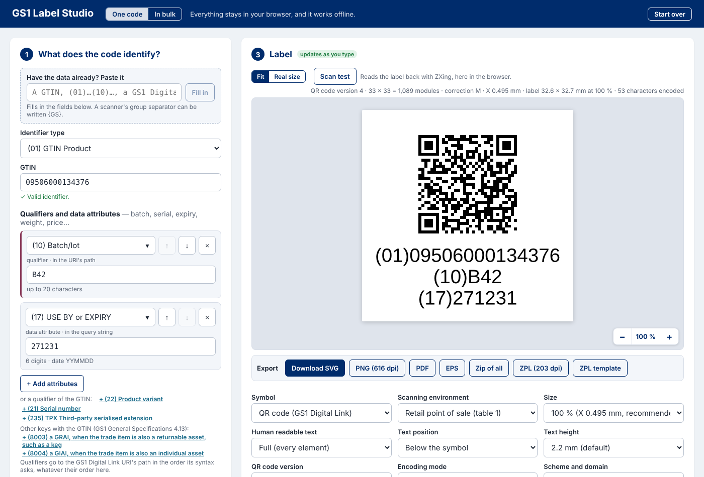

- The header: **One code** or **In bulk** (section 13), and **Start over**, which clears every field and choice as on a
  first visit.
- **1 — What does the code identify?** The key, its qualifiers and data attributes, and the GS1 Digital Link URI's own
  parameters.
- **2 — Where is it scanned?** Questions that choose the symbol specification table and the symbol.
- **3 — Label.** The label, redrawn as you type, its tools over it, the **Export** bar below it, then its options, the
  GS1 Digital Link URI and the element string, and the sections *Printer (ZPL)*, *RFID and NFC (EPC)* and *Digital
  signature (GS1, JWS)*.

The page takes the screen's whole width. On a phone the fields come first, with a small live preview fixed at the top;
tap it to go to the label.

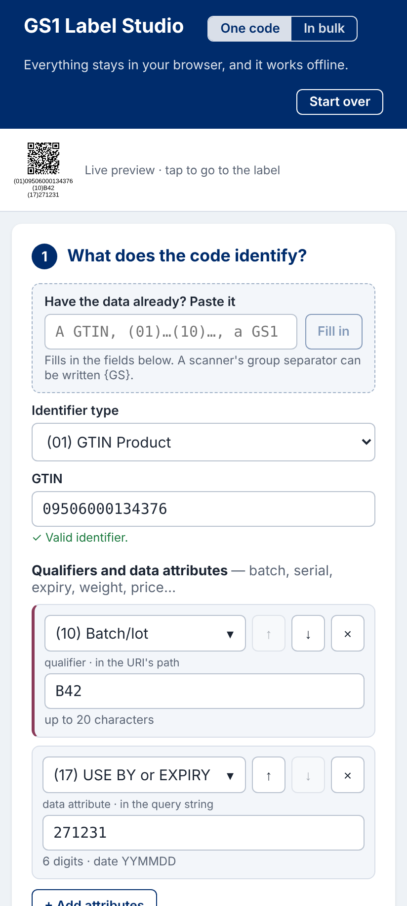

The page follows the system's light or dark theme.

## 3. Step 1 — what the code identifies

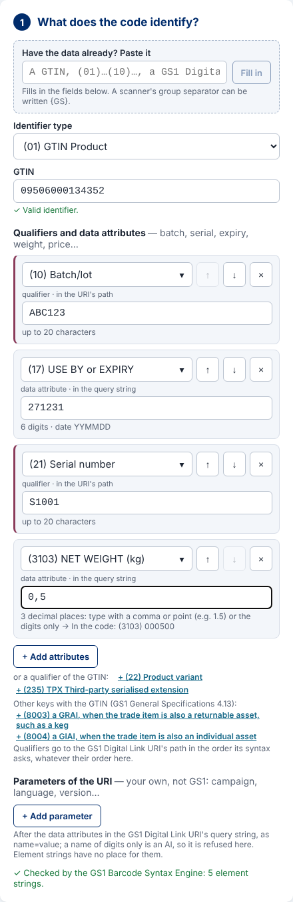

### Paste what you have

**Have the data already? Paste it**, then **Fill in**. It takes:

- a GTIN alone: `9506000134376`;
- an element string with brackets: `(01)09506000134352(10)ABC123(17)271231`;
- an element string without brackets, as a scanner sends it — write the group separator as `{GS}`;
- a scanner's output with its symbology identifier: `]d2010950600013435210ABC123{GS}17271200`;
- a GS1 Digital Link URI: `https://id.gs1.org/01/09506000134376/10/B42?17=271231`, its own parameters included.

The fields below are filled in from it. When something is wrong the engine says what, with the characters at fault
marked:

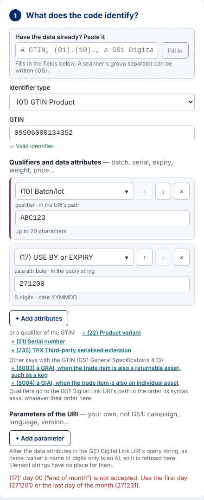

### The key

**Identifier type** lists every GS1 identification key, each as *(AI) abbreviation name* — `(01) GTIN Product`,
`(00) SSCC Logistic unit`, `(414) GLN Physical location`…: the 16 keys a GS1 Digital Link URI can carry, then, under
*In element strings only*, the Made-to-Order GTIN `(03)`, which a URI cannot carry (it is drawn in GS1 DataMatrix when a
URI symbol was chosen).

Type the key's value below. A GTIN may be typed in its own length (8, 12, 13 or 14 digits). The check digit is
checked as you type: *The check digit does not match: it should be 6.*

### Qualifiers and data attributes

One list holds the key's qualifiers (batch, serial number, variant…) and its data attributes (expiry, weight, price…):

- **+ Add attributes** adds a row; its AI field lists the key's qualifiers not yet given first, then every attribute.
  Its arrow always lists every AI; typing filters the list.
- The links beside it add a qualifier of the key at once: *+ (22) Product variant*, *+ (21) Serial number*…
- Each row says where it goes: *qualifier · in the URI's path* (marked on its left edge) or *data attribute · in the
  query string*. Qualifiers go to the URI's path in the order its syntax asks, whatever their order in the list; ↑ and ↓
  move a row, × removes it.
- Each value is checked on its row, with a hint of the format (*6 digits · date YYMMDD*, *up to 20 characters*).
- Decimal attributes take a comma or a point: a net weight of `0,5` kg becomes *(3103) 000500*; the hint shows what goes
  in the code.
- Two qualifiers the key does not take together are said on the row (*Not with (22), (10) and (21): the key takes one
  or the other.*).
- Attributes that only element strings carry — (8014), (8040) to (8043), (8200)… — are offered and marked so.

### Several keys in one symbol

Some keys go together (GS1 General Specifications 4.13): an SSCC with the GTIN of the trade items it contains and their
count, a GTIN that is also a returnable asset. Under the list, *Other keys with the SSCC* (or the GTIN) offers the
pairings the standard allows as links; a row of another key says *another key · in the URI's query string* and has its
check digit checked on the row. Pairs the standard forbids — (01) with (02) or (37), for example — are refused by the
Syntax Engine with its reason.

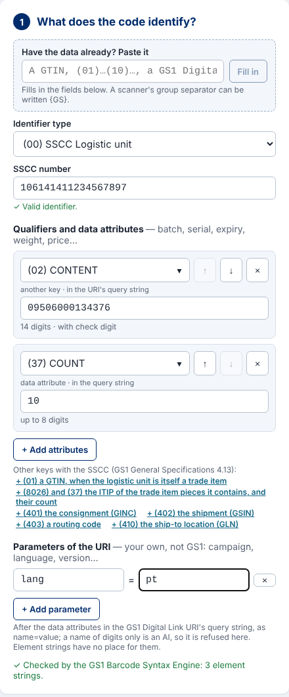

### Parameters of the URI

**Parameters of the URI** — your own, not GS1's: a campaign, a language, a version. **+ Add parameter** adds a
`name = value` row; they are appended to the GS1 Digital Link URI's query string after the data attributes, percent
encoded. A name of digits only is an AI and is refused, as are a missing name and a name given twice. Element strings
have no place for them, so they appear only in URI symbols.

At the bottom of the step: *✓ Checked by the GS1 Barcode Syntax Engine: 5 element strings*, or the engine's message.

## 4. Step 2 — where it is scanned

The studio walks the GS1 General Specifications' decision tree (figure 5-68) one question at a time. The key already
answers some — *The GTIN already answers 2 questions of the tree* — and they are not asked. Answer **Yes** or **No**:
at a general retail point of sale? in general distribution? a regulated healthcare item? a tobacco product under the EU
traceability regulation? marked directly on the item?

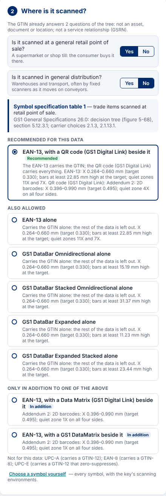

The answer leads to a **symbol specification table** (named, with its sections) and to the choices of section 2 of the
General Specifications for that application:

- **Recommended for this data** — the first symbol the standard lists for that table that carries all your data, or,
  where only the GTIN fits (an EAN-13 at a till), that symbol with a 2D symbol beside it that carries the rest.
- **Also allowed** — the other symbols, each with what it carries, its X-dimension range and its bar height.
- **Only in addition to one of the above** — symbols the standard allows beside another, never alone.
- **Not for this data** — with the reason (*UPC-A carries a GTIN-12*).

Choosing one changes the label at once. At a till, GS1 DataBar Expanded carries everything only for a variable measure
item (a count or a measure that varies, AIs 30, 31nn, 32nn, 35nn, 36nn); otherwise it carries the GTIN alone.

**Choose a symbol yourself** offers every symbol with the key's scanning environments instead, starting from the
guided choice; **Change in step 2** goes back.

## 5. Step 3 — the label

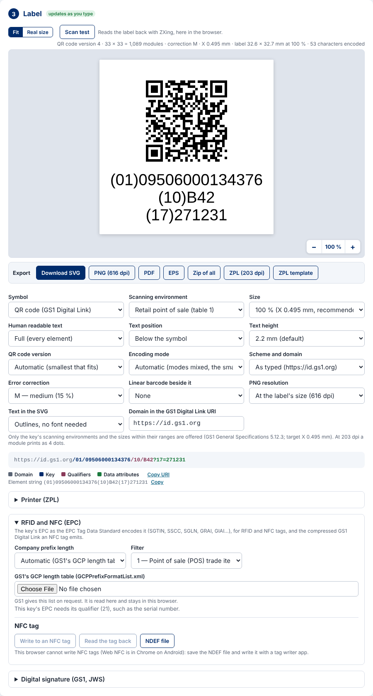

- The **caption** over the label says what is drawn: the symbol, its version or rows × columns and modules (or its width
  from the first bar to the last), the error correction, the X-dimension, the label's size at the chosen size, and the
  characters encoded — FNC1 and group separators included.
- The **canvas** shows the label fitted to its area. − and + at its lower right corner zoom from 25 % to 400 %; the
  figure between them goes back to 100 %.
- **Fit** or **Real size**, and **Scan test** (section 7).
- The **Export** bar (section 8) and, in bulk, **Generate in bulk** (section 15).
- Under the options: the GS1 Digital Link URI coloured by part — domain, key, qualifiers, data attributes — with **Copy
  URI**, and the element string with **Copy**.

The symbols are drawn as the General Specifications lay them out: an EAN/UPC with its guard bars and digits, ITF-14 with
its bearer bars and its 14 digits, GS1-128 with its element strings below, the 2D symbols with their quiet zone and
their text.

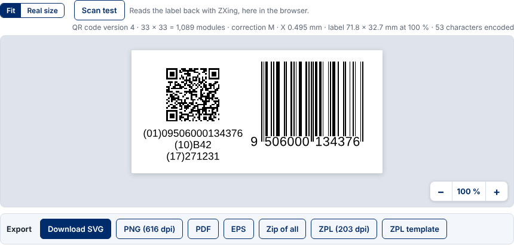

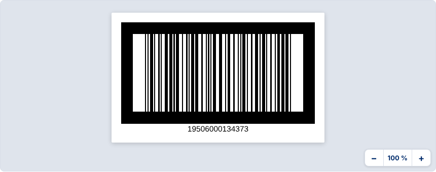

When the data of a GS1-128 passes 48 data characters, or the symbol would pass 165.10 mm with its quiet zones, the
element strings go in as many GS1-128 symbols as needed, in order, the key in the first, stacked on the left a quiet
zone apart, each with its own text:

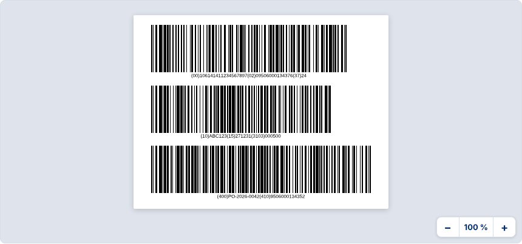

The box **GS1-128 symbols** under the options lists the element strings: tick *new symbol* to start a symbol where you
choose; **Automatic** goes back.

## 6. The label's options

Only the choices that apply to the symbol are shown.

| Option | What it does |
|---|---|
| Symbol | Shown when you chose the symbol yourself; otherwise step 2's choice is named, with *Change in step 2* |
| Scanning environment | The key's symbol specification tables (when you chose the symbol yourself) |
| Size | The X-dimension, from the table's minimum to its maximum; the target marked *recommended* |
| Human readable text | Full (every element string), the identification key only, or none |
| Text position | Below the symbol (the default), above it, key below and attributes above, left or right of it (an element string a line, never broken); beside an EAN/UPC a 2D symbol's text goes below or above |
| Text height | From 2.0 mm (the minimum) to 5.0 mm; 2.2 mm by default; 3.0 mm is what the GS1 Logistic Label asks |
| QR code version | Automatic (the smallest that fits) or 1 to 40; refused when the data does not fit |
| Encoding mode | QR code: automatic (modes mixed, the smallest symbol), or numeric, alphanumeric or byte for the whole data; a character the mode cannot take is named |
| Scheme and domain | As typed, or in capitals (`HTTPS://ID.GS1.ORG`), which lets alphanumeric mode encode the URI's start; the path and the query stay as typed |
| Error correction | QR code: L (7 %), M (15 %), Q (25 %), H (30 %) |
| Linear barcode beside it | An EAN-13, UPC-A or EAN-8 as the GTIN takes, or UPC-E, beside a 2D symbol |
| Bearer bars | ITF-14: a frame (suits every printing method) or bars of 2X at the top and bottom |
| Bar width reduction | Linear symbols: 0.010 to 0.050 mm taken off every bar, for printing that spreads ink |
| PNG resolution | At the label's size (12 pixels a module), or 300, 600 or 1200 dpi with a whole number of pixels a module, the X-dimension it prints at said |
| Text in the SVG | Outlines (no font needed) or real text, editable but needing Liberation Sans and OCR-B where it is printed |
| Domain in the GS1 Digital Link URI | `https://id.gs1.org` by default; your resolver's domain |
| Label | For an SSCC: the symbol alone, or the GS1 Logistic Label (section 9) |

The hint under the options says the table and its section, and how many dots a module takes at the printer's resolution
(section 10).

## 7. Seeing it at real size, and the scan test

**Real size** draws the label at 1:1 between rulers in millimetres. A screen's pixels are not all the same size, so
calibrate it once: **Calibrate the screen**, hold the short side of a bank card (53.98 mm) against the screen and move
the slider — or − and + for half a pixel — until the bar is as long as the card. The calibration is kept in this
browser; **Reset** forgets it.

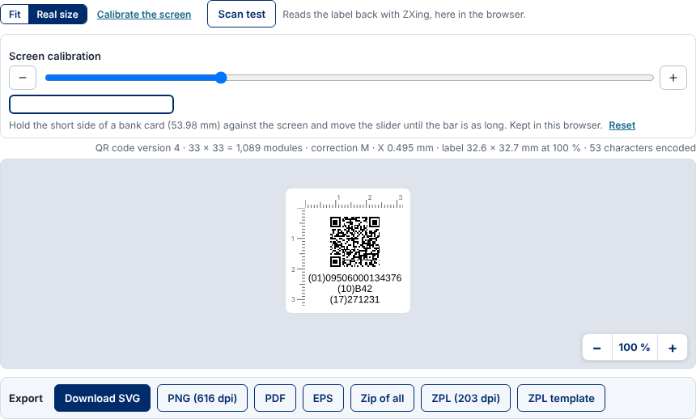

**Scan test** draws the label as the SVG would print it and reads it back with ZXing, here in the browser, comparing
each symbol's symbology identifier and data with what the label should carry:

*✓ Read as intended: ]Q1 https://id.gs1.org/01/…* — or what was read instead. Nothing is sent anywhere: the reader comes
with the page.

## 8. Exporting the label

| Button | File |
|---|---|
| Download SVG | Vector, at real size in millimetres; the text as outlines or as text (option *Text in the SVG*) |
| PNG | At the label's size (12 pixels a module) or at the resolution chosen; its dpi recorded in the file |
| PDF | One page the size of the label, vector, the text as outlines, in process black (100 % K) |
| EPS | The PDF's drawing in PostScript, for prepress |
| Zip of all | SVG, PNG, PDF and EPS with a README of the data, the symbol, its sizes and how to print it |
| ZPL (203 dpi) | The label in ZPL II with the printer's own commands, for the printer profile chosen (section 10) |
| ZPL template | The same ZPL with `{{01}}`, `{{10}}`… or `{{URI}}` where the values go, each described in a comment at the top |

Files are named after the symbol, the key and its qualifiers: `gs1-128_00_106141411234567897.zpl`. What ZPL cannot print
correctly is refused with the reason, never printed wrong (section 16). How to use each file: the
[printing guide](printing-guide.md).

## 9. The GS1 Logistic Label

For an SSCC, **Label** offers the GS1 Logistic Label (General Specifications 6.6) in A6 (105 × 148 mm), 4 × 6 in, A5
(148 × 210 mm) or 6 × 8 in. **From** and **To** take who sends and who receives it.

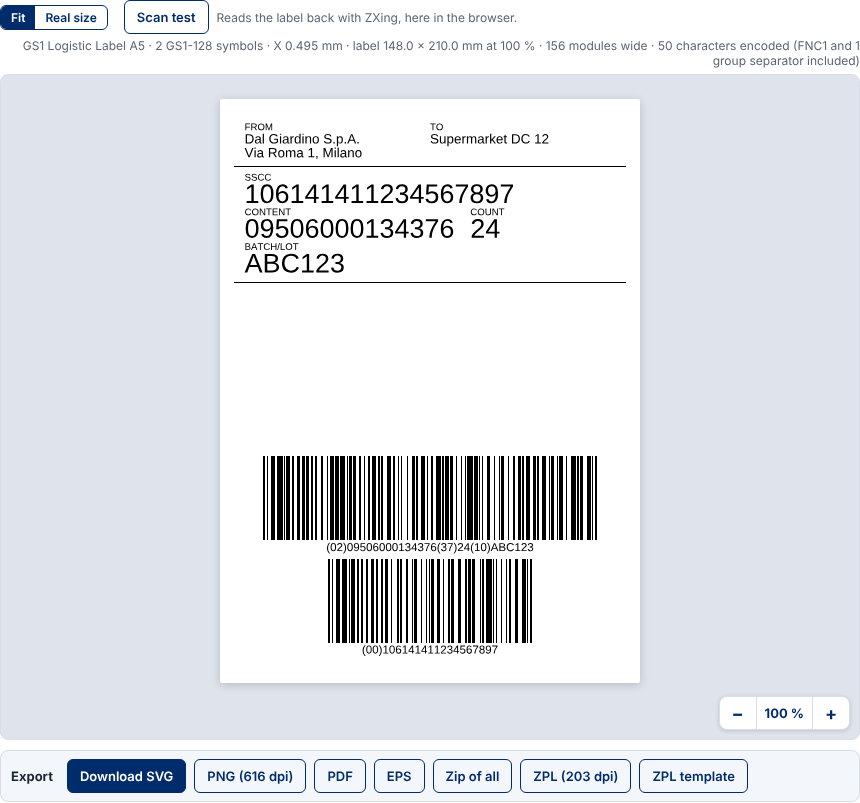

- The top block: the free text, 3.5 mm high.
- The middle block: each element string's data title (SSCC, CONTENT, COUNT, BATCH/LOT…) above its content, 7 mm high.
- The bottom block: the GS1-128 symbols with their 3 mm text, the SSCC alone in the lowest, the rest split as they fit
  the page's width.

A page too short for its symbols is refused with its height. The label exports as SVG, PNG, PDF and EPS and in bulk;
not yet in ZPL (its PDF prints it at its size). A 2D symbol beside the middle block and data titles in a second language
are not there yet.

## 10. Printer (ZPL)

A thermal printer prints whole dots, so a module must be a whole number of dots or the symbol degrades. **Printer
(ZPL)** sets the printer the ZPL files are for:

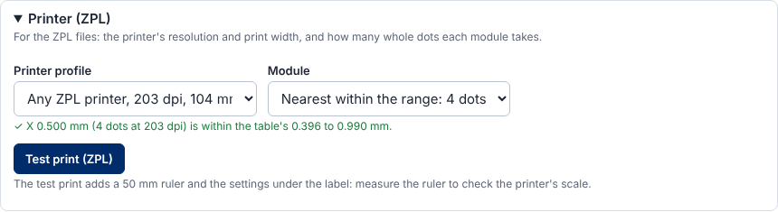

- **Printer profile**: *Any ZPL printer* at 152, 203, 300, 406 or 600 dpi, 104 mm wide, or your own — **New profile…**
  takes a name, the resolution (100 to 1200 dpi) and the print width (10 to 500 mm); **Edit profile** changes it. Your
  profiles are kept in this browser.
- **Module**: the whole numbers of dots within the table's X-dimension range, the nearest to the label's size by
  default; the X-dimension printed is said (*✓ X 0.500 mm (4 dots at 203 dpi) is within the table's 0.396 to 0.990
  mm*), or that no whole number of dots fits.
- A label wider than the printer prints is refused.
- **Test print (ZPL)** adds a 50 mm ruler with a tick every 10 mm and the settings under the label: print it and measure
  the ruler to check the printer's scale.

The ZPL buttons of the Export bar and the bulk ZPL file use the same profile and dots.

## 11. RFID and NFC (EPC), and NFC tags

**RFID and NFC (EPC)** gives the key's EPC as the EPC Tag Data Standard 2.3 encodes it, for every key that has a scheme
(SGTIN, SSCC, SGLN, GRAI, GIAI, GSRN, GSRNP, GDTI, SGCN, CPI, ITIP):

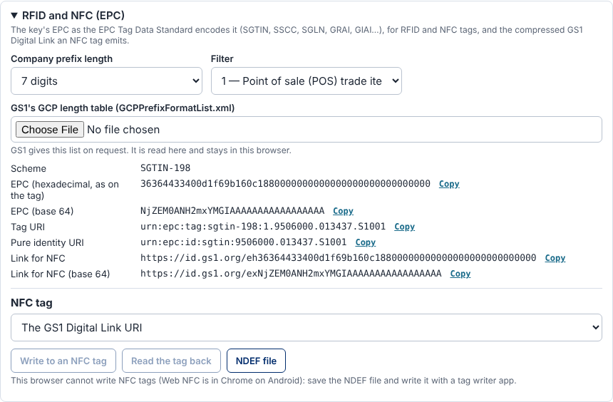

- **Company prefix length**: chosen, or *Automatic* from GS1's GCP length table (`GCPPrefixFormatList.xml`, which GS1
  gives on request): load it once, it is read here and kept in this browser.
- **Filter**: the EPC filter value (1 for a point-of-sale trade item…).
- The scheme, the EPC in hexadecimal as on the tag (filled to 16-bit words), in base 64, the tag URI, the pure identity
  URI and the links for NFC (`/eh…` and `/ex…` on your domain), each with **Copy**.
- A key that needs a qualifier for its EPC says so (*This key's EPC needs its qualifier (21), such as the serial
  number.*).

**NFC tag** writes the GS1 Digital Link URI, or the EPC's link for NFC, to an NFC tag as an NDEF URI record:

- **Write to an NFC tag**, then **Read the tag back** to check it holds that URI. This needs Web NFC, which only Chrome on
  Android has; hold the tag to the phone when asked.
- Elsewhere, **NDEF file** saves the NDEF message (NFC Forum URI record, the prefix abbreviated) for a tag writer app.

## 12. Digital signature (GS1, JWS)

Signs the code's data as the GS1 Digital Signatures Technical Implementation Guideline 1.1.0 (section 4) describes: a
JSON Web Signature you publish where your resolver's link type `gs1:jws` points, with your public key.

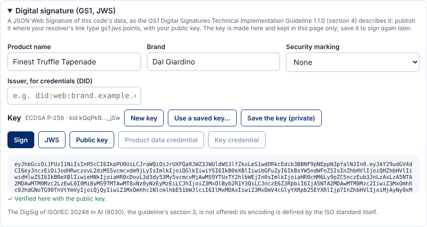

1. Fill in **Product name** and **Brand** if you want them in the signed data (the key, serial, batch and dates come
   from step 1).
2. Optionally a **Security marking** — hologram, microprinting, UV ink or watermark — with **Where to look**, its **Code
   pattern** (a regular expression the code must match) and **The code in the signature**: *shown*, to compare with the
   marking (the guideline's workflow 2), or *taken out*, to be read from the marking (workflow 3).
3. **New key** makes an ECDSA P-256 key in the page (its RFC 7638 thumbprint as its *kid*), or **Use a saved key…**
   takes one you saved. **Save the key (private)** downloads it as a JWK: keep it safe; the page does not keep it.
4. **Sign** writes the JWS and verifies it with the public key before offering it: *✓ Verified here with the public
  key.* **JWS** and **Public key** (a JWK set) download them.
5. With an **Issuer, for credentials (DID)**, such as `did:web:brand.example.com`, **Product data credential** and
   **Key credential** download the GS1 verifiable credentials (data model 1.2.1) as JWTs.

The DigSig of ISO/IEC 20248 in AI (8030), the guideline's section 3, is not offered: its encoding is defined by the ISO
standard itself.

## 13. In bulk: rows from a spreadsheet

**In bulk** in the header turns step 1 into **Rows**; steps 2 and 3 stay as they are, so the label is designed once and
its preview steps through the rows.

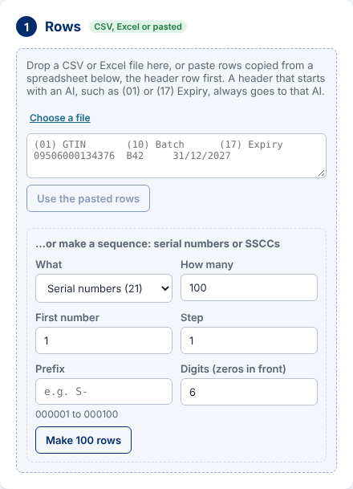

1. **Drop a CSV or Excel file**, **Choose a file**, or paste rows copied from a spreadsheet (the header row first) and
   **Use the pasted rows**. CSV with comma, semicolon or tab; Excel's first worksheet (`.xlsx`).
2. Each column's AI is guessed from its header — an AI (`(01)`, `(17) Expiry` always go to that AI), a GS1 data title,
   or a common word in English, Portuguese or Spanish (*Lote*, *Validade*, *Código de barras*). Change it under **Goes
   to**. Dates become YYMMDD from ISO and day-first forms (`31/12/2027 → 271231`).
3. **Same value on every row** → **+ Add**: an AI with the same value on every row, such as a country of origin (422).
4. The rows are checked at once: *2 rows ready · 2 with errors*.

The columns chosen are remembered, in this browser, for files with the same headers.

Over the label, the row navigation steps through the rows: *Row 3 · 2 of 4 · fixed*.

## 14. In bulk: the validation report

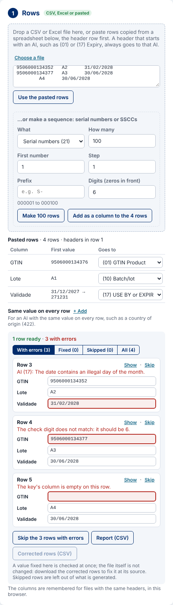

- The filters: **With errors**, **Fixed**, **Skipped**, **All**, with their counts.
- Each row in error shows its reason and its cells, the one at fault outlined. Fix it in place: the value is checked at
  once and the row becomes *fixed*. The file itself is not changed.
- **Show** shows the row's label; **Skip** leaves it out of what is generated; **Include** takes it back; **Undo the
  fixes** brings back the file's values.
- **Skip the N rows with errors** skips them together.
- **Report (CSV)** downloads every row with its status, reason, the columns at fault and what was fixed;
  **Corrected rows (CSV)** downloads the rows with your fixes, to correct the file at its source.
- A hint when Excel kept only 15 digits of a long code (an SSCC typed as a number) or a CSV wrote it in scientific
  notation: format that column as text.

## 15. In bulk: sequences and generating every label

### Making a sequence

**…or make a sequence** makes serial numbers or SSCCs:

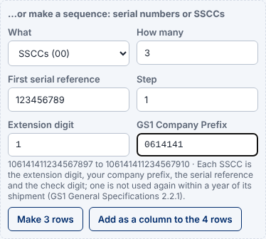

- **Serial numbers (21)**: how many, the first number, the step, a prefix and the digits (zeros in front);
  `S-000001` to `S-000100`. What AI (21) cannot hold — a character outside its set, more than 20 characters — is
  refused.
- **SSCCs (00)**: how many, the extension digit, the GS1 Company Prefix (4 to 12 digits) and the first serial reference;
  the check digits are computed. A serial reference that does not fit is refused.
- **Make N rows** makes rows of their own; **Add as a column to the N rows** adds the sequence to the rows loaded,
  keeping their fixes and skips. At most 100,000 rows.

### Generate in bulk

Under the Export bar, **Generate in bulk** draws the label shown, with its options, for every row ready or fixed:

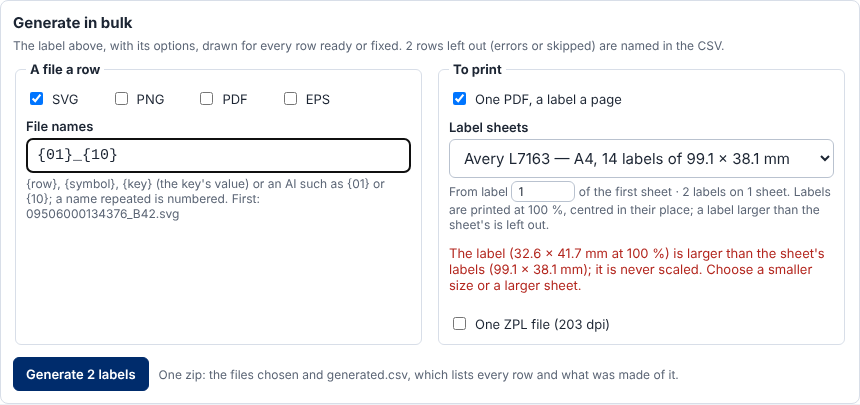

- **A file a row**: SVG, PNG, PDF and/or EPS, named by **File names** — `{row}`, `{symbol}`, `{key}` or any AI such as
  `{01}` or `{10}`; a name repeated is numbered. The first name is shown.
- **To print**: **One PDF, a label a page**; **Label sheets** — Avery L7160, L7163, L7651, 5160 or a **Custom sheet…**
  (page, label size, columns × rows, margins and pitch) — each label at 100 % centred in its place, starting from any
  label of the first sheet. A label larger than the sheet's labels is said before generating; labels are never scaled.
  **One ZPL file** with every label, for the printer profile chosen.
- **Generate N labels** makes one zip with the files chosen and `generated.csv`, which lists every row and what was
  made of it, or why nothing was. Rows in error or skipped are left out and named there.

Generation runs in the background with a progress bar and **Cancel**; the page stays usable meanwhile. A thousand QR
code labels as SVG and one PDF took 10.7 s when measured ([performance targets](metrics/README.md#performance-targets-backlog-25)).

## 16. Messages and what to do

| Message (or its start) | Why | What to do |
|---|---|---|
| *The check digit does not match: it should be N.* | A digit is mistyped, or the last digit is not the check digit | Correct the value; the studio computes the check digit for a sequence |
| The engine's message, characters marked (*day 00*, *illegal day of the month*) | The value breaks the AI's format | Correct what is marked |
| *Qualifiers (22) and (235) cannot be used together* | The key takes one set of qualifiers or the other | Remove one |
| *It is invalid to pair AI (01) with AI (37)* (or another pair) | The General Specifications forbid the pair (4.13) | Keep the keys the pairing allows |
| A value with `(` refused | The barcode encoder cannot take it yet | Use another character |
| *EAN-13 carries a GTIN-13…*, *UPC-E carries a GTIN-12…* | The symbol cannot carry that GTIN | Choose the symbol step 2 recommends |
| The data does not fit the QR version chosen | Too much data for that version and level | Choose *Automatic*, a larger version or a lower level |
| *The parameter "…" is given twice*, a name of digits | Parameters of the URI need unique, non-numeric names | Rename it |
| *…mm wide; … prints 104 mm* | The label is wider than the printer prints | A smaller size, a fewer-dot module, or another profile |
| *The label (… mm) is larger than the sheet's labels* | Labels are never scaled | A smaller size or a sheet with larger labels |
| *ZPL places the text below or above the symbol* | ZPL refuses text left or right (the printer's font sets its width) | Text below or above for ZPL; the PDF keeps it beside |
| *ZPL writes the QR code in the printer's automatic mode* | One QR mode could not be shown to print in ZPL | Automatic mode for ZPL; the PDF keeps the mode |
| *^BR prints … at 1 to 10 dots a module* | GS1 DataBar in ZPL at this size | Another size, or the PDF |
| GS1 DataBar refused in ZPL at a till (tables 1 and 3) | `^BR` prints a fixed height, below what the table asks | Print the PDF |
| *The GS1 Logistic Label is not written in ZPL yet* | Not done yet | Print its PDF at its size |
| *the A6 label is 148 mm high* (too short) | The page cannot hold its symbols | A larger page (A5, 6 × 8 in) |
| *Not a name the pattern knows: {…}* | A file name pattern with an unknown name | `{row}`, `{symbol}`, `{key}` or an AI |

## 17. Glossary

| Term | Meaning |
|---|---|
| AI | Application Identifier: the number in brackets that says what a value is — (01) GTIN, (10) batch, (17) expiry |
| Element string | An AI and its value; several make the data of GS1-128, GS1 DataMatrix or GS1 DataBar Expanded |
| GS1 Digital Link URI | A web address that carries the same data, such as `https://id.gs1.org/01/09506000134376/10/B42`; what the QR code and Data Matrix with a GS1 Digital Link carry |
| Key | The identification key: GTIN, SSCC, GLN, GRAI, GIAI… |
| Qualifier | A value that refines the key in the URI's path: batch, serial number, variant |
| Data attribute | Further data: expiry, weight, price; in the URI's query string |
| Symbol specification table | The table of the General Specifications (5.12.3) that sets the symbols, sizes and quality where a code is scanned |
| X-dimension | The width of the narrowest bar or of a module |
| Module | The smallest element of a symbol: a narrow bar, or a square of a 2D symbol |
| Quiet zone | The empty margin a symbol needs around it |
| HRI | Human readable interpretation: the text under or beside the symbol |
| FNC1 | The character that marks a GS1 symbol and separates element strings of no fixed length |
| Bearer bars | The frame or bars around an ITF-14 |
| EPC | Electronic Product Code: the key as an RFID tag encodes it |
| NDEF | The message format of NFC tags |
| JWS, JWK | JSON Web Signature, JSON Web Key |
| ZPL | Zebra Programming Language, the printer language of Zebra printers and many others |
| dpi | Dots per inch: a printer's resolution |
