# GS1 Label Studio — user guide

How to make GS1 barcodes and labels with the studio, step by step: one code at a time or thousands from a
spreadsheet, as files for artwork or as print files for label printers. The studio is at
<https://ricardomelo.github.io/gs1-label-studio/>; it runs in your browser, and nothing you type or load leaves your
computer.

Every feature named here is listed in [features.md](features.md) with the tests that prove it. How to send the files to
a printer or to prepress: the [printing guide](printing-guide.md). The words used: the [glossary](#17-glossary).

## Contents

1. [What the studio does](#1-what-the-studio-does)
2. [The screen at a glance](#2-the-screen-at-a-glance)
3. [Step 1 — what the code identifies](#3-step-1--what-the-code-identifies)
4. [Step 2 — where it is scanned](#4-step-2--where-it-is-scanned)
5. [Step 3 — the label](#5-step-3--the-label)
6. [The label's options](#6-the-labels-options)
7. [Seeing it at real size, and the scan test](#7-seeing-it-at-real-size-and-the-scan-test)
8. [Exporting the label](#8-exporting-the-label)
9. [The GS1 Logistic Label](#9-the-gs1-logistic-label)
10. [Printer (ZPL, TSPL, EPL2, DPL)](#10-printer-zpl-tspl-epl2-dpl)
11. [RFID and NFC (EPC), and NFC tags](#11-rfid-and-nfc-epc-and-nfc-tags)
12. [Digital signature (GS1, JWS)](#12-digital-signature-gs1-jws)
13. [In bulk: rows from a spreadsheet](#13-in-bulk-rows-from-a-spreadsheet)
14. [In bulk: the validation report](#14-in-bulk-the-validation-report)
15. [In bulk: sequences and generating every label](#15-in-bulk-sequences-and-generating-every-label)
16. [Messages and what to do](#16-messages-and-what-to-do)
17. [Glossary](#17-glossary)

## 1. What the studio does

- **Right by construction.** You say what the code identifies and where it is scanned; the studio follows the GS1
  General Specifications (release 26.0) to the symbol specification table, offers only the symbols that table allows
  and only the sizes within its range, recommends one, computes or checks every check digit, and places quiet zones and
  human readable text where the standard puts them.
- **Paste anything.** A GTIN, an element string with or without brackets, a GS1 Digital Link URI or what a barcode
  scanner types: the GS1 Barcode Syntax Engine — GS1's own — recognises it, names each Application Identifier (AI) and
  explains what is wrong in plain words.
- **Every GS1 symbol it can check.** EAN-13, EAN-8, UPC-A, UPC-E, ITF-14, GS1-128 (over several symbols when the data
  is long), the GS1 DataBar family, GS1 DataMatrix, and the QR code and Data Matrix with a GS1 Digital Link URI; every
  symbol is read back by an independent decoder in the tests. GS1 DotCode is named but not drawn (no decoder is
  available to check it), and GS1 QR Code is not offered (beside the QR code with a GS1 Digital Link URI it confuses;
  [ADR 0003](adr/0003-product-scope-and-ux.md)).
- **Files for artwork and for printers.** SVG, PNG, PDF and EPS at real size, a zip of all, and ZPL II, TSPL, EPL2
  and DPL with the printer's own commands (ZPL also as a template with placeholders).
- **Labels.** The GS1 Logistic Label for an SSCC, and a label of your own: barcodes, text with fields from the data,
  lines, boxes and images placed, turned and resized (section 5). The work is saved as a file and opened again
  (section 8), and the last one is offered again on your next visit.
- **In bulk.** Rows from CSV, Excel or a paste; each row checked, fixed or skipped; serial numbers and SSCCs made for
  you; a file a row, one PDF, laser label sheets, one ZPL file and a CSV of what was made.
- **RFID, NFC and signatures.** The EPC of the key for RFID and NFC tags, an NFC tag written from a phone, and a GS1
  digital signature of the code's data.
- **Private and offline.** Everything runs in the page. After the first visit the studio works without a connection,
  and it can be installed as an application from the browser's menu.

The studio speaks English, Brazilian Portuguese, Spanish, French, German and Italian (section 2); this guide is in
English.

## 2. The screen at a glance

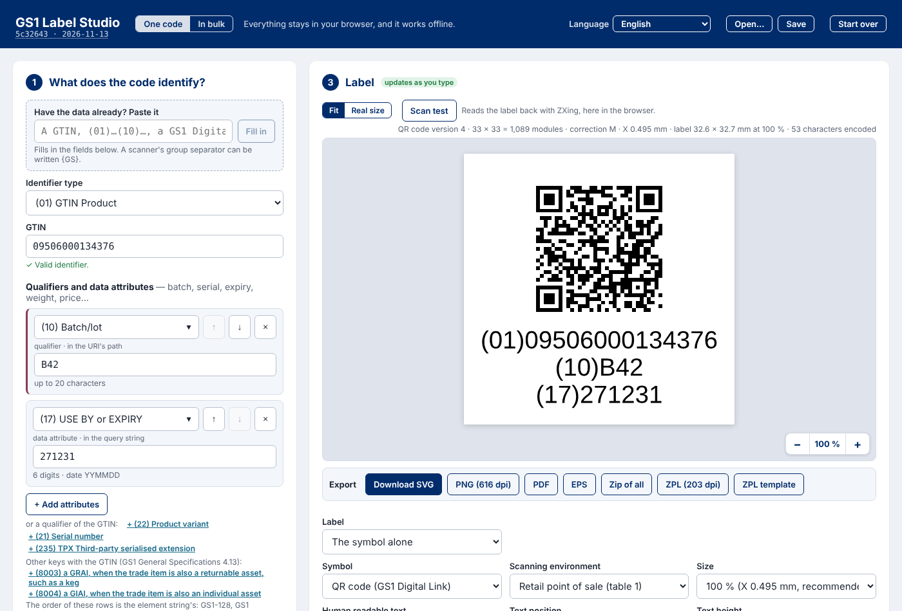

- The header: **One code** or **In bulk** (section 13), **Language**, **Open…** and **Save** (the work kept as a file
  on your computer, section 8), and **Start over**, which clears every field and choice as on a first visit (on a
  phone, Language, Open… and Save are under **More** and Start over is a round icon beside the live preview).
- **1 — What does the code identify?** The key, its qualifiers and data attributes, and the GS1 Digital Link URI's own
  parameters.
- **2 — Where is it scanned?** Questions that choose the symbol specification table and the symbol.
- **3 — Label.** The label, redrawn as you type, its tools over it, the **Export** bar below it, then its options, the
  GS1 Digital Link URI and the element string, and the sections *Printer (ZPL, TSPL, EPL2, DPL)*, *RFID and NFC (EPC)* and *Digital
  signature (GS1, JWS)*.

On a computer the page takes the screen's whole width, as above. At its foot, **About GS1 Label Studio**: the
repository on GitHub, the licence (Apache 2.0), links to this guide and the printing guide, the version published (the
commit it was built from, with its date — the way to tell whether the page shows the latest work), and the software it
is made with, each linked to its repository; the GS1 Barcode Syntax Engine with the release that checks the data and the
date of its GS1 Barcode Syntax Dictionary (*GS1 Barcode Syntax Engine 1.4.1 — … · GS1 Barcode Syntax Dictionary of
2026-01-27*).

### On a phone

A phone — and a tablet held upright, or a narrow window — shows one column and one part at a time, chosen in the tab
bar at the bottom, as phone apps do:

| Tab | What it shows |
|---|---|
| **Data** | step 1 (or the rows, in bulk), with a small live preview at the top: tap it to open the label |
| **Scan** | step 2, where the code is scanned |
| **Label** | the label, its tools and its options |
| **Export** | the downloads, *Generate in bulk* and *Printer (ZPL, TSPL, EPL2, DPL)* |
| **More** | **Language**, **Install the app**, *RFID and NFC (EPC)*, *Digital signature* and About |

Each tab keeps where it was scrolled to. A link to another part — *Change in step 2* under the label's options, or the
live preview — opens its tab. A red dot on **Data** says the data has an error; on **Label**, that the label cannot be
drawn. The header keeps the name and **One code / In bulk**; **Start over** is the round reload icon at the right of the
live preview's bar.

**Install the app** puts the studio on the home screen, where it opens without the browser's bars and works offline, under
the name *GS1 Label Studio*. Chrome, Edge and Samsung Internet show their install dialog; on an iPhone or iPad the button
says how: Share, then *Add to Home Screen*; other browsers install from their menu. Once installed, the button says so.
On a tablet the button is under **More** too.

  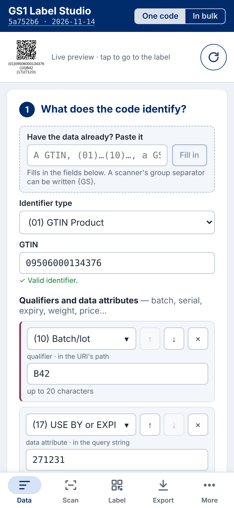
  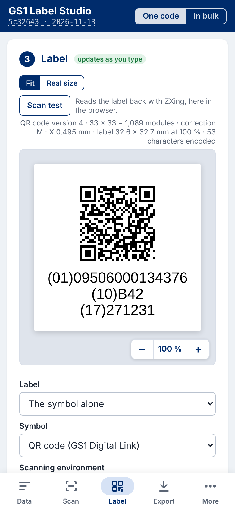
  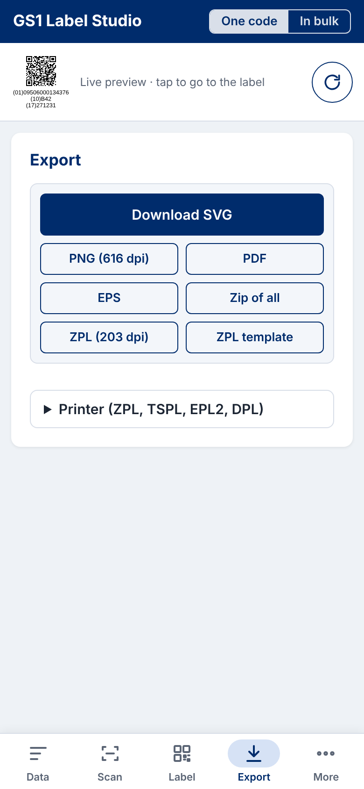
  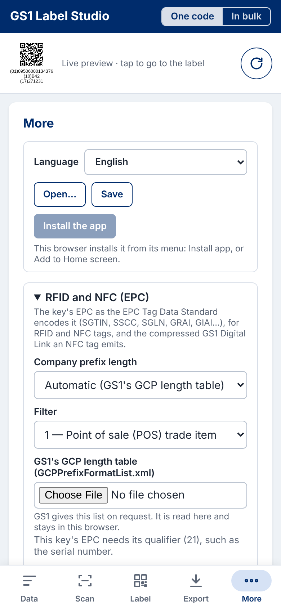

### On a tablet held horizontally

A rail on the left holds the same five parts; the part chosen is on the left and the label, with its tools and the
**Export** bar, always on the right, redrawn as you type. Turning the tablet changes the layout and keeps what you
typed.

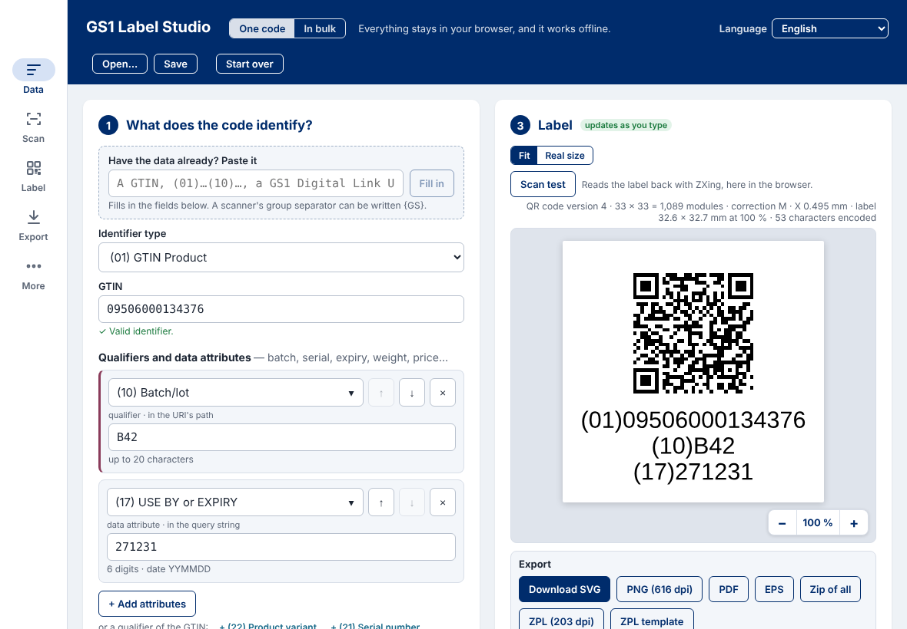

The page follows the system's light or dark theme.

**Language**: English, Português (Brasil), Español, Français, Deutsch or Italiano. The studio opens in the browser's
language (Portuguese for any Portuguese, and likewise Spanish, French, German and Italian; English otherwise) and
remembers the choice in this browser. Changing it redraws the page at once, keeping what you typed; the messages of the
GS1 Barcode Syntax Engine are translated too. The data titles of the AIs are Portuguese names in Portuguese, and GS1's
English ones in the other languages. The files the studio makes —
the README in the zip, the CSVs, the notes of a test print — stay in English.

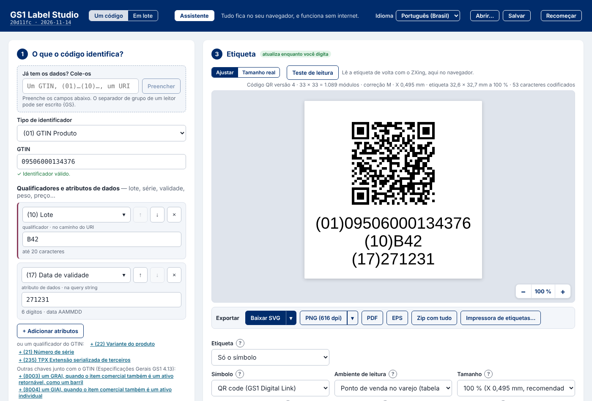

## 3. Step 1 — what the code identifies

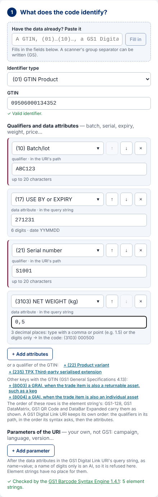

### Paste what you have

**Have the data already? Paste it**, then **Fill in**. It takes:

- a GTIN alone: `9506000134376`;
- an element string with brackets: `(01)09506000134352(10)ABC123(17)271231`;
- an element string without brackets, as a scanner sends it — write the group separator as `{GS}`;
- a scanner's output with its symbology identifier: `]d2010950600013435210ABC123{GS}17271200`;
- a GS1 Digital Link URI: `https://id.gs1.org/01/09506000134376/10/B42?17=271231`, its own parameters included.

The fields below are filled in from it. When something is wrong the engine says what, with the characters at fault
marked:

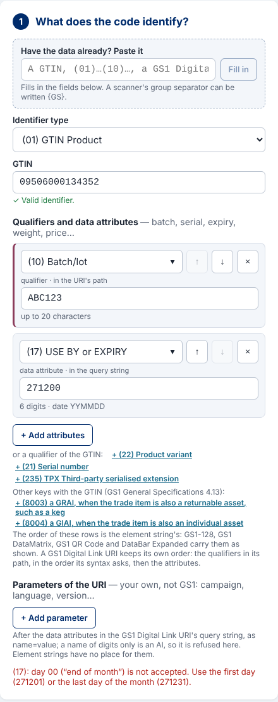

### The key

**Identifier type** lists every GS1 identification key, each as *(AI) abbreviation name* — `(01) GTIN Product`,
`(00) SSCC Logistic unit`, `(414) GLN Physical location`…: the 16 keys a GS1 Digital Link URI can carry, then, under
*In element strings only*, the Made-to-Order GTIN `(03)`, which a URI cannot carry (it is drawn in GS1 DataMatrix when a
URI symbol was chosen).

Type the key's value below. A GTIN may be typed in its own length (8, 12, 13 or 14 digits). The check digit is
checked as you type: *The check digit does not match: it should be 6.*

### Qualifiers and data attributes

One list holds the key's qualifiers (batch, serial number, variant…) and its data attributes (expiry, weight, price…):

- **+ Add attributes** adds a row; its AI field lists the key's qualifiers not yet given first, then every attribute.
  Its arrow always lists every AI; typing filters the list.
- The links beside it add a qualifier of the key at once: *+ (22) Product variant*, *+ (21) Serial number*…
- Each row says where it goes: *qualifier · in the URI's path* (marked on its left edge) or *data attribute · in the
  query string*. Qualifiers go to the URI's path in the order its syntax asks, whatever their order in the list; ↑ and ↓
  move a row, × removes it.
- Each value is checked on its row, with a hint of the format (*6 digits · date YYMMDD*, *up to 20 characters*).
- Decimal attributes take a comma or a point: a net weight of `0,5` kg becomes *(3103) 000500*; the hint shows what goes
  in the code.
- Names and addresses are typed as people write them: a patient's (7253) family name or (7254) given name, a ship-to
  address (4300)–(4320) take their spaces and accents as %XX in the code, and the tool writes them so — *Maria José*
  becomes *(7254) Maria%20Jos%C3%A9*, which the hint shows; %XX already written is kept. A pasted name is shown as
  people read it (*Jo%C3%A3o* → *João*), and a `{7254}` field on a label of one's own shows it as written.
- A patient's sex, (7252), is ISO/IEC 5218's digit — 0 not known, 1 male, 2 female, 9 not applicable — and may be
  typed as a word in any of the six languages: *Feminino*, *female*, *weiblich* become *(7252) 2*, which the hint shows.
  A letter such as *M* or *F* is refused, as M is male in English and Portuguese but female (*mujer*) in Spanish.
- Two qualifiers the key does not take together are said on the row (*Not with (22), (10) and (21): the key takes one
  or the other.*).
- Attributes that only element strings carry — (8014), (8040) to (8043), (8200)… — are offered and marked so.

### Several keys in one symbol

Some keys go together (GS1 General Specifications 4.13): an SSCC with the GTIN of the trade items it contains and their
count, a GTIN that is also a returnable asset. Under the list, *Other keys with the SSCC* (or the GTIN) offers the
pairings the standard allows as links; a row of another key says *another key · in the URI's query string* and has its
check digit checked on the row. Pairs the standard forbids — (01) with (02) or (37), for example — are refused by the
Syntax Engine with its reason.

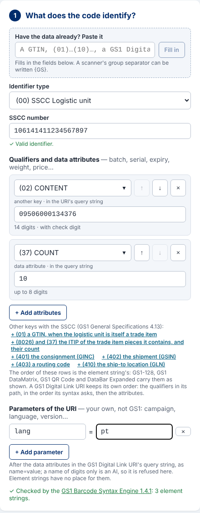

### Parameters of the URI

**Parameters of the URI** — your own, not GS1's: a campaign, a language, a version. **+ Add parameter** adds a
`name = value` row; they are appended to the GS1 Digital Link URI's query string after the data attributes, percent
encoded. A name of digits only is an AI and is refused, as are a missing name and a name given twice. Element strings
have no place for them, so they appear only in URI symbols.

At the bottom of the step: *✓ Checked by the GS1 Barcode Syntax Engine 1.4.1: 5 element strings*, or the engine's
message. The engine's name, with the release that checked the data, links to that release's notes on GitHub; the files
made name it too (section 8).

## 4. Step 2 — where it is scanned

The studio walks the GS1 General Specifications' decision tree (figure 5-68) one question at a time. The key already
answers some — *The GTIN already answers 2 questions of the tree* — and they are not asked. Answer **Yes** or **No**:
at a general retail point of sale? in general distribution? a regulated healthcare item? a tobacco product under the EU
traceability regulation? marked directly on the item?

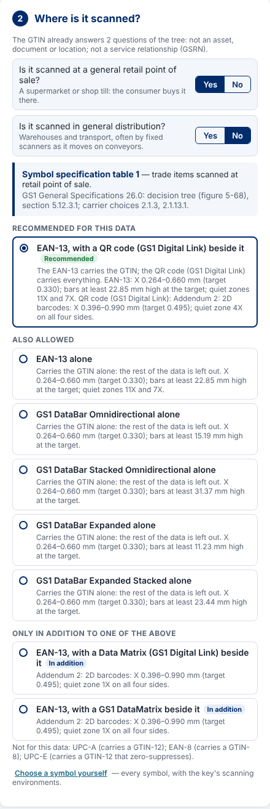

The answer leads to a **symbol specification table** (named, with its sections) and to the choices of section 2 of the
General Specifications for that application:

- **Recommended for this data** — the first symbol the standard lists for that table that carries all your data, or,
  where only the GTIN fits (an EAN-13 at a till), that symbol with a 2D symbol beside it that carries the rest.
- **Also allowed** — the other symbols, each with what it carries, its X-dimension range and its bar height.
- **Only in addition to one of the above** — symbols the standard allows beside another, never alone.
- **Not for this data** — with the reason (*UPC-A carries a GTIN-12*).

Choosing one changes the label at once. At a till, GS1 DataBar Expanded carries everything only for a variable measure
item (a count or a measure that varies, AIs 30, 31nn, 32nn, 35nn, 36nn); otherwise it carries the GTIN alone.

**Choose a symbol yourself** offers every symbol with the key's scanning environments instead, starting from the
guided choice; **Change in step 2** goes back.

## 5. Step 3 — the label

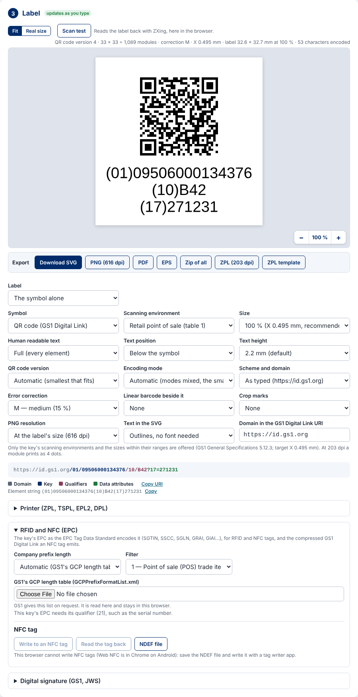

- The **caption** over the label says what is drawn: the symbol, its version or rows × columns and modules (or its width
  from the first bar to the last), the error correction, the X-dimension, the label's size at the chosen size, and the
  characters encoded — FNC1 and group separators included.
- The **canvas** shows the label fitted to its area. − and + at its lower right corner zoom from 25 % to 400 %; the
  figure between them goes back to 100 %.
- **Fit** or **Real size**, and **Scan test** (section 7).
- The **Export** bar (section 8) and, in bulk, **Generate in bulk** (section 15).
- Under the options: the GS1 Digital Link URI coloured by part — domain, key, qualifiers, data attributes — with **Copy
  URI**, and the element string with **Copy**.

The symbols are drawn as the General Specifications lay them out: an EAN/UPC with its guard bars and digits, ITF-14 with
its bearer bars and its 14 digits, GS1-128 with its element strings below, the 2D symbols with their quiet zone and
their text.

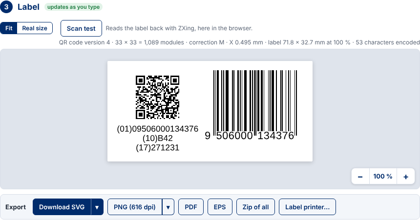

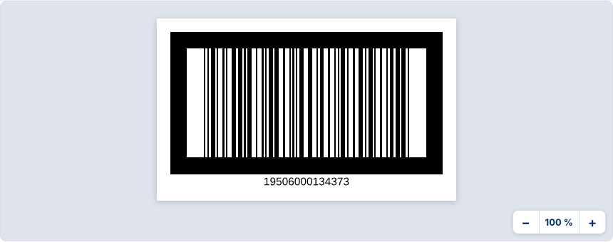

When the data of a GS1-128 passes 48 data characters, or the symbol would pass 165.10 mm with its quiet zones, the
element strings go in as many GS1-128 symbols as needed, in order, the key in the first, stacked on the left a quiet
zone apart, each with its own text:

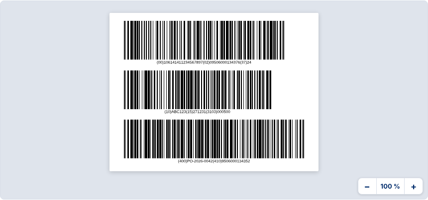

The box **GS1-128 symbols** under the options lists the element strings: tick *new symbol* to start a symbol where you
choose; **Automatic** goes back.

### A label of one's own: barcodes, text, lines, boxes and images placed freely

Every place has its own label, so the studio has an editor rather than ready-made ones. In **Label**, choose *A label
of my own (barcodes and text placed freely)*:

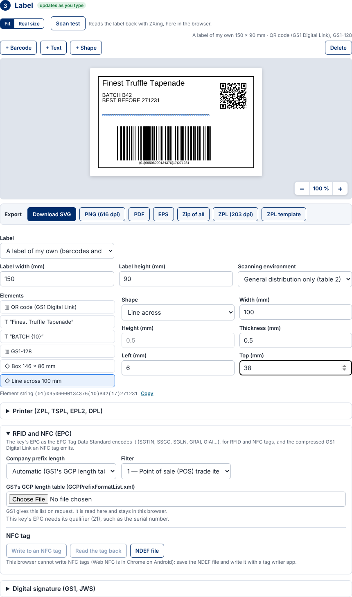

1. Set **Label width (mm)** and **Label height (mm)**, and the **Scanning environment** that sizes the barcodes (in
   step 2's guided choice, its table does).
2. **+ Barcode** adds a barcode; **+ Text** a text block; **+ Shape** a line or a box; **+ Image** an image, such as
   a logo, from a file you choose (PNG, JPEG, GIF, WebP or SVG). Each is listed under
   **Elements**, and chosen. Where an element already sits at the new one's corner, the new one goes 5 mm right and
   down, and again, so that it is never hidden under another.
3. Choose an element in the list or click it on the label; drag it on the label to move it (by half millimetres), or
   type **Left (mm)** and **Top (mm)**. Dragging and the arrow keys stop the element at the label's edge; one already
   past it (a **Left** typed, the label made smaller) moves back onto the label but never further out; only **Left**
   and **Top** typed place it past the edge. From the keyboard: choose it in the list, press **Tab** to **On the label**
   beside it and **Enter**: a ring goes round the element on the label (a hint under it says what the keys do); press
   the arrow keys: each press moves it half a millimetre, or 5 mm with **Shift**. The next **Tab** goes on to its
   corner's square; **Esc** on either brings you back to the element in the list. The chosen element shows a small square at its bottom right corner: drag it to
   make the element larger or smaller, its top left corner kept. A box takes the corner's width and height and a line
   its length (by half millimetres); an image keeps its proportions; a barcode takes the nearest **Size** its scanning
   environment allows (its bars or modules follow the corner, its text keeps its height), and a text block the nearest
   **Text height**. The properties show the new size as it changes. Dragging the square and the arrow keys stop the
   element at the label's edge: a box or a line on the last half millimetre, an image at the width that keeps it on the
   label, a barcode or a text block at the largest size that does (a barcode's text included); only the properties
   (**Width**, **Size**, **Text height** and the others) make it larger than that. When the element runs past the
   label's edge, its square stays at the edge, where the element is cut, and turns red; it grows no further, and when
   you drag it the corner comes under the pointer, so the element shrinks back onto the label. From the keyboard: choose the element in the list, **On the label** and
   then **Tab** give the square a ring (just after the element's own ring) (a hint under it says what the keys do), and press the arrow keys: each press moves the
   corner half a millimetre, or 5 mm with **Shift**. A box takes **→** and **←** on its width and **↓** and **↑** on
   its height, a line the two along it; an image, a barcode and a text block keep their proportions, **→** and **↓**
   making them larger, **←** and **↑** smaller, a barcode and a text block a size at a time (with **Shift**, about
   5 mm at a time). After each press the hint starts with the new place (**Left** and **Top**) or the new size, and
   says when a barcode or a text block has no larger or smaller size, the element has reached the label's edge or runs
   past it; a screen reader is told the same.
   **Grid and rulers**, over the label beside **Delete**, draws lines over the label every few millimetres (finer as
   you zoom in: every 2 mm at 100 % on a computer, every millimetre at 200 %), a stronger one every 10 mm, and rulers
   in millimetres above and to the left of the label; the chosen element's width and height are marked in blue on the
   rulers and follow it as it moves. They are only drawn on the screen, never in the label or its files, and the
   pointer goes through them to the elements. Press it again to hide them; the studio remembers the choice in this
   browser for the next visit. In **Real size** the label has its own rulers instead.
4. A barcode: its **Symbol**, **Size** (a percentage of the environment's target X-dimension, or of its table's row),
   **Human readable text**, and the **Element strings it carries** (a GS1 Digital Link URI carries them all).
5. A text block: its **Text** (a line a line), **Text height** (its capitals'), and **Insert a field from the data**,
   which adds `{10}`, `{17}`… — each replaced by that element string's value, so in bulk every row's label shows its
   own data. A date, such as (17) or (11), is also offered in five formats, each shown with the date it gives:
   `{17:DD/MM/YYYY}` *31/12/2027*, `{17:DD.MM.YYYY}`, `{17:YYYY-MM-DD}`, `{17:MM/YYYY}` and `{17:DD MMM YYYY}`
   *31 DEC 2027*. Other formats can be typed after the colon, with `DD`, `MM`, `MMM` (the month's abbreviation),
   `YY` and `YYYY`; the century is the one section 7.12 of the General Specifications chooses, and a day 00 is the
   month's last. When the text has `MMM`, **Month names** chooses its language: *English* (JAN to DEC), *Portuguese*
   (JAN, FEV … DEZ), *Spanish* (ENE, FEB … DIC), *French* (JAN, FEV, MAR, AVR … DEC, without accents), *German* (JAN,
   FEB, MRZ … DEZ) or *Italian* (GEN, FEB … DIC); a new text block starts in the interface's language.
   A date followed by a time, such as (7003) *expiration date and time*, (7011), (4324), (4325) or (8008), is also
   offered with its time: `{7003:DD/MM/YYYY hh:mm}` *31/12/2027 15:30*, `{7003:DD.MM.YYYY hh:mm}`,
   `{7003:YYYY-MM-DD hh:mm}` and `{7003:hh:mm}` *15:30*, and (8008) with its seconds, `{8008:YYYY-MM-DD hh:mm:ss}`.
   The time's parts are in lower case, `hh`, `mm` and `ss`, so that `MM` stays the month. A part the value does not
   have, such as (7011)'s time when only its date was given, is left out with the text before it: `DD/MM/YYYY hh:mm`
   then shows the date alone.
   A date of birth, (7250) *DOB* or (7251) *DOB TIME*, is written YYYYMMDD, its year whole, and keeps the century it
   was given: `{7250:DD/MM/YYYY}` of 19600115 shows *15/01/1960* (the rule for YYMMDD would make 60 into 2060). It is
   offered in the same five formats, and (7251) with its time too: `{7251:DD/MM/YYYY hh:mm}` *15/01/1960 08:30*.
   In bulk, the list also offers, under *Columns of the spreadsheet*, each column that holds no AI (a product's name,
   its region, a price), each shown with the row shown's value, such as `{Produto}` *Finest Truffle Tapenade*: each
   row's label shows that row's cell, in the drawing and in the print files. The header's case and the spaces around
   it do not matter; a column empty on a row leaves nothing, and a name in braces that no column has stays on the label
   as typed, so a mistyped field shows. On a single label, with no spreadsheet, such a field also stays as typed.
6. A shape: its **Shape** (*Line across*, *Line down*, *Box* or *Filled box*), **Width (mm)**, **Height (mm)** and
   **Thickness (mm)**, from its top left corner. A line across is as wide as it is long, a line down as high; its other
   side is its thickness, shown but not typed. A box's outline is drawn inside its width and height; a filled box has
   no outline to thicken. Changing the shape keeps its corner, its thickness and the length it shares with the new one.
7. An image: it comes in 20 mm wide; **Width (mm)** changes it, and its **Height (mm)** follows its proportions. It is
   kept in black and white, as label printers print: each pixel whose grey over white is below half way is dark, a
   transparent one light, so a light colour (yellow, a pale grey) vanishes and a logo in black works best. An image
   larger than 600 pixels a side is scaled down to it. **Replace…** takes another file at the same place and width.
   **Darkness** moves that half way: towards *Darker* more of the image's light colours print black (a pale grey logo
   comes out), towards *Lighter* fewer (only what is near black), from 5 % to 95 %, 50 % the usual. The label is
   redrawn as the slider moves. The studio keeps the file's greys only while the page is open: after a reload, or a
   work opened again, the darkness chosen is kept but the slider is greyed out until **Replace…** takes the same file
   again, which brings it back at that darkness.
   **Greys as dots, for a photo** (under Darkness) prints a photo or a shaded image as dots instead of black and white
   areas: each grey as many dots as it is dark, closer together where it is darker (dithering). Darkness then makes
   all its greys darker or lighter while white stays white and black black. A printer prints the dots at its own
   resolution, so the label drawn on the screen shows the picture's pixels and the print file the printer's dots, each
   as dark as the other. As the darkness, the box waits for **Replace…** after a reload. A logo in black prints better
   without it: its edges stay sharp.
8. **Rotation** turns a barcode, a text block or an image: *0°*, *90°* (reading downwards), *180°* (upside down) or
   *270°* (reading upwards). It turns about its box, whose top left corner stays at **Left** and **Top**. A QR code
   reads in any direction, so it stays upright. A line or box needs none: choose *Line across* or *Line down*, or swap
   its width and height.
9. A frame around the whole label, or around a barcode clear of its quiet zones, is not an overlap.
10. **Delete** takes the chosen element off the label.

A barcode, line, box or image past the label's edge, or a barcode overlapping another element (its quiet zones must stay
clear; a box's outline counts only where it is drawn), is named in red under
the size; the label is still drawn. **Scan test** reads every barcode. The label exports as SVG, PNG, PDF and EPS and
in bulk, and in ZPL with the printer's own commands (the Export bar's file, its test print and the bulk ZPL file): each
barcode as the symbol alone is written, at the whole dots a module nearest to its own X-dimension (within its table's
row), its bars where the label puts them; each line of text with `^A0` at its capitals' height; each line and box with
`^GB`, its edges at the nearest dots; each image as a graphic field (`^GFA`, in ZPL's own compression, which every
ZPL II printer reads) at the printer's dots, each dot the image's pixel under its centre; a turned barcode or text with its field turned (`R`, `I`, `B`) and a turned image sent
turned. A barcode whose bars, or a line, box or image, would run past the label's edge at those
dots is refused. In EPL2 too, each line of text in the printer's font whose capitals come nearest its height and that
keeps it within the width the label gives it, each line and filled box with `LO`, each outlined box with `X` and each
image with `GW`, whose dots go as raw bytes: the EPL2 file of a label with an image is then not a text file, and is sent
to the printer as it is, unchanged (see the printing guide). EPL2 refuses what it refuses for a symbol alone (GS1
DataMatrix, the QR code, GS1 DataBar). A turned barcode or text goes in EPL2 with its rotation, its point of origin
turned with it as the guide says; a Data Matrix has no rotation in EPL2, so one turned is refused there. In TSPL too,
each line of text with `TEXT` in the dot font whose capitals come nearest its height and that keeps it within its
width, each line and filled box with `BAR`, each outlined box with `BOX` and each image with `BITMAP`, its dots as raw
bytes as in EPL2; TSPL refuses what it refuses for a symbol alone (GS1-128 but for an SSCC alone, EAN-8, UPC, GS1 DataBar). A turned barcode
or text goes in TSPL with its rotation, turned about its point of origin as TSC's printers do (the manual's example);
a turned QR code is refused there. In DPL too, each record by its bottom left corner, counted up from the label's bottom
in tenths of a millimetre: each line of text in the internal font whose capitals come nearest its height and that keeps
it within its width, each line and filled box as an `X` record's line, each outlined box as its box; DPL refuses what
it refuses for a symbol alone (GS1 DataMatrix, GS1-128 but for an SSCC alone, GS1 DataBar), an image (DPL prints one
stored in the printer first, which Labelize, the emulator of the tests, does not draw). A turned barcode or text goes
in DPL with its record's rotation, turned about its bottom left corner as Datamax's manual shows; a turned Data Matrix
or QR code is refused there (Labelize does not turn them).

## 6. The label's options

Only the choices that apply to the symbol are shown.

| Option | What it does |
|---|---|
| Symbol | Shown when you chose the symbol yourself; otherwise step 2's choice is named, with *Change in step 2* |
| Scanning environment | The key's symbol specification tables (when you chose the symbol yourself) |
| Size | The X-dimension, from the table's minimum to its maximum; the target marked *recommended* |
| Human readable text | Full (every element string), the identification key only, or none |
| Text position | Below the symbol (the default), above it, key below and attributes above, left or right of it (an element string a line, never broken); beside an EAN/UPC a 2D symbol's text goes below or above |
| Text height | From 2.0 mm (the minimum) to 5.0 mm; 2.2 mm by default; 3.0 mm is what the GS1 Logistic Label asks |
| QR code version | Automatic (the smallest that fits) or 1 to 40; refused when the data does not fit |
| Encoding mode | QR code: automatic (modes mixed, the smallest symbol), or numeric, alphanumeric or byte for the whole data; a character the mode cannot take is named |
| Scheme and domain | As typed, or in capitals (`HTTPS://ID.GS1.ORG`), which lets alphanumeric mode encode the URI's start; the path and the query stay as typed |
| Error correction | QR code: L (7 %), M (15 %), Q (25 %), H (30 %) |
| Linear barcode beside it | An EAN-13, UPC-A or EAN-8 as the GTIN takes, or UPC-E, beside a 2D symbol |
| Bearer bars | ITF-14: a frame (suits every printing method) or bars of 2X at the top and bottom |
| Bar width reduction | Linear symbols: 0.010 to 0.050 mm taken off every bar, for printing that spreads ink |
| PNG resolution | At the label's size (12 pixels a module), or 300, 600 or 1200 dpi with a whole number of pixels a module, the X-dimension it prints at said |
| Text in the SVG | Outlines (no font needed) or real text, editable but needing Liberation Sans and OCR-B where it is printed |
| Domain in the GS1 Digital Link URI | `https://id.gs1.org` by default; your resolver's domain |
| Label | For an SSCC: the symbol alone, or the GS1 Logistic Label (section 9) |

The hint under the options says the table and its section, and how many dots a module takes at the printer's resolution
(section 10).

## 7. Seeing it at real size, and the scan test

**Real size** draws the label at 1:1 between rulers in millimetres. A screen's pixels are not all the same size, so
calibrate it once: **Calibrate the screen**, hold the short side of a bank card (53.98 mm) against the screen and move
the slider — or − and + for half a pixel — until the bar is as long as the card. The calibration is kept in this
browser; **Reset** forgets it.

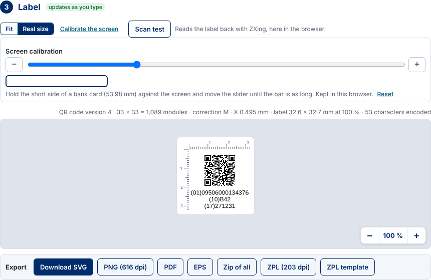

**Scan test** draws the label as the SVG would print it and reads it back with ZXing, here in the browser, comparing
each symbol's symbology identifier and data with what the label should carry:

*✓ Read as intended: ]Q1 https://id.gs1.org/01/…* — or what was read instead. Nothing is sent anywhere: the reader comes
with the page.

## 8. Exporting the label

| Button | File |
|---|---|
| Download SVG | Vector, at real size in millimetres; the text as outlines or as text (option *Text in the SVG*) |
| PNG | At the label's size (12 pixels a module) or at the resolution chosen; its dpi recorded in the file |
| PDF | One page the size of the label, vector, the text as outlines, in process black (100 % K) |
| EPS | The PDF's drawing in PostScript, for prepress |
| Zip of all | SVG, PNG, PDF and EPS with a README of the data, the symbol, its sizes and how to print it |
| ZPL (203 dpi) | The label in ZPL II with the printer's own commands, for the printer profile chosen (section 10) |
| ZPL template | The same ZPL with `{{01}}`, `{{10}}`… or `{{URI}}` where the values go, each described in a comment at the top |

The release of the GS1 Barcode Syntax Engine that checked the data is written where a file has a place for it that is
never printed: the zip's README (*Data checked by the GS1 Barcode Syntax Engine 1.4.1 (dictionary 2026-01-27).*), the
PDF's *Producer* (a PDF reader shows it among the document's properties) and the EPS's `%%Creator` comment.

Files are named after the symbol, the key and its qualifiers: `gs1-128_00_106141411234567897.zpl`. What ZPL cannot print
correctly is refused with the reason, never printed wrong (section 16). How to use each file: the
[printing guide](printing-guide.md).

### Saving the work and opening it again

1. **Save** in the header (under **More** on a phone) downloads the work as a file, such as
   `dl-qrcode_01_09506000134376_10_B42.gs1-work.json`: the data typed in step 1, the answers of step 2, every option of
   the label — a label of one's own with all its elements —, the printer profile and, in bulk, the columns chosen for
   the spreadsheet's headers. A message under the header names the file.
2. Keep it where you like; nothing leaves your computer.
3. Later, or in another browser, **Open…** takes the file back: the fields, the choices and the label return as they
   were saved. In bulk, take the spreadsheet again: its columns are chosen as they were saved (the rows stay in the
   spreadsheet, not in the work).
4. The ZPL the Export bar downloads carries the same work in comments (`^FX GS1 Label Studio work 1/3 …`), which
   printers and Labelary ignore: **Open…** takes that ZPL back too. A ZPL made elsewhere cannot be opened — its printer
   commands do not keep the fields, the meaning of the data or the sizes in millimetres; Labelary's viewer draws it.
5. This browser also keeps the last work by itself, a moment after each change. On the next visit a bar under the
   header asks about it — *Your last work, of 4 November 2026 at 14:30, is kept in this browser.*, with the key's
   element string and, for a label of one's own, *a label of your own*: **Continue it** brings it back as **Open…**
   would (in bulk, take the spreadsheet again); **Start anew** forgets it. Nothing comes back unasked, and nothing is
   kept over it until you answer. **Start over** forgets it too. A private window, or a browser that blocks storage,
   keeps nothing; the work file of step 1 is still the way to keep a work for good or take it to another computer.

## 9. The GS1 Logistic Label

For an SSCC, **Label** offers the GS1 Logistic Label (General Specifications 6.6) in A6 (105 × 148 mm), 4 × 6 in, A5
(148 × 210 mm) or 6 × 8 in. **From** and **To** take who sends and who receives it. **2D symbol beside the data** adds
a QR code or a Data Matrix with the GS1 Digital Link URI, or a GS1 DataMatrix with the element string, to the right of
the middle block (6.6.4.1.1). **Data titles also in** adds Portuguese, Spanish, French, German or Italian to the English data titles (6.6.4.2:
English unless the trading partners agree on another language, and a second one at the labeller's discretion).

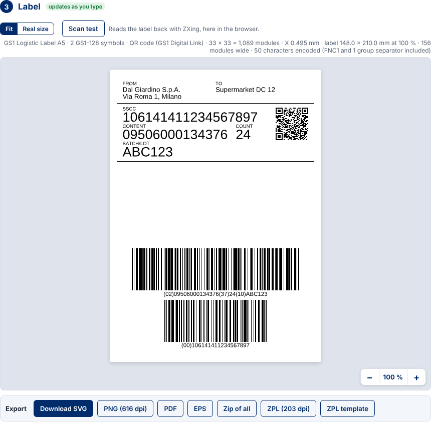

- The top block: the free text, 3.5 mm high, FROM on the left half and TO on the right. A line too long for its half
  goes on to the next line, broken between words (a word too long on its own, between its letters); type a new line
  where you want one. When the wrapped lines leave the label too short, the free text is made 3 mm high, the least
  6.6.4.4 allows; if even that does not fit, the label is refused, with shorter text in From and To among the cures.
- The middle block: each element string's data title (SSCC, CONTENT, COUNT, BATCH/LOT…) above its content, 7 mm high. A content wider than the label (an 18-digit SSCC is 102 mm at 7 mm, wider
  than a 4 × 6 in label) takes 2 mm margins and is made just small enough to fit.
- With a second language, each title has its translation on a line of its own under it (CONTENT, then CONTEÚDO or
  CONTENIDO, CONTENU, INHALT, CONTENUTO), and so have FROM and TO (REMETENTE, DESTINATÁRIO; ABSENDER, EMPFÄNGER…); a
  title that is the same in every language, such as SSCC or GTIN, or that the language writes as English does (ROUTE
  in German), stays one line, its content level with the others on its row. The second line
  takes 4 mm a row, so a label that was just full may then need the larger size. The translations are drafts, to be
  reviewed by native speakers. ZPL prints their accents (UTF-8, checked through Labelary) and TSPL declares UTF-8;
  EPL2 and DPL files carry them in UTF-8 too, which a printer set to another code page may print otherwise.
- The 2D symbol, if chosen: at the middle block's top right, at table 5's X-dimension (0.743 mm at 100 %, growing with
  **Size** as GS1-128 does), its quiet zone clear of the text; a line too wide for the room beside it goes below it.
  It carries every element string, which the GS1-128 symbols already show as text, so it has no text of its own. The
  caption gives its modules, and **Scan test** reads it with the GS1-128 symbols.
- The bottom block: the GS1-128 symbols with their 3 mm text, the SSCC alone in the lowest, the rest split as they fit
  the page's width.

A page too short for its symbols is refused with its height. The label exports as SVG, PNG, PDF and EPS and in bulk,
and in ZPL with the printer's own commands: each GS1-128 a `^BC` at the printer profile's dots, the text and the rules
where the layout puts them, the 2D symbol as `^BQ` or `^BX` at whole dots within table 5's X-dimensions, and its test print. A6 and A5 are wider than a 4-inch printer prints (104 mm): choose 4 × 6
in, or a printer profile of your own that prints wider. In EPL2 too: each GS1-128 as UCC/EAN 128, the text in the
printer's font that fits the room the layout gives it, and a Data Matrix with the GS1 Digital Link URI beside the data;
EPL2 refuses an element string of no predefined length that is not the last of its symbol (as `(37)` before `(10)`),
a GS1 DataMatrix and a QR code, saying why. In TSPL and DPL for an SSCC alone, the element string their GS1-128
carries: the same text, rules and 2D symbol, with what each refuses for a symbol alone refused here too (other element
strings, a GS1 QR Code; in DPL a GS1 DataMatrix). A ZPL template does not write it yet (its PDF prints it).

## 10. Printer (ZPL, TSPL, EPL2, DPL)

A thermal printer prints whole dots, so a module must be a whole number of dots or the symbol degrades. **Printer
(ZPL, TSPL, EPL2, DPL)** sets the printer the print files are for, and its language:

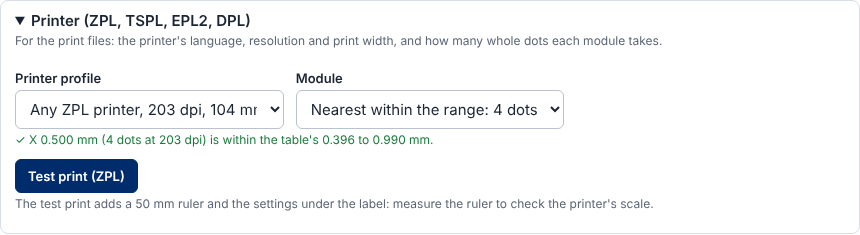

- **Printer profile**: *Any ZPL printer* at 152, 203, 300, 406 or 600 dpi, *Any TSPL printer*, *Any EPL2 printer* and
  *Any DPL printer* at 203 and 300 dpi, all 104 mm wide, or your own — **New profile…** takes a name, the language (ZPL,
  TSPL, EPL2 or DPL), the
  resolution (100 to 1200 dpi) and the print width (10 to 500 mm); **Edit profile** changes it. Your profiles are kept
  in this browser.
- With a TSPL, EPL2 or DPL profile the studio says that its files are checked in an emulator (Labelize), not yet on such a
  printer: print the test label and scan it before a production run. What the language cannot print is refused with
  the reason ([printing guide, section 8](printing-guide.md#8-tspl-epl2-and-dpl-and-the-other-printer-languages)).
- **Module**: the whole numbers of dots within the table's X-dimension range, the nearest to the label's size by
  default; the X-dimension printed is said (*✓ X 0.500 mm (4 dots at 203 dpi) is within the table's 0.396 to 0.990
  mm*), or that no whole number of dots fits.
- A label wider than the printer prints is refused.
- **Test print** (in the profile's language) adds a 50 mm ruler with a tick every 10 mm and the settings under the label:
  print it and measure the ruler to check the printer's scale.

The print file's button of the Export bar — *ZPL (203 dpi)*, *TSPL (203 dpi)*, *EPL2 (300 dpi)* or *DPL (300 dpi)*, a
`.zpl`, `.prn`, `.epl` or `.dpl` file — and the bulk print file use the same profile and dots. The ZPL template is offered with a ZPL profile.

## 11. RFID and NFC (EPC), and NFC tags

**RFID and NFC (EPC)** gives the key's EPC as the EPC Tag Data Standard 2.3 encodes it, for every key that has a scheme
(SGTIN, SSCC, SGLN, GRAI, GIAI, GSRN, GSRNP, GDTI, SGCN, CPI, ITIP):

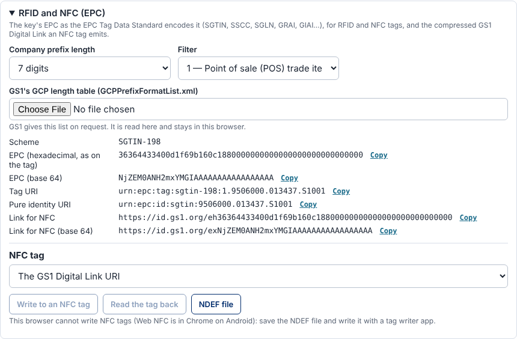

- **Company prefix length**: chosen, or *Automatic* from GS1's GCP length table (`GCPPrefixFormatList.xml`, which GS1
  gives on request): load it once, it is read here and kept in this browser.
- **Filter**: the EPC filter value (1 for a point-of-sale trade item…).
- The scheme, the EPC in hexadecimal as on the tag (filled to 16-bit words), in base 64, the tag URI, the pure identity
  URI and the links for NFC (`/eh…` and `/ex…` on your domain), each with **Copy**.
- A key that needs a qualifier for its EPC says so (*This key's EPC needs its qualifier (21), such as the serial
  number.*).

**NFC tag** writes the GS1 Digital Link URI, or the EPC's link for NFC, to an NFC tag as an NDEF URI record:

- **Write to an NFC tag**, then **Read the tag back** to check it holds that URI. This needs Web NFC, which only Chrome on
  Android has; hold the tag to the phone when asked.
- Elsewhere, **NDEF file** saves the NDEF message (NFC Forum URI record, the prefix abbreviated) for a tag writer app.

## 12. Digital signature (GS1, JWS)

Signs the code's data as the GS1 Digital Signatures Technical Implementation Guideline 1.1.0 (section 4) describes: a
JSON Web Signature you publish where your resolver's link type `gs1:jws` points, with your public key.

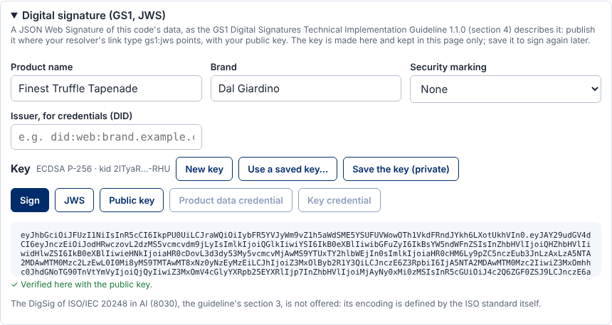

1. Fill in **Product name** and **Brand** if you want them in the signed data (the key, serial, batch and dates come
   from step 1).
2. Optionally a **Security marking** — hologram, microprinting, UV ink or watermark — with **Where to look**, its **Code
   pattern** (a regular expression the code must match) and **The code in the signature**: *shown*, to compare with the
   marking (the guideline's workflow 2), or *taken out*, to be read from the marking (workflow 3).
3. **New key** makes an ECDSA P-256 key in the page (its RFC 7638 thumbprint as its *kid*), or **Use a saved key…**
   takes one you saved. **Save the key (private)** downloads it as a JWK: keep it safe; the page does not keep it.
4. **Sign** writes the JWS and verifies it with the public key before offering it: *✓ Verified here with the public
  key.* **JWS** and **Public key** (a JWK set) download them.
5. With an **Issuer, for credentials (DID)**, such as `did:web:brand.example.com`, **Product data credential** and
   **Key credential** download the GS1 verifiable credentials (data model 1.2.1) as JWTs.

The DigSig of ISO/IEC 20248 in AI (8030), the guideline's section 3, is not offered: its encoding is defined by the ISO
standard itself.

## 13. In bulk: rows from a spreadsheet

**In bulk** in the header turns step 1 into **Rows**; steps 2 and 3 stay as they are, so the label is designed once and
its preview steps through the rows.

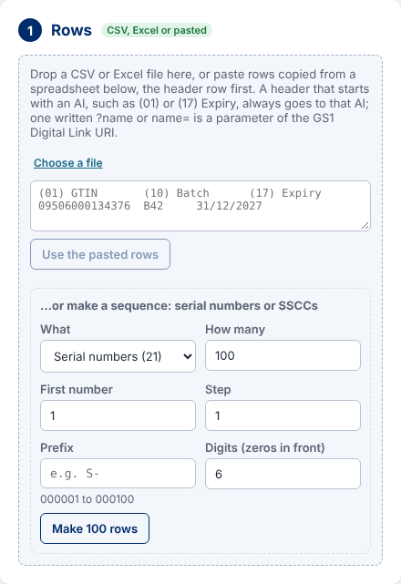

1. **Drop a CSV or Excel file**, **Choose a file**, or paste rows copied from a spreadsheet (the header row first) and
   **Use the pasted rows**. CSV with comma, semicolon or tab; Excel's first worksheet (`.xlsx`).
2. Each column's AI is guessed from its header — an AI (`(01)`, `(17) Expiry` always go to that AI), a GS1 data title,
   or a common word in English, Portuguese, Spanish, French, German or Italian (*Lote*, *Validade*, *Código de barras*,
   *Numéro de lot*, *Verfallsdatum*, *Scadenza*). Change it under **Goes
   to**. Dates become YYMMDD from ISO and day-first forms (`31/12/2027 → 271231`). An AI that carries a time, such as
   (7003), (4324) or (8008), keeps a time after the date (`31/12/2027 15:30 → 2712311530`), (8008) its seconds too;
   (7011), whose time is optional, leaves out a midnight written with its seconds (`00:00:00`, how a date alone is
   exported); other dates drop it. A time may be on a 12-hour clock, with AM or PM (`31/12/2027 8:05 PM →
   2712312005`). An Excel cell keeps the time its format shows (`dd/mm/yyyy hh:mm`), and a cell that holds a time
   alone (`h:mm`, `h:mm AM/PM`) comes as HH:MM, as on a 24-hour clock, for a column shown on the label. (7007)'s
   harvest period takes two dates in one cell, with a dash, *to*, *a*, *até*, *au* or *bis* between them
   (`01/09/2027 - 15/09/2027 → 270901270915`); its first date alone is a single day. A date
   of birth, (7250) or (7251), becomes YYYYMMDD from `1960-01-15` or `15/01/1960`, and (7251) keeps its time
   (`1960-01-15 08:30 → 196001150830`); a two-digit year such as `15/01/60` is left as typed and refused, since its
   century cannot be told. A patient list's headers are guessed too: *GSRN* alone goes to (8018), the recipient's, which
   a patient's data require; *Data de nascimento*, *Sexo*, *Primeiro nome*, *Sobrenome*, *Nome completo* and their words
   in the other languages, or their data titles (*DOB*, *FAMILY NAME*), to (7250)–(7259). A bare *Nome* or *Name* is
   left for you to choose, as it may hold a full name or a surname. A name or an address whose AI takes its other
   characters as %XX — (7253), (7254), (7256), (7257), (7259) and the ship-to and return-to AIs (4300)–(4320) — has its
   spaces and accents written so for the barcode (`Maria José → Maria%20Jos%C3%A9`); %XX already written is kept. A
   field such as `{7254}` on a label of one's own shows the name as written, *Maria José*. (7252)'s sex is ISO/IEC
   5218's digit (0, 1, 2 or 9) or a word in any of the six languages (`Feminino → 2`, `Männlich → 1`, `Inconnu → 0`);
   a letter such as *F* is refused.
3. **Same value on every row** → **+ Add**: an AI with the same value on every row, such as a country of origin (422).
4. The rows are checked at once: *2 rows ready · 2 with errors*.

The columns chosen are remembered, in this browser, for files with the same headers.

Over the label, the row navigation steps through the rows: *Row 3 · 2 of 4 · fixed*.

## 14. In bulk: the validation report

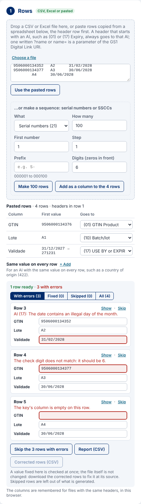

- The filters: **With errors**, **Fixed**, **Skipped**, **All**, with their counts.
- Each row in error shows its reason and its cells, the one at fault outlined. Fix it in place: the value is checked at
  once and the row becomes *fixed*. The file itself is not changed.
- **Show** shows the row's label; **Skip** leaves it out of what is generated; **Include** takes it back; **Undo the
  fixes** brings back the file's values.
- **Skip the N rows with errors** skips them together.
- **Report (CSV)** downloads every row with its status, reason, the columns at fault and what was fixed;
  **Corrected rows (CSV)** downloads the rows with your fixes, to correct the file at its source.
- A hint when Excel kept only 15 digits of a long code (an SSCC typed as a number) or a CSV wrote it in scientific
  notation: format that column as text.

## 15. In bulk: sequences and generating every label

### Making a sequence

**…or make a sequence** makes serial numbers or SSCCs:

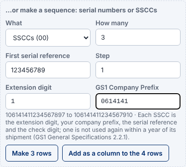

- **Serial numbers (21)**: how many, the first number, the step, a prefix and the digits (zeros in front);
  `S-000001` to `S-000100`. What AI (21) cannot hold — a character outside its set, more than 20 characters — is
  refused.
- **SSCCs (00)**: how many, the extension digit, the GS1 Company Prefix (4 to 12 digits) and the first serial reference;
  the check digits are computed. A serial reference that does not fit is refused.
- **Make N rows** makes rows of their own; **Add as a column to the N rows** adds the sequence to the rows loaded,
  keeping their fixes and skips. At most 100,000 rows.

### Generate in bulk

Under the Export bar, **Generate in bulk** draws the label shown, with its options, for every row ready or fixed:

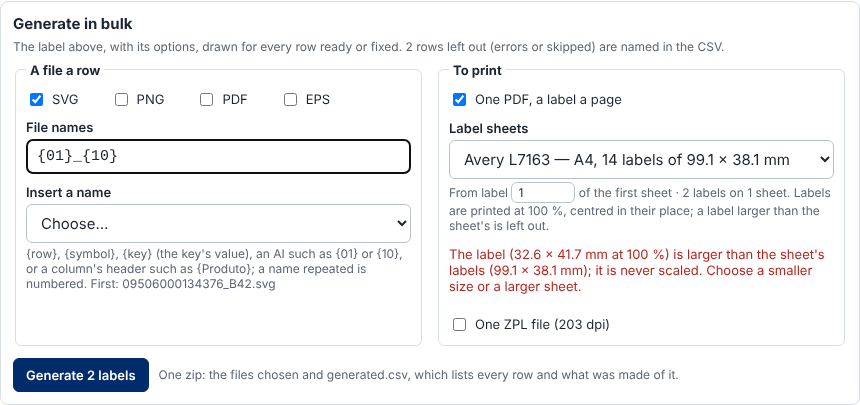

- **A file a row**: SVG, PNG, PDF and/or EPS, named by **File names** — `{row}`, `{symbol}`, `{key}`, any AI such as
  `{01}` or `{10}`, or any column's header such as `{Produto}` (the row's cell under it, the header's case and the
  spaces around it aside; accents are dropped, as file names keep plain letters); a name repeated is numbered. The
  first name is shown. **Insert a name** lists the names the pattern can take, each with the first row's value:
  `{row}`, `{symbol}`, `{key}`, the AIs of the first row's data, and under *Columns of the spreadsheet* each column
  holding no AI; the name chosen goes at the end of the pattern, after an underscore unless the pattern ends in `-`,
  `_`, `.` or a space.
- **To print**: **One PDF, a label a page**; **Label sheets** — Avery L7160, L7163, L7651, 5160 or a **Custom sheet…**
  (page, label size, columns × rows, margins and pitch) — each label at 100 % centred in its place, starting from any
  label of the first sheet. A label larger than the sheet's labels is said before generating; labels are never scaled.
  **One ZPL file** with every label, for the printer profile chosen.
- **Generate N labels** makes one zip with the files chosen and `generated.csv`, which lists every row and what was
  made of it, or why nothing was. Rows in error or skipped are left out and named there.

Generation runs in the background with a progress bar and **Cancel**; the page stays usable meanwhile. A thousand QR
code labels as SVG and one PDF took 10.7 s when measured ([performance targets](metrics/README.md#performance-targets-backlog-25)).

## 16. Messages and what to do

| Message (or its start) | Why | What to do |
|---|---|---|
| *The check digit does not match: it should be N.* | A digit is mistyped, or the last digit is not the check digit | Correct the value; the studio computes the check digit for a sequence |
| The engine's message, characters marked (*day 00*, *illegal day of the month*) | The value breaks the AI's format | Correct what is marked |
| *Qualifiers (22) and (235) cannot be used together* | The key takes one set of qualifiers or the other | Remove one |
| *It is invalid to pair AI (01) with AI (37)* (or another pair) | The General Specifications forbid the pair (4.13) | Keep the keys the pairing allows |
| A value with `(` refused | The barcode encoder cannot take it yet | Use another character |
| *EAN-13 carries a GTIN-13…*, *UPC-E carries a GTIN-12…* | The symbol cannot carry that GTIN | Choose the symbol step 2 recommends |
| The data does not fit the QR version chosen | Too much data for that version and level | Choose *Automatic*, a larger version or a lower level |
| *The parameter "…" is given twice*, a name of digits | Parameters of the URI need unique, non-numeric names | Rename it |
| *…mm wide; … prints 104 mm* | The label is wider than the printer prints | A smaller size, a fewer-dot module, or another profile |
| *The label (… mm) is larger than the sheet's labels* | Labels are never scaled | A smaller size or a sheet with larger labels |
| *ZPL places the text below or above the symbol* | ZPL refuses text left or right (the printer's font sets its width) | Text below or above for ZPL; the PDF keeps it beside |
| *ZPL writes the QR code in the printer's automatic mode* | One QR mode could not be shown to print in ZPL | Automatic mode for ZPL; the PDF keeps the mode |
| *^BR prints … at 1 to 10 dots a module* | GS1 DataBar in ZPL at this size | Another size, or the PDF |
| GS1 DataBar refused in ZPL at a till (tables 1 and 3) | `^BR` prints a fixed height, below what the table asks | Print the PDF |
| *DPL prints an image stored in the printer's memory first…* | An image on a label of one's own, in DPL | Print its ZPL, EPL2, TSPL or PDF |
| *DPL's Data Matrix is printed upright only for now…* | A turned Data Matrix on a label of one's own, in DPL | Turn it back to 0°, or print its ZPL, TSPL or PDF |
| *TSPL's QR code is printed upright only for now…* | A turned QR code on a label of one's own (from a work file), in TSPL | Turn it back to 0°: a QR code is read in any direction |
| *The … runs past the label's edge at … dots a module* | A barcode of a label of one's own, at the printer's dots, past the label's edge | Move it inside the label |
| *A line or box runs past the label's edge* | A line or box of a label of one's own past the label's edge, in a print file | Move it inside the label, or shorten it |
| *A line or box needs a length, a width and a thickness greater than 0 mm* | A line or box of a label of one's own with a size of 0 | Give it a size |
| *… is not an image this browser can read* | **+ Image** or **Replace…** given a file that is not a PNG, JPEG, GIF, WebP or SVG image, or a damaged one | Choose the image file, or save it again as PNG |
| *An image runs past the label's edge* | An image of a label of one's own past the label's edge, in a print file | Move it inside the label, or make it narrower |
| *ZPL prints a QR code upright only…* | A QR code of a label of one's own turned (in a work file made by hand), in ZPL | Turn it back to 0°: a QR code reads in any direction |
| *A line of text runs past the label's edge* / *A barcode's text runs past the label's edge* | A turned text, or a turned barcode's text or ITF-14 frame, past the label's edge, in ZPL, EPL2 or TSPL | Move it inside the label |
| *EPL2 prints a Data Matrix upright only…* | A turned Data Matrix of a label of one's own, in EPL2 | Turn it back to 0°, or print its ZPL or its PDF |
| *(10) is not a date, so its field takes no date format.* | A text block's field such as `{10:DD/MM/YYYY}` | Write `{10}` alone; formats are for dates |
| *The date format “…” has none of DD, MM, MMM, YY, YYYY, hh, mm and ss.* | A date field's format without a part of the date or time, such as `{17:dd/yy}` | Write the date's parts in capitals: `{17:DD/YY}` |
| *(17) carries no time, so its field takes no hh, mm or ss.* | A time after a date that has none, such as `{17:DD/MM/YYYY hh:mm}` | Leave out `hh`, `mm` and `ss`; a time comes with AIs such as (7003) |
| *This file is not a work saved by GS1 Label Studio.* | **Open…** was given another file (a spreadsheet, an image) | Open a `.gs1-work.json` file saved here, or a ZPL downloaded here |
| *This ZPL carries no work: only the ZPL that GS1 Label Studio downloads can be opened here.* | A ZPL made elsewhere, or a ZPL template | Open the work file, or view the ZPL in Labelary's viewer |
| *Part of the work in this ZPL is missing* | The ZPL was cut or edited, and some `^FX` comments are lost | Download the ZPL again |
| *This work was saved by a newer version of GS1 Label Studio* | The file comes from a newer studio than the page shown | Reload the page, then open it again |
| *The work file is damaged (part: …)* | The file was edited and a part is not as the studio writes it | Save the work again from the studio |
| *Table … does not allow …* | A barcode on a label of one's own that the scanning environment's table does not have | Choose another symbol, or another environment (or another answer in step 2) |
| *The label is 148.0 mm wide; … prints 104 mm* | An A5 or A6 GS1 Logistic Label on a 4-inch printer | Choose 4 × 6 in, or a profile of a wider printer |
| *… is not offered yet: Labelize, the emulator the tests print TSPL with, does not draw it* (or EPL2) | No test has read that symbol back in that language | Use a ZPL profile, or print the PDF |
| *EPL2's Data Matrix (the b command) has no FNC1…*, *EPL2's QR code is for Japanese printer models only* | The language cannot print it | Use a ZPL profile, or print the PDF |
| *DPL's GS1-128 is offered for an SSCC (00) alone…*, *TSPL's GS1-128 is offered for an SSCC (00) alone…*, *DPL's Data Matrix (W1c) has no FNC1…* | DPL or TSPL cannot print it, or no test has read it back (a GS1 Logistic Label with more than an SSCC too) | Use a ZPL or EPL2 profile, or print the PDF |
| *DPL sizes a QR code's module in tenths of a millimetre…* | The module's dots fall between DPL's sizes | Choose another size or printer |
| *the A6 label is 148 mm high* (too short) | The page cannot hold its symbols | A larger page (A5, 6 × 8 in) |
| *Not a name the pattern knows: {…}* | A file name pattern with an unknown name | `{row}`, `{symbol}`, `{key}`, an AI or a column's header |

## 17. Glossary

| Term | Meaning |
|---|---|
| AI | Application Identifier: the number in brackets that says what a value is — (01) GTIN, (10) batch, (17) expiry |
| Element string | An AI and its value; several make the data of GS1-128, GS1 DataMatrix or GS1 DataBar Expanded |
| GS1 Digital Link URI | A web address that carries the same data, such as `https://id.gs1.org/01/09506000134376/10/B42`; what the QR code and Data Matrix with a GS1 Digital Link carry |
| Key | The identification key: GTIN, SSCC, GLN, GRAI, GIAI… |
| Qualifier | A value that refines the key in the URI's path: batch, serial number, variant |
| Data attribute | Further data: expiry, weight, price; in the URI's query string |
| Symbol specification table | The table of the General Specifications (5.12.3) that sets the symbols, sizes and quality where a code is scanned |
| X-dimension | The width of the narrowest bar or of a module |
| Module | The smallest element of a symbol: a narrow bar, or a square of a 2D symbol |
| Quiet zone | The empty margin a symbol needs around it |
| HRI | Human readable interpretation: the text under or beside the symbol |
| FNC1 | The character that marks a GS1 symbol and separates element strings of no fixed length |
| Bearer bars | The frame or bars around an ITF-14 |
| EPC | Electronic Product Code: the key as an RFID tag encodes it |
| NDEF | The message format of NFC tags |
| JWS, JWK | JSON Web Signature, JSON Web Key |
| ZPL | Zebra Programming Language, the printer language of Zebra printers and many others |
| dpi | Dots per inch: a printer's resolution |
